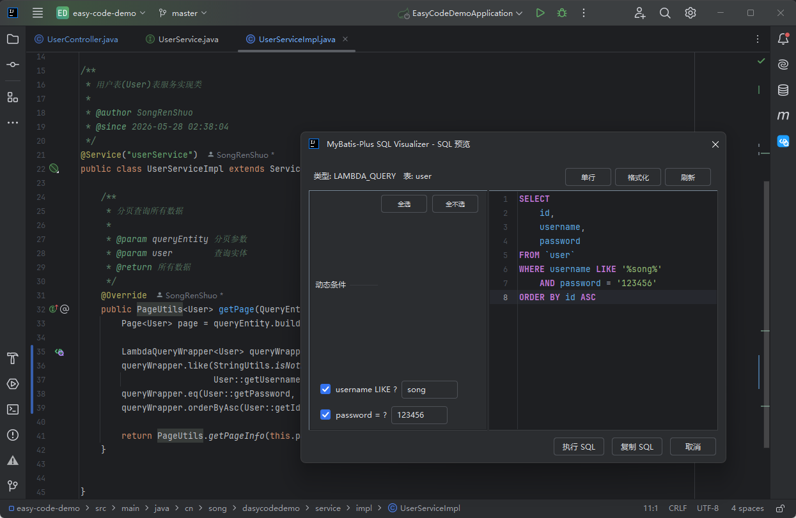
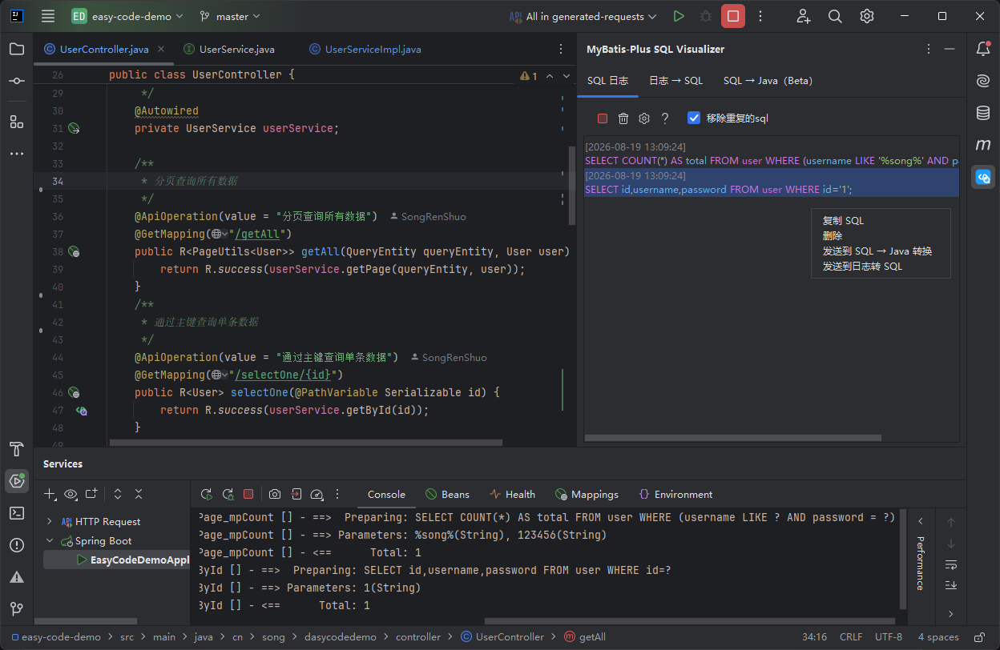
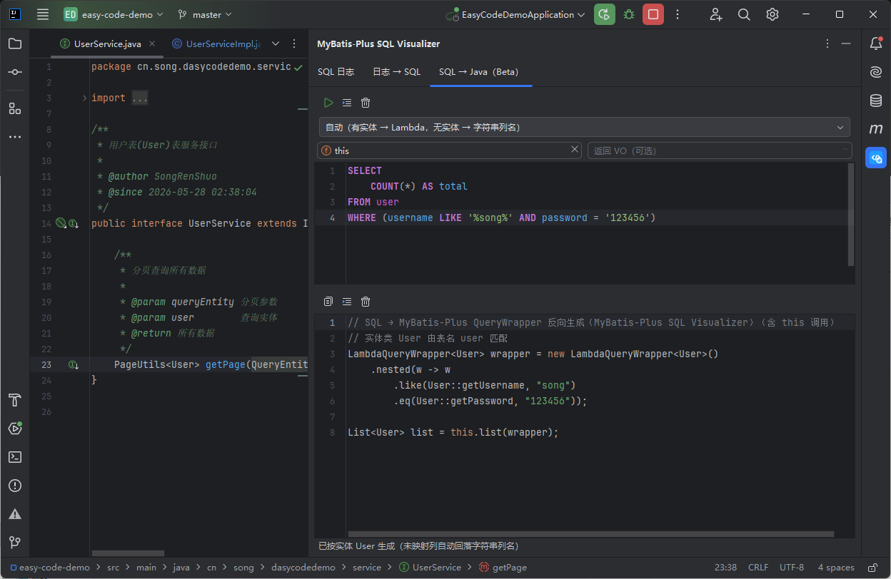
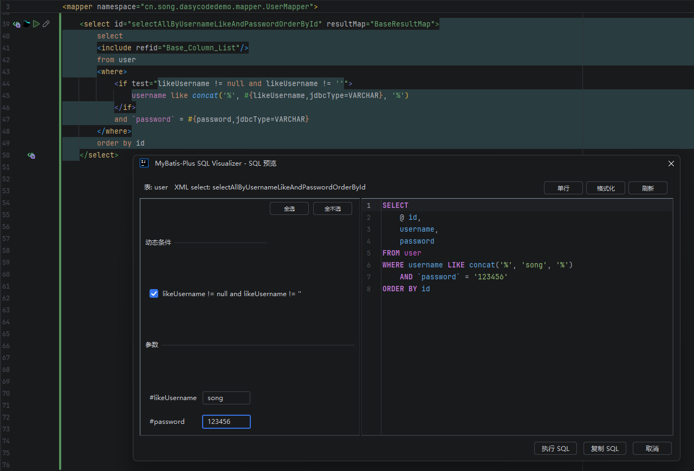
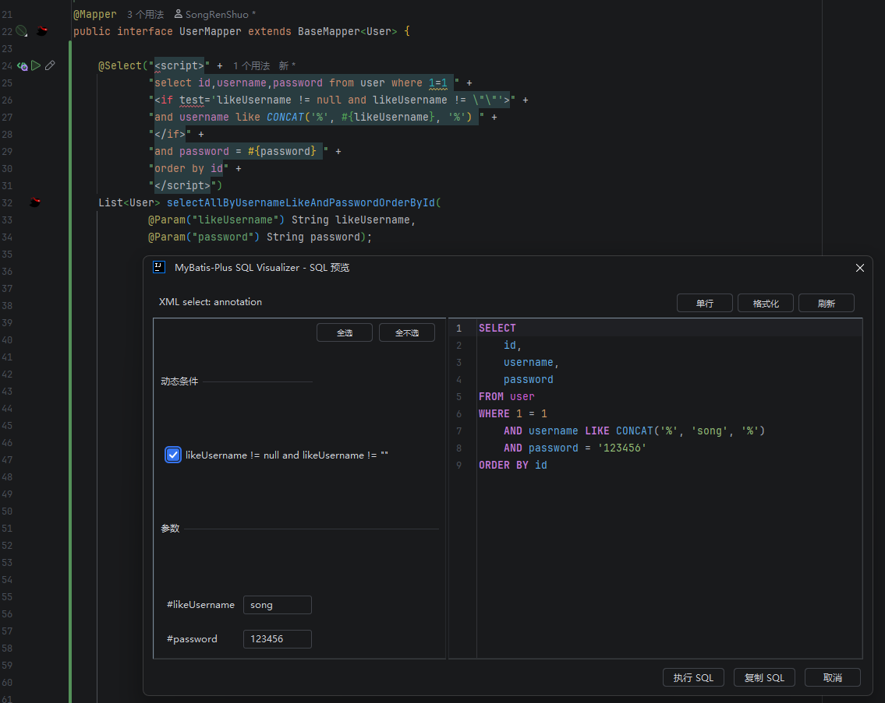

# SQL Visualizer

本插件原名为 MyBatis-Plus SQL Visualizer，现更名 SQL Visualizer——仍全面支持 MyBatis-Plus / MyBatis-Plus-Join / JPA / Hibernate，插件 ID 与升级链路不变。IntelliJ IDEA 插件：MyBatis-Plus / MyBatis-Plus-Join 的 SQL 调试利器——Wrapper 链、XML/注解动态 SQL 实时预览（含 MPJ 联表 JOIN），控制台日志一键还原，SQL 反向转 Java 代码。告别翻日志、手拼参数。支持 IDEA 2024.3 及以上版本。

## 功能截图

**Wrapper → SQL 预览弹窗**（动态条件勾选 / 参数回填 / 格式化）


**SQL 日志工具窗口**（控制台日志捕获还原、日志转 SQL）


**SQL → MP Java 代码反向转换**（右键 / Alt+Shift+J / 侧边栏 tab）


**XML 动态 SQL 预览**（动态标签、OGNL 条件勾选、参数回填）


**Java 注解 SQL 预览**（@Select/@Update 等，注解行 gutter 图标）


## 痛点分析

| 痛点 | 描述 | 影响 |
|------|------|------|
| **调试困难** | 开发者无法直观看到 MP 构造器最终生成的 SQL | 排查问题时需要开启 MyBatis 日志，查看繁琐的控制台输出 |
| **SQL 优化不便** | 无法快速验证生成的 SQL 是否合理 | 影响性能调优效率 |
| **联表查询复杂** | `MPJLambdaWrapper` 联表查询逻辑复杂，容易出错 | 需要频繁对比实际 SQL 验证逻辑正确性 |
| **参数不可见** | 日志中的 SQL 带着 `?` 占位符 | 无法直接看到实际参数值，调试效率低 |
| **CRUD 全覆盖** | 现有方案只能看查询 SQL，无法预览更新、删除语句 | 误操作风险高，特别是批量更新/删除 |
| **学习成本高** | 新成员学习 MP 时，无法直观理解 API 对应的 SQL 效果 | 团队培训成本增加 |

## 功能特性

**Wrapper 转 SQL 预览**

- 支持 `LambdaQueryWrapper` / `LambdaUpdateWrapper` / `LambdaDeleteWrapper`、字符串版 `QueryWrapper` / `UpdateWrapper`、`MPJLambdaWrapper` / `MPJQueryWrapper` 联表查询，以及 `service.lambdaQuery()` 等服务链
- 左侧面板可勾选动态条件（`.eq(true, ...)` 布尔重载）、回填 `?` 参数（LIKE 自动拼百分号、按字段类型决定是否加引号）、调整 foreach / bind 值
- SQL 自动格式化（多行 / 单行），分页子句按 9 种方言差异渲染（MySQL / PostgreSQL / Oracle / SQL Server / H2 / SQLite / MariaDB / DM / KingBase）

**XML 与注解 SQL 预览**

- mapper XML 动态 SQL 完整预览：`if` / `choose` / `where` / `set` / `foreach` / `bind` / `sql`+`include` 等标签按 MyBatis 语义渲染，OGNL 表达式可在面板勾选
- `@Select` / `@Update` / `@Delete` / `@Insert` 注解（含 `<script>` 与 Provider 注解）同样支持，注解行有 gutter 图标

**SQL 代码补全**

- mapper XML 与 Java SQL 注解字符串内 Ctrl+Space 补全：表名 / 列名（按子句位置提示）、`#{}` 参数名、XML 动态标签与 OGNL 表达式；预览弹窗的输入框同样带补全

**SQL → Java 反向转换**

- 选中 SQL 文本右键或按 Alt+Shift+J 生成 MyBatis-Plus 代码（QueryWrapper / LambdaQueryWrapper / Wrappers / MPJ 形态，默认形态可在设置页配置），支持增删改查与多表 JOIN，可指定调用类与返回 VO，生成的代码可直接编译
- 侧边栏工具窗口「SQL → Java」tab：粘贴 SQL 即转，支持形态快捷切换

**SQL 日志工具窗口**

- 自动捕获运行控制台的 `Preparing:` / `Parameters:` 日志，还原成可执行 SQL 条目列表，双击预览、右键复制；「日志 → SQL」tab 可粘贴整段日志批量还原（多组语句自动分隔）

**检查更新与自动安装**

- 设置页「更新」分区检查更新、一键下载安装（重启生效）；「启动时自动检查更新」开关默认开，发现新版弹通知后台安装

**其他**

- 批量操作预览：`save` / `updateBatchById` 等批量 SQL 按列展开，参数可逐列勾选；`saveOrUpdate` 冲突子句按方言渲染（MySQL `ON DUPLICATE KEY UPDATE` / PG `ON CONFLICT` 等）
- 逻辑删除注入：实体含 `@TableLogic` 时自动追加 `AND deleted = 0`（可配置关闭）
- 执行 SQL（IntelliJ IDEA Ultimate + Database 插件）：预览后自动创建临时 .sql 文件，Ctrl+Enter 执行
- UPDATE / DELETE 无 WHERE 条件时红色警示全表操作风险

## 预览 SQL 与运行时 SQL 的差异

> 预览目标是对齐 MP 运行时语义；以下差异是静态求值的固有特性，语义等价、仅文本不同。

| 差异 | 说明 |
|------|------|
| **静态常量内联** | `in(col, DicConstants.A, DicConstants.B)` 等静态 final 常量被求值内联（预览 `IN (1, 2)`）；MP 运行时渲染 `IN (?, ?)` 绑定参数 |
| **集合单占位符** | `in(col, 集合变量)` 运行时大小无法静态展开 → 预览 `IN (?)`；面板输入框支持逗号分隔多值回填（输入 `1,2,3` → `(1, 2, 3)`） |
| **分页字面量计算** | `page(new Page<>(1, 10), wrapper)` 字面量直接计算 `LIMIT 0, 10`；运行时变量渲染 `LIMIT ?, ?`（offset 来源标注 `(pageNum - 1) * pageSize`） |

## 使用说明

### 触发方式

| 方式 | 操作 |
|------|------|
| 右键菜单 | 光标置于 Wrapper 上 → 右键 → `Convert to SQL` |
| 快捷键 | 默认 `Alt+Shift+Q`（macOS `Option+Shift+Q`），可在 Keymap 或插件设置页修改 |
| 代码左侧图标 | Wrapper 锚点行左侧 gutter 图标，点击弹窗预览（可配置关闭） |

### 示例

```java
// 查询
LambdaQueryWrapper<DeviceInfoEntity> wrapper = new LambdaQueryWrapper<DeviceInfoEntity>()
    .eq(DeviceInfoEntity::getId, 1001L)
    .isNotNull(DeviceInfoEntity::getStationId);

// 生成的 SQL
SELECT id, station_id, share_scheme_id
FROM device_info_entity
WHERE id = 1001
    AND share_scheme_id IS NOT NULL
```

```java
// 更新（无 WHERE 时会警示全表更新）
LambdaUpdateWrapper<DeviceInfoEntity> update = new LambdaUpdateWrapper<DeviceInfoEntity>()
    .set(DeviceInfoEntity::getStationId, 101L)
    .eq(DeviceInfoEntity::getId, 1001L);
```

```java
// 联表查询（MyBatis-Plus-Join）
MPJLambdaWrapper<DeviceInfoEntity> wrapper = new MPJLambdaWrapper<DeviceInfoEntity>()
    .selectAll(DeviceInfoEntity.class)
    .leftJoin(StationInfoEntity.class, StationInfoEntity::getDeviceId, DeviceInfoEntity::getId)
    .eq(DeviceInfoEntity::getId, 1001L)
    .orderByDesc(StationInfoEntity::getCreateTime);

// 生成的 SQL
SELECT t.id, t.station_id, t.share_scheme_id
FROM device_info t
LEFT JOIN station_info t1 ON t1.device_id = t.id
WHERE t.id = 1001
ORDER BY t1.create_time DESC
```

### 其他入口

- **XML / 注解 SQL**：mapper XML 的 `<select>` 等语句或 Java Mapper 注解行左侧 gutter 图标，点击即预览；选中包含多条 SQL 的代码段会弹出候选栏（行号 + 摘要 + 定位跳转）
- **SQL → Java**：选中 SQL 文本右键 → `Convert SQL to MP Java Code`（或 Alt+Shift+J）；侧边栏工具窗口「SQL → Java」tab 粘贴即转
- **SQL 日志**：侧边栏「MyBatis SQL Log」工具窗口点「捕捉」开始监听控制台；双击日志条目预览还原 SQL；「日志 → SQL」tab 粘贴日志批量还原
- **帮助**：工具窗口工具栏「?」按钮查看功能与快捷键一览

### 配置

`Settings → Tools → SQL Visualizer`，设置按分区组织：

**SQL 预览**

| 配置项 | 默认值 | 作用 |
|--------|--------|------|
| 数据库方言 | MySQL | 分页 / upsert 子句按方言渲染（MySQL / PostgreSQL / Oracle / SQL Server / H2 / SQLite / MariaDB / DM / KingBase） |
| 替换 ? 占位符 | 开 | 关闭后变量也渲染为 `?`，在左栏输入框手动填值；代码字面量恒内联 |
| 格式化输出 | 开 | 多行缩进（关 = 单行） |
| 逻辑删除注入 | 开 | 实体含 `@TableLogic` 时自动追加 `AND deleted = 值` |
| 逻辑删除值 | 0 | 逻辑删除条件的值（对齐 MP `logic-delete-value`） |

**表名映射**

| 配置项 | 默认值 | 作用 |
|--------|--------|------|
| 表前缀 / 表后缀 | 空 | 推断表名统一加前缀 / 后缀（`sys_` + device_info → `sys_device_info`；`@TableName` 显式表名同样修饰） |
| 移除表名前缀 / 后缀 | 空 | 推断表名去除指定前缀 / 后缀（首个匹配；`;` 分隔多值） |
| 忽略字段名 | 空 | 指定字段不进 SELECT 展开与补全（`;` 分隔多值） |
| 表名推断策略 | SNAKE | 无 `@TableName` 时类名转表名的规则：SNAKE 驼峰转下划线 / CAMEL 保留驼峰 |

**代码生成（SQL → Java）**

| 配置项 | 默认值 | 作用 |
|--------|--------|------|
| SQL→Java 默认 Wrapper 形态 | 自动 | 反向转换生成代码的默认形态：AUTO 自动选择 / QUERY / LAMBDA / WRAPPERS / MPJ |
| 自动推断失败时允许手动选择实体类 | 开 | 关闭后纯自动推断，不弹实体选择框 |

**SQL 日志**

| 配置项 | 默认值 | 作用 |
|--------|--------|------|
| SQL / 参数前缀 | `Preparing:` / `Parameters:` | 控制台日志识别前缀（「混合前缀」开启后可同时识别两种格式） |
| 自动捕捉 | 关 | IDE 启动后自动开始监听控制台 |
| 发现 SQL 自动打开窗口 | 关 | 捕获到 SQL 时自动打开日志工具窗口 |
| 时间戳显示 | 开 | 条目列表显示捕获时间（格式可配，默认 `yyyy-MM-dd HH:mm:ss`） |
| 去重窗口 | 60000 ms | 相同 SQL 在窗口内重复不显示 |
| 移除包含关键字 | 空 | 过滤包含指定关键字的日志行（`;` 分隔多值） |

**界面与操作**

| 配置项 | 默认值 | 作用 |
|--------|--------|------|
| 代码左侧显示预览 SQL 图标 | 开 | Wrapper 锚点行 gutter 图标入口 |
| 界面语言 | 简体中文 | 插件 UI 语言（English / 跟随系统可选） |
| 快捷键 | `Alt+Shift+Q` / `Alt+Shift+J` | 分别对应 Wrapper 转 SQL 与 SQL→Java 反向转换；录制式修改，保存写入 IDE Keymap（冲突可「强制使用」抢占） |

**更新与诊断**

| 配置项 | 默认值 | 作用 |
|--------|--------|------|
| 启动时自动检查更新 | 开 | 启动静默检查，发现新版弹通知（可一键后台下载安装） |
| 检查更新 / 下载并安装 | - | 手动检查更新、查看变更日志、一键下载安装（重启生效） |
| 插件缓存 | - | 显示反查缓存占用大小，可一键清除 |
| 内部构建号 | - | 每次构建唯一（MPV-Build），反馈问题时一键复制粘贴 |

设置变更无需重启 IDE：重新触发预览即按新配置生效；弹窗内「单行 / 多行」按钮为临时视图切换，不写回「格式化输出」配置。

### SQL 预览弹窗

弹窗默认尺寸按屏幕比例自适应（宽 62% / 高 65%，下限 900×600），可手动拉伸并记忆尺寸；左侧动态条件复选框 + 参数输入，右侧 SQL 可编辑。

## 文档

| 文档 | 说明 |
|------|------|
| [功能概览](docs/需求文档/20260812-1058-MP-SQL可视化-需求文档.md) | 完整功能清单与规格（`F-xx`） |
| [开发计划](docs/开发计划/20260812-1058-MP-SQL可视化-开发计划.md) | 分阶段开发计划与验收标准（`T-xx`） |

## 开发环境

- JDK 17（`jvmToolchain(17)`）
- 构建平台：IntelliJ IDEA Ultimate 2024.3.7.1（最低支持版本编译；数据源 API 在 `com.intellij.database`，仅 Ultimate 捆绑）
- 兼容性：IDEA 2024.3+（`since-build=243`，Plugin Verifier 按目标 IDE 集合校验）
- Gradle 9.x（Wrapper 内置）

## 常用命令

| 命令 | 说明 |
|------|------|
| `./gradlew build` | 编译 + 测试 + 打包插件 |
| `./gradlew test` | 运行单元测试 |
| `./gradlew runIde` | 启动沙箱 IDEA 调试插件 |
| `./gradlew verifyPlugin` | 兼容性校验：默认全量三版本（243/253/262，发布前）；`-PverifyIdes=minimal` 边界两版本（243+262，约 10 分钟）；`-PverifyIdes=smoke` 仅构建基准 243（约 2 分钟，日常开发后冒烟） |
| `./gradlew buildPlugin` | 生成发布 zip（`build/distributions/`） |

验证节奏：日常功能提交前 `test` + `verifyPlugin -PverifyIdes=smoke`（约 3 分钟）；使用新平台 API 后 `minimal`；发布 / 里程碑交付用全量三版本。verifyPlugin 与并行测试共享默认沙盒 / `.pluginVerifier` 缓存，并行会话需错峰。

## 发布

详见 [开发计划](docs/开发计划/20260812-1058-MP-SQL可视化-开发计划.md) 的 M6 里程碑。

M28 起发布流程新增一步（插件设置页「检查更新」的数据源）：打版发布时维护仓库根 `update/update.json`——运行 `./gradlew writeUpdateManifest` 生成骨架（版本号 / 下载地址 / 发布日期），人工补充本次 `changeNotes`（纯文本，`\n` 换行），提交推送后生效（清单 URL 固定：`https://gitee.com/songrenshuo/mybatis-plus-sql-visualizer/raw/master/update/update.json`）。

## 变更记录

见 [CHANGELOG.md](CHANGELOG.md)。

## 友情插件推荐

如果你也在做后端 API 开发，推荐试试 [Cool Request](https://www.coolrequest.dev)——一款 IDEA 内置的 HTTP 客户端插件，类似 Postman 但直接嵌在 IDE 里。支持 Spring Boot、Spring MVC、JAX-RS 等框架，一键发送请求、调用任意对象方法、统计 API 耗时、生成在线文档，总下载量已超百万次。

<a href="https://www.coolrequest.dev" target="_blank">Cool Request — 让 API 调试变得简单</a>

---

## 联系作者

扫码添加作者微信或加入交流群（二维码为限时码，仓库内图片定期更新）：

| 作者微信 | 交流群 |
|----------|--------|
|  |  |

遇到问题或有建议？请在 [Issues](https://gitee.com/songrenshuo/mybatis-plus-sql-visualizer/issues) 提交反馈。
