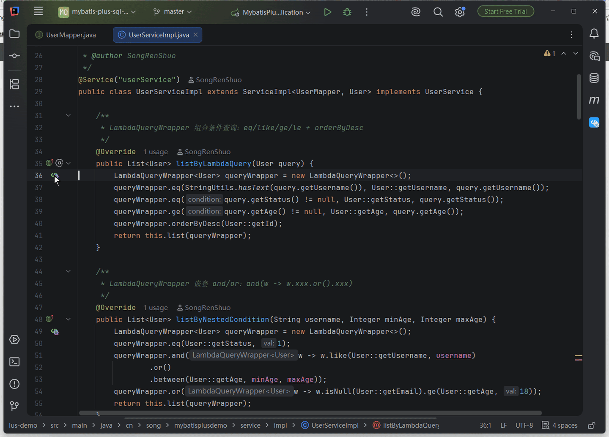
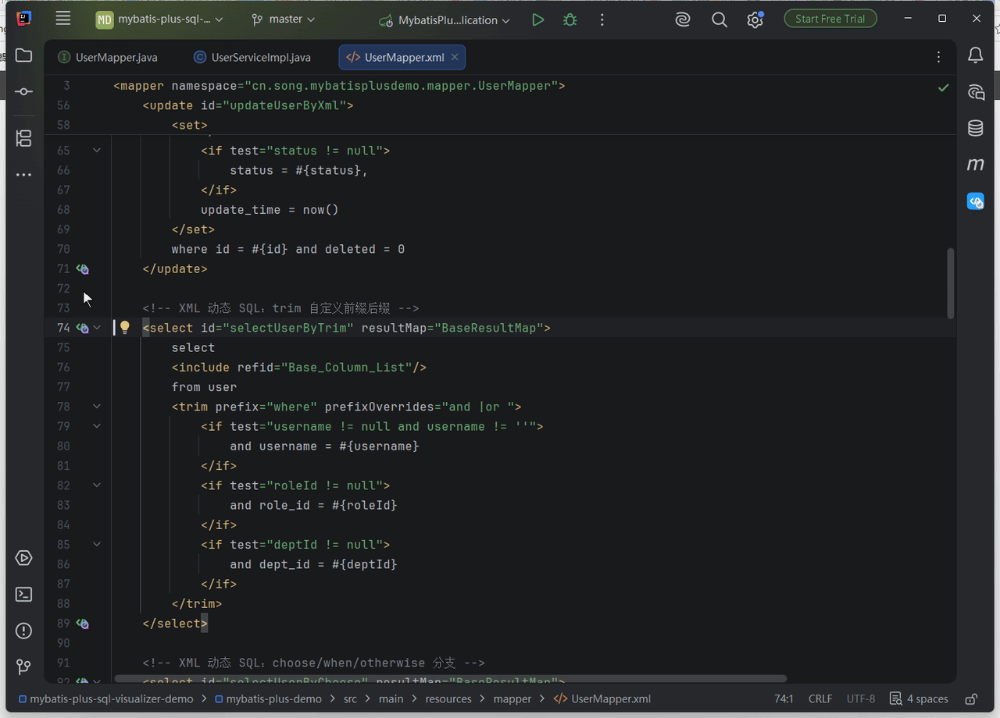
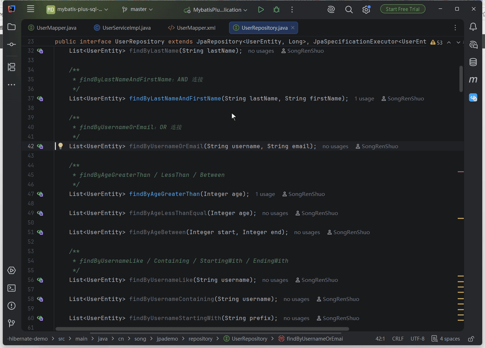
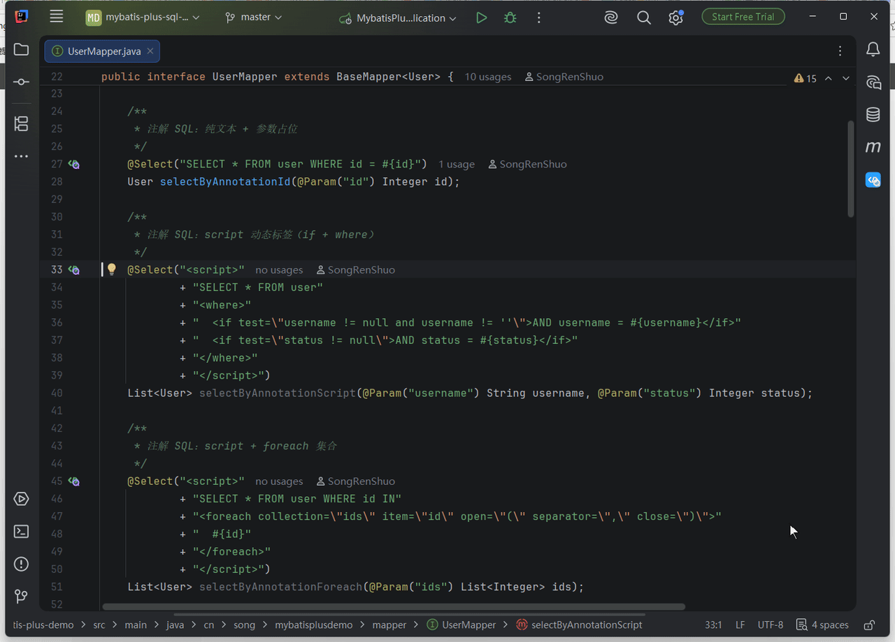
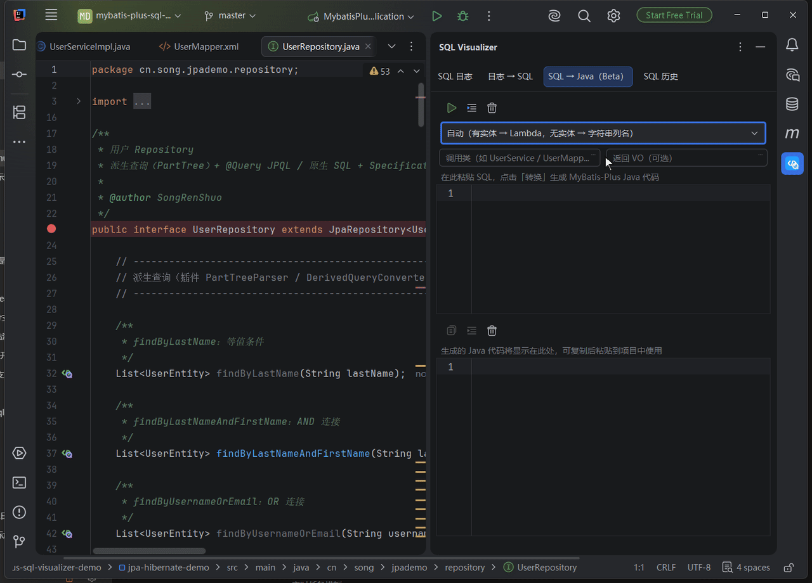
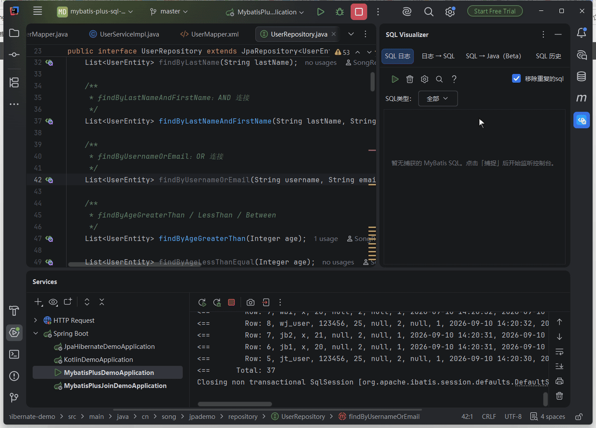
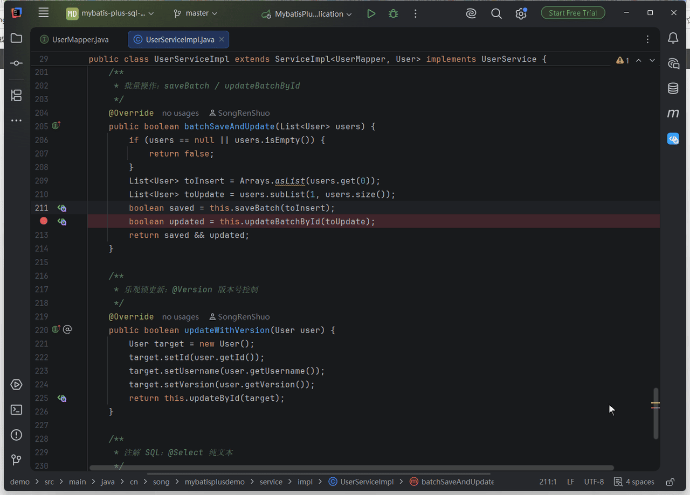
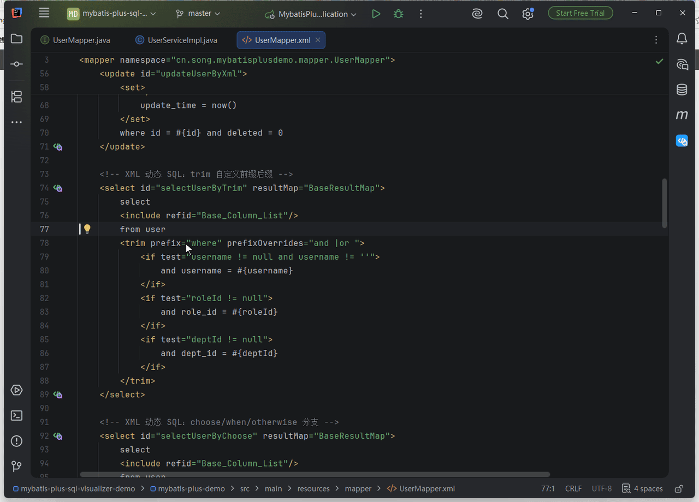
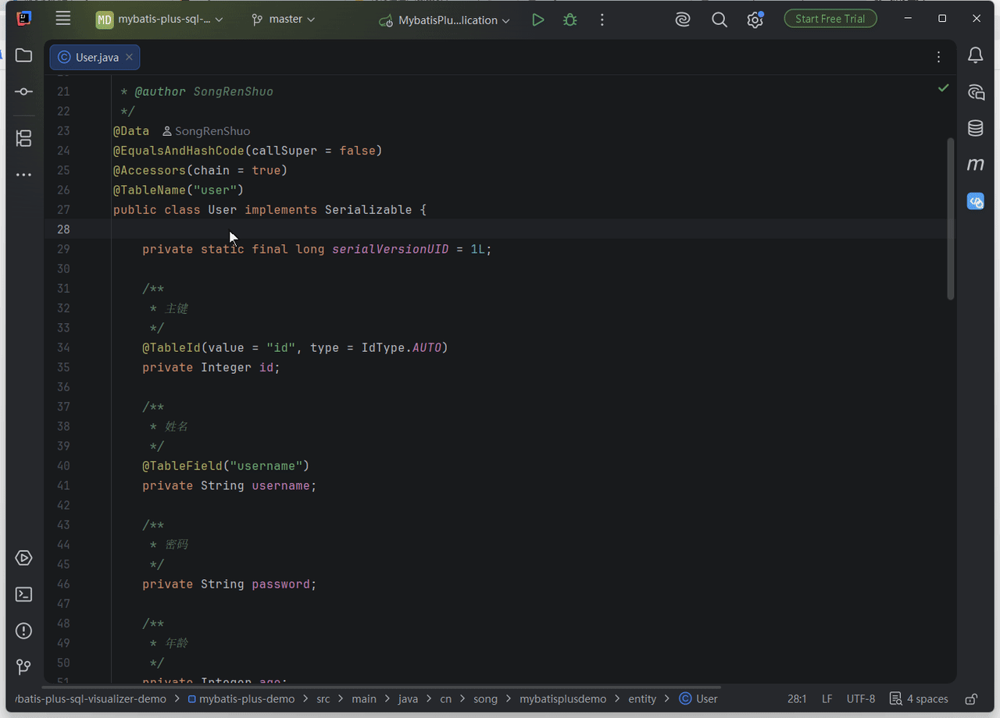
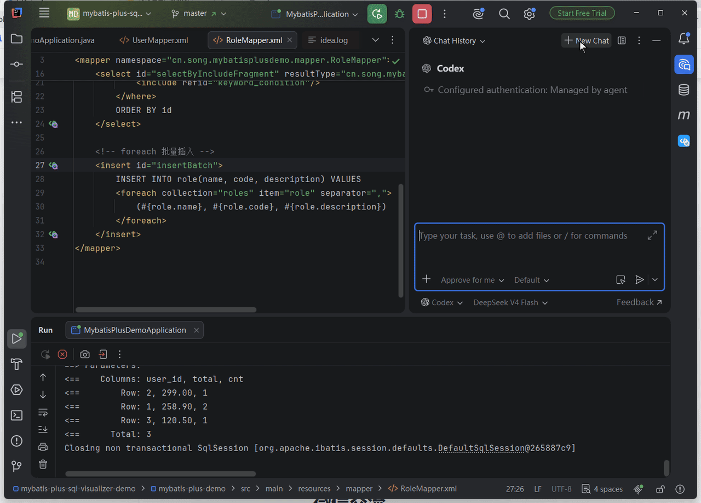

# SQL Visualizer

> **服务未启，SQL 先知**

MyBatis-Plus / MyBatis-Plus-Join / JPA / Hibernate / JdbcTemplate 的 SQL 调试利器——IntelliJ IDEA 插件：写代码时预览静态可推导的 SQL（Wrapper 链、XML/注解/HQL 动态 SQL，含 MPJ 联表 JOIN）；跑起来后真实参数与耗时自动捕获，慢查询标红、EXPLAIN 看计划、一键跳回源码；SQL 也能反向转成 Java 代码。不启服务、不翻日志、不手拼参数。支持 IDEA 2024.3 及以上版本，[功能矩阵与在线文档](https://sql-visualizer.jvtools.cn)见官网。
> **写前预览，运行后对照；无法静态确定的条件先核实再执行。**
> 支持 IntelliJ IDEA 2024.3~2026.x 全版本（含 2025.1–2025.3）。
> 四条理由：Wrapper 链静态生成 SQL 预览（无需运行代码）；JPA/Hibernate 全家桶支持（派生查询 / JPQL / Criteria / HQL / NamedQuery / Specification / QBE）；预览即可一键执行验证（内嵌 IDEA 原生数据库控制台）；支持达梦/人大金仓/OceanBase/openGauss 等 11 种数据库方言（含信创场景）。

## 能力全景：覆盖调试的两个阶段

**编码期（写代码时，静态预览）**：Wrapper 链（Lambda / Query / Update / Delete / MPJ 联表 / 服务链）、XML 动态 SQL（if/foreach/OGNL，自研框架自定义标签内嵌 SQL 兜底识别）、注解 SQL、JPA 派生方法 / JPQL / Criteria、HQL —— gutter 图标一键预览可静态推导的 SQL（含逻辑删除、乐观锁、多租户拦截器模拟渲染；动态条件须核对运行时），并支持 SQL 反向转 Java 代码、实体类 / 数据库表右键生成 CRUD SQL。

**运行期（跑起来后，动态捕获）**：字节码增强捕获为默认通道——无需应用开启 SQL 日志即可捕获 SQL、耗时、影响行数与报错；连接包装可采集绑定参数，运行中 attach 的语句级织入可能缺少参数，慢查询标红并给出静态性能建议；日志条目与源码双向跳转（自研框架、JAR 形态业务工具库的调用自动定位到业务代码行），预览面板的调用栈可悬停展开、逐帧跳转；控制台日志（MyBatis / Hibernate / JdbcTemplate 三族，并发多线程交错按线程分桶还原）作为不改工程的回落通道；保活心跳类刷屏 SQL 一键屏蔽，可选 SQL 日志落盘与两级导航。

**验证（随时）**：预览结果内嵌原生数据库控制台一键执行，EXPLAIN 执行计划覆盖 11 种方言（9 种真机 / 引擎级实证、OceanBase 文档级验证、SQL Server 按官方文法落地待真机），SQL 性能规则引擎与静态标注对照，JOIN 关系图可视化；执行前有 `${}` 注入确认与无界写发现清单两道闸；MCP 直连执行有超时护栏，IDE 原生控制台不在该护栏覆盖面。UPDATE / DELETE 可生成回滚预案，可靠恢复须提供写入前的行快照。

本插件原名为 MyBatis-Plus SQL Visualizer，现更名 SQL Visualizer——仍全面支持 MyBatis-Plus / MyBatis-Plus-Join / JPA / Hibernate，插件 ID 与升级链路不变。

## dev 后续能力与验收边界

- EXPLAIN 跨会话基线复用预览历史保存，按项目/数据源 UUID/方言/实际 SQL 隔离；“保留原始执行计划”独立默认关闭。计划可能含业务谓词或秘密，启用前应阅读应用级存储说明；清除预览历史同时清除计划。
- “复制为 AI 上下文”v2 仅消费已取得且当前匹配的计划和静态元数据，不为复制触发网络或 JDBC；默认输出严格匿名诊断投影，不是可执行 SQL，也不保证代替用户完成隐私审查。
- FieldFill 安全模拟只使用用户显式填写的字面量，默认关闭，不执行用户的 MetaObjectHandler；显式参数优先，WHERE条件与UPSERT不猜填，清除参数历史会清除模拟预设。
- 诊断反馈增加审阅/删段/最终文本及逐次同意，只有用户最终提交才走已有公开需求池；编辑和重试均需重新同意，不自动附原SQL/参数/文件。本轮没有实际上传诊断。
- 正式 [UI验收规程](docs/验收文档/20261015-2338-T-M19-UI增量正式验收文档.md) 与 [Runner/真库规程](docs/验收文档/20261015-2345-T-O145-V178-Runner与真库正式验收文档.md) 包含入口、操作、正反例和截图记录。本轮禁止启动沙盒IDE进行UI验收；非UI真库/真实agent/性能证据与UI结果严格分开，新增dev代码不表示已发版。

## 功能演示

**Wrapper → SQL 预览**（动态条件勾选 / 参数回填 / 格式化 / 一键执行）



**XML / HQL 动态 SQL 预览**（动态标签、OGNL 条件勾选、参数回填）



**JPA / Hibernate SQL 预览**（派生方法 / JPQL / Criteria / hbm 命名查询）



**Java 注解 SQL 预览**（@Select/@Update 等，注解行 gutter 图标）



**SQL → MP Java 代码反向转换**（右键 / Alt+Shift+J / 侧边栏 tab）



**SQL 日志工具窗口**（控制台日志捕获还原、跳转源码、历史回看）



**批量操作参数面板**（批量 SQL 按列展开、参数逐列勾选）



**SQL 代码补全**（表名 / 列名 / `#{}` 参数 / XML 动态标签）



**实体类 / 数据库表右键生成 CRUD SQL**（三入口右键 / 候选浮层打字过滤 / 列勾选实时收缩）



**MCP：AI agent 真实调用插件工具**（AI Assistant 的 Codex agent 经 ACP 调用 `sqlv_*` 工具并留痕，agent 拿到确定性可执行 SQL）



> 更多功能细节与在线文档见 [官网](https://sql-visualizer.jvtools.cn)。

## 痛点分析

| 痛点 | 描述 | 影响 |
|------|------|------|
| **调试困难** | 开发者无法直观看到 MP 构造器最终生成的 SQL | 排查问题时需要开启 MyBatis 日志，查看繁琐的控制台输出 |
| **SQL 优化不便** | 无法快速验证生成的 SQL 是否合理 | 影响性能调优效率 |
| **联表查询复杂** | `MPJLambdaWrapper` 联表查询逻辑复杂，容易出错 | 需要频繁对比实际 SQL 验证逻辑正确性 |
| **参数不可见** | 日志中的 SQL 带着 `?` 占位符 | 无法直接看到实际参数值，调试效率低 |
| **CRUD 全覆盖** | 现有方案只能看查询 SQL，无法预览更新、删除语句 | 误操作风险高，特别是批量更新/删除 |
| **学习成本高** | 新成员学习 MP 时，无法直观理解 API 对应的 SQL 效果 | 团队培训成本增加 |

## 功能特性

**Wrapper 转 SQL 预览**

- Java 文件支持 `LambdaQueryWrapper` / `LambdaUpdateWrapper` / `LambdaDeleteWrapper`、字符串版 `QueryWrapper` / `UpdateWrapper`、`MPJLambdaWrapper` / `MPJQueryWrapper` 联表查询，以及 `service.lambdaQuery()` 等服务链。Kotlin Wrapper 目前仅有文本识别实验件，尚不能可靠还原表和列/值，因此不显示可点击的预览图标；主动使用 Convert to SQL/快捷键时会明确说明限制且不生成猜测 SQL，可运行后从 SQL 日志核对实际语句。
- 其他 ORM / JDBC 写法同样行内 gutter 一键预览：JdbcTemplate 字符串 SQL（命名参数按名回填、`StringBuilder` 拼接自动聚合）、自研 DAO 字符串 SQL（调用行与方法定义行双锚点）、xbatis（原 mybatis-mp）、Easy-Query、MyBatis Dynamic SQL、Querydsl
- Wrapper 锚点行 gutter 图标：左键直接弹出预览，右键菜单可选「预览 SQL」或「最近执行记录」，反查本会话捕获的该位置执行记录
- 左侧面板可勾选动态条件（`.eq(true, ...)` 布尔重载）、回填 `?` 参数（LIKE 自动拼百分号、按字段类型决定是否加引号）、调整 foreach / bind 值
- SQL 自动格式化（多行 / 单行），分页子句按 11 种方言差异渲染（MySQL / PostgreSQL / Oracle / SQL Server / H2 / SQLite / MariaDB / DM / KingBase / OceanBase / openGauss）

**XML 与注解 SQL 预览**

- mapper XML 动态 SQL 完整预览：`if` / `choose` / `where` / `set` / `foreach` / `bind` / `sql`+`include` 等标签按 MyBatis 语义渲染，OGNL 表达式可在面板勾选；`refid="其它命名空间.片段id"` 跨文件 include 同样展开（property 静态替换与环检测一致，`${}` 动态 refid 也支持）；`if` test 求值失败或超出受限 OGNL 支持面的条件行给可见标注，不再静默默认展开；mapper 方法未写 `@Param` 的单集合参数支持 `list` / `collection` / `array` 快捷别名（对齐 MyBatis 自身参数命名语义），`<foreach>` 按集合类型照常展开；集合参数按签名拆分多值——`List` 直写 `IN (#{list})`（无 `<foreach>`）的语句输入 `PI,WP` 渲染为 `IN ('PI', 'WP')`，引号按元素类型（`List<Long>` 裸渲染）
- 自研框架 mapper XML 兜底识别：根元素名不固定、SQL 写在自定义标签 CDATA/文本里的通用 XML 同样可预览——叶子标签首段文本以 SELECT / INSERT / UPDATE / DELETE / WITH / REPLACE 开头即出 gutter 图标，不依赖标签名与根元素名；载体标签自身或祖先带 `type="hql"` / `"jpql"` 时走 HQL 转换管道，实体不可解析或转换失败回退原文直显；右键 / Alt+Shift+Q 与多语句候选行为一致，设置页「界面与操作」总开关默认开
- `@Select` / `@Update` / `@Delete` / `@Insert` 注解（含 `<script>` 与 Provider 注解）同样支持，注解行有 gutter 图标

**JPA / Hibernate SQL 预览**

- Spring Data JPA 派生方法（`findByXxx`）、Repository CRUD 方法（`save` / `findById` / `deleteById` 等直接解析出 SQL）、`@Query`（JPQL / 原生 SQL）、`@NamedQuery`、CriteriaBuilder 调用链、HQL（含自定义 DAO）均可一键预览为 SQL
- `JpaSpecificationExecutor` 的 Specification 调用链与 `QueryByExampleExecutor`（`Example.of`）按实体映射解析为 WHERE 条件；Hibernate `.hbm.xml` 映射实体及其 `<query>` / `<sql-query>` 命名查询同样支持
- 写前静态预览与运行期调试互补：IDEA 2026.3 起官方提供 Hibernate Debugger（debugger 会话内查看运行期语句）；本插件管写代码时——不启动应用、不连数据库即可预览与 EXPLAIN，两者分工不同、互不替代
- 嵌入值对象（`@Embedded` / `@Embeddable` / `@EmbeddedId`）字段按宿主表列展平参与预览：嵌套嵌入的 `@AttributeOverride` 支持 `name="zipcode.zip"` 点路径覆写（JPA 规范强制形态）；Spring Data 形态的裸 `@Embedded` 按 `prefix` 列名前缀展平，`@Embedded.Nullable` / `@Embedded.Empty` 捷径注解正确识别；派生查询方法名里的嵌入段驼峰路径（`findByUpdateInfoCreatedTime` 这类）解析到真实展平列，WHERE / ORDER BY（含 `Sort.by`）不产出 `update_info_created_time` 这类伪列；混合注解实体（MyBatis-Plus `@TableName` 与 jakarta 嵌入注解共存）在 Wrapper 预览、批量模板与 CRUD 生成里同样展平为宿主表列
- 实体解析支持 `@Entity` / `@Table` / `@Column` / `@ManyToOne` 注解；HQL 的 `SELECT u` 自动展开为实体列清单，无别名 HQL 的 WHERE 裸属性（如 `stationCode`）同样转成真实列名（`STATION_CODE`），嵌入段限定形态（如 `updateInfo.BE_DELETE = 0`）也落到真实裸列名（`BE_DELETE = 0`）而不再残留属性名

**SQL 代码补全**

- mapper XML 与 Java SQL 注解字符串内 Ctrl+Space 补全：表名 / 列名（按子句位置提示）、`#{}` 参数名、XML 动态标签与 OGNL 表达式；预览弹窗的输入框同样带补全；Java 文件中 Wrapper 链上下文补全方法名 / 实体字段

**SQL → Java 反向转换**

- 选中 SQL 文本右键或按 Alt+Shift+J 生成 MyBatis-Plus 代码（QueryWrapper / LambdaQueryWrapper / Wrappers / MPJ 形态，默认形态可在设置页配置），支持增删改查与多表 JOIN，可指定调用类与返回 VO，生成的代码可直接编译
- 侧边栏工具窗口「SQL → Java」tab：粘贴 SQL 即转，支持形态快捷切换

**实体类 / 数据库表右键生成 CRUD SQL**

- 实体类文件、项目视图实体节点或 Database 工具窗表节点右键，一键生成 INSERT / UPDATE / SELECT / DELETE 并进入预览：自增主键默认不勾选、`@Version` 列 SET 尾自动递增并进 WHERE、逻辑删除实体出对应变体语句，SQL Server / 达梦上勾回自增列的 INSERT 自动带 `SET IDENTITY_INSERT … ON/OFF` 成对包装；Community 版仅实体侧入口
- 候选语句以原生浮层选择：打字按摘要过滤、Enter / 双击选定、ESC 关闭

**SQL 日志工具窗口（主侧边栏，4 个 tab）**

- 两种捕获通道，条目统一还原成可执行 SQL 列表：**增强捕获**（字节码增强，默认通道）注入确认前置到任何运行之前——开启增强捕获或打开项目（出厂未确认态）时即弹一次，授权持久化先于任何 Run；同意后插件把 `-javaagent` 写进运行配置 VM 参数，agent 在应用 JVM 的 `premain` 阶段即完成采集织入，首轮运行即完整捕获启动期 SQL（框架初始化、数据源探活、Flyway/Liquibase 迁移），不用等重启项目；监听启动时对已在运行的应用进程自动补扫（未确认弹确认、已确认直接挂载）；注入任一步失败自动回落 attach 热挂载，挂载成功会如实提示能力边界——挂载前已创建的连接不在捕获范围，重新运行项目后完整生效；`-javaagent` 只进真实应用运行任务，Gradle / Maven 的测试与 IDE 任务（`test`、`runIde` 等）fork 出的 JVM 一律不注入；自动注入识别不了项目类型（非 Spring Boot + MyBatis-Plus 工程）时改弹引导框，一键开启增强捕获——agent 通道不依赖项目类型、不改工程代码；在 JDBC 接口层直接采集——无需应用开启 SQL 日志，真实参数（默认不脱敏，设置页可开启打码）、执行耗时、影响行数、报错信息、目标库角标（`[MySQL]`、`[DM（达梦）]` 等，方言智能推断：agent 连接 URL 优先、IDE 数据源配置次之、均未命中回退 MySQL，覆盖全部 11 种方言及 HSQL / GBASE）开箱即得；**控制台捕获**自动识别 MyBatis `Preparing:` / `Parameters:` 日志（另支持 Hibernate 与 JdbcTemplate 日志格式，并发多线程交错的日志按线程分桶还原，参数不错挂不丢失），JdbcTemplate 命名参数为集合值时按元素还原（`IN (:p)` + `[a]` → `IN ('a')`，方括号不落进 SQL）；停止监听时同步停掉应用内采集
- 单击条目轻量预览（可编辑高亮编辑器，改个值直接复制；零占位符的字面量 SQL 与 IN 列表同样识别出可编辑参数行）、双击完整弹窗、右键复制 / 复制时间戳 / 跳转源码；控制台的执行异常行（MyBatis `###` 错误块、Spring DAO、JDBC 异常）自动绑定到对应条目——列表行显示错误片段，详情含报错全文
- 条目元信息：`#N` 会话内捕获序号、时间（时间来源可选「日志时间」——自动识别 Logback / Log4j2 / Spring Boot 默认、ISO 8601 等常见格式的原始时间戳，解析不到回退捕获时间；或「捕获时间」）、耗时（增强条目为毫秒级精确值，控制台通道解析 p6spy / MP TimeCount / 自定义前缀）、影响行数；超阈值红色标记并统计慢查询
- 列表支持 SQL 类型筛选、Ctrl+F 搜索（SQL 内容 / 源文件 / `#行号` / 时间文本）、排序方式选择器（时间升 / 降序、耗时升 / 降序、行号）、重复条目去重（⨉N 徽章即时同步）、Ctrl/Shift 多选批量复制；条目按 SELECT / INSERT / UPDATE / DELETE 类型着色标记（左侧色条或整行淡背景，颜色与形态可自定义），单行 / 关键字换行 / 格式化三种显示模式在设置页「列表显示」切换、即时生效
- 聚焦页签：条目右键「聚焦调用方方法」按源码行号区间静态近似只看该方法发出的 SQL；Web 请求内的 SQL 可「按请求聚焦」——聚焦页签可多开（上限 8）可关闭，与类型过滤、搜索正确叠加，范围外条目隐藏并显示计数
- 屏蔽刷屏 SQL：保活心跳类语句（如 `SELECT 1`）右键「屏蔽此 SQL」一键屏蔽，支持多选；工具栏漏斗图标与右键「管理屏蔽规则…」打开同一管理对话框（规则列表 / 已拦截 N 次计数 / SQL 语法高亮预览），匹配口径为空白规范化后精确匹配（自动剥离尾分号），可选「结构匹配」按语句形状一并屏蔽参数值不同的同形状 SQL；删除规则后缓冲内条目恢复显示
- 「日志 → SQL」tab 可粘贴整段日志批量还原（多组语句自动分隔）；「历史」tab 浏览全量落盘的历史 SQL（两级导航：文件 → 条目；条目持久化参数与原始时间，新版可读全部旧文件），可再次预览与跳转源码；历史文件超出保留上限自动清理最旧（默认 30 个，可配全量保留）
- 「跳转到源码」：增强捕获条目取自真实调用栈，直达执行 SQL 的代码行——自研框架统一入口的调用自动上溯跳过框架帧定位业务代码（框架引擎链登记进「源码捕获帧过滤前缀」、以依赖 JAR 形态运行的业务工具库登记进「JAR 业务帧包名前缀」——登记后跳转直接落进工具类内部的 SQL 行；两栏随输入即时校验格式与跨栏冲突、可一键修复，实时与历史面板共用同一解析）；控制台通道可注册内置 `InnerInterceptor` 示例（`docs/instrumentation/SqlSourceInterceptor.kt`）获得同等的精确定位，未配置时弹引导一键注入；携带 mapper 语句信息的条目可直跳 mapper XML，定位到语句节点起始行（XML 不存在或定位失败回退跳 Java）

**MCP：给 AI agent 的确定性 SQL 工具**

- 向 IDEA 内置的 MCP Server 注册十一个只读工具（IDEA 2025.2+，未装 MCP Server 插件的环境零影响）：渲染三件套 `sqlv_render_sql`（源码定位直接渲染可执行 SQL，含真实参数）/ `sqlv_schema_context`（表列结构紧凑上下文，输出首行披露实际命中的数据源、未指名时标注 auto-resolved）/ `sqlv_explain`（九方言执行计划），工作流四件套 `sqlv_render_logs`（MyBatis/Hibernate/JdbcTemplate 日志还原可执行 SQL）/ `sqlv_check_sql`（静态写风险与类型核查）/ `sqlv_rollback_plan`（回滚预案，不执行）/ `sqlv_perf_advice`（21 条规则性能建议），生成与核查三件套 `sqlv_crud_sql`（实体生成 CRUD）/ `sqlv_reverse_sql`（SQL 转 MyBatis-Plus 代码）/ `sqlv_mapper_check`（mapper 契约 + 渲染产物风险核查），历史检索一件 `sqlv_history_search`（渲染历史多维检索：关键字/正则/时间界/源文件过滤，只读不执行）——Claude Code / Cursor / AI Assistant 等 agent 可直接调用。带 `filePath` 的三个工具统一接受项目相对路径或项目内绝对路径（项目外路径与 `..` 上跳拒绝）；`sqlv_schema_context` / `sqlv_explain` 可选指定 `dataSource`（配置了多个数据源时建议显式指名），`sqlv_explain` 的 `dialect` 可省略、按数据源 URL 自动识别
- 设置页「MCP 工具」子页可整体开关插件 MCP 功能、逐工具启用/禁用——插件开关与 IDE「工具 → MCP 服务器」的平台总开关相互独立，经平台工具过滤扩展在下一次工具列表刷新或新会话即时生效；与校验类工具的位差一句话：校验器给的是置信度评分，这里给的是确定性证据——静态校验器产不出的渲染产物实证。能力全景与 agent 侧接入说明（Claude Code / Cursor / AI Assistant）见[官网 MCP 专页](https://sql-visualizer.jvtools.cn/features/mcp)

**检查更新（Gitee 抢先体验通道）**

- 稳定版由 JetBrains Marketplace 推送；设置页勾选「启动时自动检查更新」后进入 Gitee 内测通道，抢先获取新版本，发现新版弹通知一键下载安装，下载后热替换即时生效免重启（环境不支持时自动回退重启安装）；支持「忽略此版本」
- 内测用户若觉得好用，欢迎到 Marketplace 插件页（plugins.jetbrains.com/plugin/33633-sql-visualizer）评分留言；磁盘安装的包不会收到市场自动更新，在 Marketplace 搜索页点一次 Update 即完成迁移并交由 IDE 接管自动更新——到页面顺手评分留言即可

**其他**

- SQL 执行（IntelliJ IDEA Ultimate + Database 插件）：预览面板内嵌原生 Database 控制台，选数据源后即可执行并查看真实结果表格与错误信息；Community 版优雅降级提示。执行 UPDATE / DELETE 前的确认框在命中无界写特征（无 WHERE 全表 / 恒真条件 / 纯通配 LIKE 等）时列出发现清单；mapper / 预览编辑器选中单个表标识符或将光标停在表名上，可用 `${table}` 快捷模板 EXPLAIN / COUNT / 抽样 N 行（多语句、注释和整段 SQL 不会送往控制台；EXPLAIN/抽样的方言语法仍须核对目标数据源。入口为右键菜单「SQL 快捷模板」，默认不占键位）
- JOIN 关系图：联表查询在预览面板「关系图」tab 由 IDE 原生 Diagrams 框架渲染（Community 降级自绘渲染），打开默认自适应居中，支持 PNG / SVG 导出
- 性能建议与复杂度：预览时按规则集给出 `SELECT *`、无索引列等性能提示与 SQL 复杂度评分
- 对比与分享：当前 SQL 与上次预览并排 Diff（IDEA 原生 Diff）；一键复制可执行 SQL；分享为 Markdown / HTML 报告
- 批量操作预览：`save` / `updateBatchById` 等批量 SQL 按列展开，参数可逐列勾选；`saveOrUpdate` 冲突子句按方言渲染（MySQL `ON DUPLICATE KEY UPDATE` / PG `ON CONFLICT` 等）
- 逻辑删除注入：实体含 `@TableLogic` 时自动追加 `AND deleted = 0`（可配置关闭）；多租户 / 数据权限拦截器模拟（占位符注入，可配置）
- UPDATE / DELETE 无 WHERE 条件时红色警示全表操作风险
- 错误一键上报：IDE 内部错误对话框一键报告到官网需求池（默认只预填异常类名与栈帧摘要，异常消息全文与完整堆栈降为可勾选附加；IDE / 插件版本自动携带、24 小时去重），帮助菜单与设置页亦有反馈入口

## 从 MyBatis Log Free 迁移？

MyBatis Log Free 新版已放弃 2025.x；如果你正从它换过来，几个常见抱怨在这里都有对应解法：

- 日志面板不用盯：开始调试自动捕捉、首条 SQL 自动展开；嫌占空间手动关掉后本次会话不再弹回。
- 字符串值按字段类型自动加引号，IN 列表逗号分隔回填——不再漏引号。
- 日期时间按类型正确回填，11 种方言渲染经保留字逐词引擎验证。
- JPA/Hibernate 全家桶预览：findByXxx 派生、JPQL、Criteria、HQL 一键转 SQL——日志插件做不到的事，写代码时就能看到。

IntelliJ IDEA 2024.3 起全版本兼容（含 2025.1–2025.3 与 2026.x）。

## 预览 SQL 与运行时 SQL 的差异

> 预览以贴近运行时 SQL 为目标，但静态分析不保证所有动态条件都与真引擎语义等价。下表只列已知的常见差异；例如 DTO 对象属性参与 XML `test` 时，真引擎对照用例 P20 已证实预览可能漏掉条件；开发版会对无法静态读取的对象属性给出警示。涉及写入或动态值时，请先核对实际 SQL 和目标数据源，不把预览当作已验证的执行结果。

| 差异 | 说明 |
|------|------|
| **静态常量内联** | `in(col, DicConstants.A, DicConstants.B)` 等静态 final 常量被求值内联（预览 `IN (1, 2)`）；MP 运行时渲染 `IN (?, ?)` 绑定参数 |
| **集合单占位符** | `in(col, 集合变量)` 运行时大小无法静态展开 → 预览 `IN (?)`；面板输入框支持逗号分隔多值回填（输入 `1,2,3` → `(1, 2, 3)`） |
| **分页字面量计算** | `page(new Page<>(1, 10), wrapper)` 字面量直接计算 `LIMIT 0, 10`；运行时变量渲染 `LIMIT ?, ?`（offset 来源标注 `(pageNum - 1) * pageSize`） |

## 使用说明

### 触发方式

| 方式 | 操作 |
|------|------|
| 右键菜单 | 光标置于 Wrapper 上 → 右键 → `Convert to SQL` |
| 快捷键 | 默认 `Alt+Shift+Q`（macOS `Option+Shift+Q`），可在 Keymap 或插件设置页修改 |
| 代码左侧图标 | Wrapper 锚点行左侧 gutter 图标：左键直接预览，右键菜单「预览 SQL」/「最近执行记录」（可配置关闭） |

### 示例

```java
// 查询
LambdaQueryWrapper<DeviceInfoEntity> wrapper = new LambdaQueryWrapper<DeviceInfoEntity>()
    .eq(DeviceInfoEntity::getId, 1001L)
    .isNotNull(DeviceInfoEntity::getStationId);

// 生成的 SQL
SELECT id, station_id, share_scheme_id
FROM device_info_entity
WHERE id = 1001
    AND station_id IS NOT NULL
```

```java
// 更新（无 WHERE 时会警示全表更新）
LambdaUpdateWrapper<DeviceInfoEntity> update = new LambdaUpdateWrapper<DeviceInfoEntity>()
    .set(DeviceInfoEntity::getStationId, 101L)
    .eq(DeviceInfoEntity::getId, 1001L);
```

```java
// 联表查询（MyBatis-Plus-Join）
MPJLambdaWrapper<DeviceInfoEntity> wrapper = new MPJLambdaWrapper<DeviceInfoEntity>()
    .selectAll(DeviceInfoEntity.class)
    .leftJoin(StationInfoEntity.class, StationInfoEntity::getDeviceId, DeviceInfoEntity::getId)
    .eq(DeviceInfoEntity::getId, 1001L)
    .orderByDesc(StationInfoEntity::getCreateTime);

// 生成的 SQL
SELECT t.id, t.station_id, t.share_scheme_id
FROM device_info t
LEFT JOIN station_info t1 ON t1.device_id = t.id
WHERE t.id = 1001
ORDER BY t1.create_time DESC
```

### 其他入口

- **XML / 注解 SQL**：mapper XML 的 `<select>` 等语句或 Java Mapper 注解行左侧 gutter 图标，点击即预览（自研框架自定义标签内嵌 SQL 同样识别）；选中包含多条 SQL 的代码段会弹出候选栏（行号 + 摘要 + 定位跳转）
- **JPA / Hibernate**：Repository 派生方法、`@Query`、Criteria 链、HQL（含自定义 DAO）行左侧 gutter 图标，点击即预览
- **SQL → Java**：选中 SQL 文本右键 → `Convert SQL to MP Java Code`（或 Alt+Shift+J）；侧边栏工具窗口「SQL → Java」tab 粘贴即转
- **CRUD SQL**：实体类文件 / 项目视图实体节点 / Database 工具窗表节点右键 → 生成 CRUD SQL，浮层选定语句后进入预览
- **SQL 日志**：增强捕获默认开启——开启或打开项目时弹注入确认（先于任何运行），同意后首轮运行即自动采集，不用等重启项目；也可侧边栏「SQL Visualizer」工具窗口点「捕捉」监听控制台日志；双击日志条目预览还原 SQL；「日志 → SQL」tab 粘贴日志批量还原；「历史」tab 浏览自动保存的历史 SQL
- **帮助**：工具窗口工具栏「?」按钮在内嵌浏览器打开功能与快捷键一览（本地页面，无网络依赖）

### 配置

`Settings → Tools → SQL Visualizer`，设置按分区组织；另有项目级设置页 `SQL Visualizer（当前项目）`——增强捕获 / 方言 / 逻辑删除 / 表名映射等可按项目覆盖全局，未覆盖项回退全局值：

**SQL 预览**

| 配置项 | 默认值 | 作用 |
|--------|--------|------|
| 数据库方言 | 智能推断（跟随数据源） | 分页 / upsert 子句按方言渲染（MySQL / PostgreSQL / Oracle / SQL Server / H2 / SQLite / MariaDB / DM / KingBase / OceanBase / openGauss）。当前「智能推断」仍是项目级最佳努力：已配置数据源按方言候选集合判断，唯一且有效的已知源或全部同方言候选可确定渲染方言；异方言、无 UUID/失效候选或证据不足时不取第一个数据源；仍可依其他明确的 IDEA 方言渲染，全部证据缺失才兼容回退 MySQL。仅能证明单模块且没有数据源候选时才参考最近增强捕获 URL。注解和 mapper XML 入口在有真实 SQL PSI 时尝试读取 IDEA provider 与有效方言；检测到显式 Resolution Scope、但平台仅返回厂商候选而不能证明实际绑定时，明确标为无法可靠解析，不猜候选或冒称强绑定；Wrapper 无注入时参考宿主文件有效方言，Java JPQL/HQL 命名查询按定义文件求来源，Criteria/native/hbm/Specification/QBE/Procedure 也按可确认的宿主文件附来源快照；hbm 同名多定义不任取第一条 SQL（均仅完成 headless，真实 IDE 注入与跨文件索引待验）。旧日志与历史只保留脱敏库标，不会反推精确连接 URL；其余入口证据缺失则继续项目候选共识或明示 MySQL 兼容回退；当前预览执行会在实际 Runner session 与 active JdbcConsole 两处核对目标方言，已知冲突阻断，自动可无损重渲染的模型要求复核后二次执行，原始查询未知方言须确认、写操作/EXPLAIN 未知方言阻断；手动选定后按手动值生效、可随时切回（升级时从未动过该设置的老用户自动进入推断模式，手动值原样保留） |
| 替换 ? 占位符 | 开 | 关闭后变量也渲染为 `?`，在左栏输入框手动填值；代码字面量恒内联 |
| 空参数填充策略 | 占位符 `?` | 带签名信息的参数输入行留空时的填充方式，占位符 `?`（默认）/ NULL 字面量 / 空字符串三选一；默认保留 `?` 待填提示，避免 NULL 静默过滤行（如 `amount >= NULL` 恒不匹配），需要可直接执行的 SQL 时切 NULL / 空字符串档，已持久化过 NULL / 空字符串的老用户保持原档 |
| 格式化输出 | 开 | 多行缩进（关 = 单行） |
| 逻辑删除注入 | 开 | 实体含 `@TableLogic` 时自动追加 `AND deleted = 值` |
| 逻辑删除值 | 0 | 逻辑删除条件的值（对齐 MP `logic-delete-value`） |
| 字段列表自动折叠 | 关 | SELECT / INSERT 列清单、VALUES 组、UPDATE SET 超过阈值时折叠为「... N columns」占位，点击即展开（阈值可配，默认 10） |
| 执行超时 | 30 秒 | MCP 直连执行的单语句超时预算（0 = 不限），驱动支持时先请求取消再报错；IDE 原生数据库控制台由平台托管，不受插件的这道超时保护 |
| 按数据源校正列名 | 开 | 实体字段名与库真实列名不一致时（字段 `orderID` / 列 `order_id` 这类非标准命名）用数据源的真实列集合纠正预览 SQL 的列名——仅在能唯一确定是哪一列时改写，0 列或多列歧义保持原样；覆盖列清单、逻辑删除 / 乐观锁 / 复合主键列与 JOIN ON 外键列，项目级可覆盖。无可用数据源（社区版 / 未配置 / 未连接 / 表看不见）时与关闭本项完全等价 |

**表名映射**

| 配置项 | 默认值 | 作用 |
|--------|--------|------|
| 表前缀 / 表后缀 | 空 | 推断表名统一加前缀 / 后缀（`sys_` + device_info → `sys_device_info`；`@TableName` 显式表名同样修饰） |
| 移除表名前缀 / 后缀 | 空 | 推断表名去除指定前缀 / 后缀（首个匹配；`;` 分隔多值） |
| 忽略字段名 | 空 | 指定字段不进 SELECT 展开与补全（`;` 分隔多值） |
| 表名推断策略 | SNAKE | 无 `@TableName` 时类名转表名的规则：SNAKE 驼峰转下划线 / CAMEL 保留驼峰 |

**代码生成（SQL → Java）**

| 配置项 | 默认值 | 作用 |
|--------|--------|------|
| SQL→Java 默认 Wrapper 形态 | 自动 | 反向转换生成代码的默认形态：AUTO 自动选择 / QUERY / LAMBDA / WRAPPERS / MPJ |
| 自动推断失败时允许手动选择实体类 | 开 | 关闭后纯自动推断，不弹实体选择框 |

**SQL 日志**

| 配置项 | 默认值 | 作用 |
|--------|--------|------|
| SQL / 参数前缀 | `Preparing:` / `Parameters:` | 控制台日志识别前缀（「混合前缀」开启后可同时识别两种格式；另支持 Hibernate / JdbcTemplate 前缀与耗时前缀配置） |
| 增强捕获 | 开 | 字节码增强捕获通道：开启或打开项目时弹注入确认（先于任何运行），同意后 agent 挂载应用 JVM 直接采集（无需开启 SQL 日志；监听启动时已在运行的应用进程由补扫接管）；参数脱敏默认关闭、可开启打码；停止监听联动停采 |
| 自动捕捉 | 关 | 运行 / 调试项目时自动开始监听控制台（进程级被动监听；手动点「停止捕捉」后本会话不再自动弹回） |
| 发现 SQL 自动打开窗口 | 开 | 捕获到 SQL 时自动展开日志工具窗口（60 秒防抖、不抢编辑器焦点；手动关闭后本次会话不再自动弹出） |
| 时间来源 | 日志时间 | 条目时间取日志行解析的原始时间戳（自动识别 Logback / Log4j2 / Spring Boot 默认、ISO 8601 等常见格式，解析不到回退捕获时间），或插件捕获时刻 |
| 时间戳显示 | 开 | 条目列表显示时间（格式可配，默认 `yyyy-MM-dd HH:mm:ss`，对两种时间来源同样生效） |
| 耗时显示 / 慢查询阈值 | - | 增强条目为结构化毫秒级耗时；控制台通道解析 p6spy / TimeCount / 自定义前缀耗时，超阈值红色标记并统计慢查询 |
| 最大条数 | 可配 | 日志条目上限（M46），超出自动淘汰 |
| 去重窗口 | 60000 ms | 相同 SQL 在窗口内重复不显示（勾选「移除重复的sql」可立即裁剪既有条目，⨉N 徽章计数） |
| 移除包含关键字 | 空 | 过滤包含指定关键字的日志行（`;` 分隔多值） |
| 自动保存捕获的 SQL | 关 | 开启后每条接收的 SQL 异步写入项目 `.idea/sql-visualizer/sql-history/`（可自定义目录；不等列表淘汰），供「历史」tab 浏览；关闭不会删除已有文件 |
| 历史文件保留上限 | 30 | 保存目录内本插件当前文件名模板匹配的历史文件超过上限时清理最旧文件组（0 = 全量保留；旧模板文件可能不再参与清理） |

本地数据不止捕获日志文件：预览 SQL 历史默认随预览持久化（可含参数快照），参数历史及命名方案在使用后可能以明文 JSON 保存参数值；两者均在 IDE 应用配置目录的 `mp-sql-visualizer.xml` 中，独立于上述自动保存开关。「清除缓存」仅清运行缓存，不清除这三类持久数据；设置页另有三项分离动作：打开捕获历史目录（由用户自行选择文件，不批量删除自定义目录）、确认后清除预览 SQL 历史（含收藏和参数快照）、确认后清除参数历史与命名方案。参数清理会使已打开面板的旧缓存和迟到写回失效，但不会清除预览历史里的参数快照；如需去除快照，应另清预览历史。

**界面与操作**

| 配置项 | 默认值 | 作用 |
|--------|--------|------|
| 代码左侧显示预览 SQL 图标 | 开 | Wrapper 锚点行 gutter 图标入口 |
| 界面语言 | 简体中文 | 插件 UI 语言（English / 跟随系统可选） |
| 快捷键 | `Alt+Shift+Q` / `Alt+Shift+J` | 分别对应 Wrapper 转 SQL 与 SQL→Java 反向转换；录制式修改，保存写入 IDE Keymap（冲突可「强制使用」抢占） |
| SQL 列表类型颜色标记 | 左侧色条 | 日志 / 历史列表按语句类型着色（SELECT 蓝 / INSERT 绿 / UPDATE 橙 / DELETE 红），形态三选一（色条 / 整行淡背景 / 关闭），四色可自定义 |
| 在插件自建编辑器中显示空白符 | 关 | 插件自建的编辑器（SQL 预览、日志转 SQL、点击预览、回滚 SQL、SQL 输入、参数导入、SQL→Java）用 `·` / `→` / `↵` 标出空格、Tab 与行尾，排查动态拼接 SQL 里的多余空白一眼可见；纯显示层不改 SQL 文本，关闭时不设置该属性、沿用 IDE 全局「显示空白符」偏好 |

**更新与诊断**

| 配置项 | 默认值 | 作用 |
|--------|--------|------|
| 启动时自动检查更新 | 关 | 勾选后进入 Gitee 抢先体验通道，启动静默检查（检查源为仓库 `update/update.json`），发现新版弹通知（可一键后台下载安装，支持「忽略此版本」）；稳定版由 JetBrains Marketplace 推送 |
| 检查更新 / 下载并安装 | - | 手动检查更新、查看变更日志、一键下载安装（热替换免重启生效，环境不支持时回退重启安装） |
| 插件缓存 | - | 显示反查缓存占用大小，可一键清除 |
| 内部构建号 | - | 每次构建唯一（MPV-Build），反馈问题时一键复制粘贴 |

设置变更无需重启 IDE：重新触发预览即按新配置生效；弹窗内「单行 / 多行」按钮为临时视图切换，不写回「格式化输出」配置。

### SQL 预览弹窗

弹窗默认尺寸按屏幕比例自适应（宽 62% / 高 65%，下限 900×600），可手动拉伸并记忆尺寸；左侧动态条件复选框 + 参数输入（参数按签名给类型占位提示——数字 / 日期 / 集合 / 对象，形态不符给淡色警示；未填写的参数默认保留 `?` 待填，「空参数填充策略」可切 NULL / 空字符串），右侧 SQL 可编辑（多 tab：SQL / 联表关系图 / 列信息）。工具栏提供格式化、关键字换行、竖向排列、执行计划（仅对只读查询包装 EXPLAIN，DML / DDL 明确拒绝并提示）、刷新等操作，「更多」菜单收纳低频动作（回滚 SQL、导入参数、差异对比、分享）；回滚 SQL 对当前 INSERT 推导可执行逆向语句（整行等值谓词 DELETE），UPDATE / DELETE 因缺 before-image 不自动生成，改走快照查询 + 粘贴回填的人工恢复路径（SQL Server / 达梦的回填 INSERT 同样自动带 `SET IDENTITY_INSERT` 包装，取不到自增列时显式告警不再静默产出必失败的语句）。执行走 Ultimate 原生控制台内嵌；含 `${}` 直替的预览显示注入提示横幅，执行 / EXPLAIN 前弹一次确认；UPDATE 预览 SET 各项带 `(new)` 行尾标注、INSERT 预览在各 VALUES 项旁标出目标列名（列-值错位一眼可见）；执行报错时给出 SQLState / 驱动错误码与出错位置，可一键定位到出错语句。

## 兼容矩阵

| JetBrains IDE | 兼容性（verifyGate 实测） | 说明 |
|---|---|---|
| IDEA / IU 2024.3（243） | Compatible | since-build 243 起步 |
| IDEA / IU 2025.1~2025.3（253） | Compatible | |
| IDEA / IU 2026.1~2026.2（262） | Compatible | 含 MCP 动态化与增强捕获全链 |

- 三目标读数随每次发行由 `verifyGate` 门禁（构建校验 + 插件验证器离线三目标）实测产出，
  读数随批次落 `docs/验收文档/`，本表随发行同步更新。
- Community 版可用（部分 Ultimate 专属能力如内嵌执行控制台自动降级，功能主体不受影响）。
- 数据库方言：MySQL / PostgreSQL / Oracle / SQL Server / H2 / SQLite / MariaDB / 达梦（DM） /
  人大金仓（KingBase）/ OceanBase / openGauss 共 11 种（信创场景含达梦与金仓真机验证）。
- 对比参考（竞品兼容区间为截至 2026-09-30 的 Marketplace 读数）：同域主流插件新版兼容线多已收缩——
  MyBatisX 251–263、MyBatis Log Free 262+、MybatisLogFormat 233–262、Mybatis-Flex-Helper 261–262；
  本插件自 2024.3 起全线可装，老版本 IDEA 用户无需先升级 IDE。


## 安装常见问题

**Q: 从插件市场安装时提示 "Remote host terminated the handshake"？**

这是 TLS 握手阶段网络中断导致的瞬时错误，不影响最终安装结果（重试后通常成功）。常见成因：

- **本地代理拦截**：若使用 HTTP 代理（如 127.0.0.1:7890），尝试 `Settings → Appearance & Behavior → System Settings → HTTP Proxy` 切换为「No proxy」或「Auto-detect」后重试
- **网络抖动**：等待几秒后点击「Install」重试
- **防火墙/安全软件**：确认未拦截 plugins.jetbrains.com 的 HTTPS 连接

若反复失败，可手动下载 zip 后通过 `Settings → Plugins → ⚙ → Install from disk` 安装。

**Q: 安装时提示 "Required plugin 'com.intellij.database' is not installed"？**

`com.intellij.database` 是可选依赖（仅「执行 SQL」功能需要），缺失不影响核心预览/日志/反向转换功能：

- **Ultimate 用户**：点「Install」安装 Database 插件即可解锁「执行 SQL」能力（原生控制台内嵌）
- **Community 用户**：无 Database 模块，点「Cancel」跳过即可；预览、日志、SQL→Java 完全可用

该提示在 v2026.9.2 起已优化为可选依赖声明，旧版本可能仍弹确认，直接点 Cancel 跳过不影响使用。

## 内网与离线环境

插件**不需要外网即可完整工作**。SQL 预览、SQL → Java 反转换、控制台日志还原、JOIN 关系图、方言格式化、CRUD SQL 生成等全部核心能力均为本地静态分析与本地渲染，不发起任何网络请求。

### 网络行为

全插件只有两处网络出口，都是可选功能，且失败时降级、不阻塞界面：

| 出口 | 目标 | 默认状态 | 失败表现 |
|------|------|----------|----------|
| 检查插件更新 | Gitee 仓库清单 | **关闭**（`设置 → Tools → SQL Visualizer → 更新与诊断 → 抢先体验：启用 Gitee 更新通道`，默认不勾选） | 启动检查静默跳过；设置页手动检查显示「检查更新失败：…」 |
| 提交问题反馈 | 官网需求池 | 仅在你点「提交」时发出 | 对话框状态行显示失败原因，可复制、可重试 |

除此之外：**无遥测、无埋点、不上报使用数据、无账号或激活码校验、不上传你的代码或 SQL**。插件也不含内嵌网络服务，不监听任何端口。解析 mapper XML 时不会联网拉取 MyBatis DTD（外部实体解析已被关闭），因此在内网 DNS 不通的环境下不会出现加载卡顿。

### 执行 SQL 与 JDBC 驱动

「执行 SQL」走 IDE 原生的 Database 控制台，插件本身不连接数据库、也不下载驱动。需要注意的是：**驱动若不在本地缓存，是 IDE 平台自己去联网下载的**——纯内网环境下这一步会失败。

内网部署时请提前二选一：

- 在 IDE 的 Database 工具窗口中为该数据源手工指定驱动 jar（右键数据源 → 属性 → 驱动页），把驱动文件放到本机任意目录后由「驱动文件」一栏加入
- 若内网有 Maven 私服（Nexus / Artifactory 等），在该页的「驱动」配置中改用私服上的驱动坐标下载

完成预置后，执行与 EXPLAIN 与联网环境完全一致。

### 内网私有更新通道

如果希望在内网分发更新（不走外网），可用系统属性把更新清单地址整体换掉：

```
-Dmpvs.update.manifest.url=http://nexus.intranet.local/plugins/update.json
```

清单为 JSON，只有 `version` 与 `downloadUrl` 是必填：

```json
{
  "version": "2026.9.23",
  "downloadUrl": "http://nexus.intranet.local/plugins/mybatis-plus-sql-visualizer-2026.9.23.zip",
  "changeNotes": "本次更新内容（纯文本，\n 可换行）",
  "publishDate": "2026-09-23",
  "sinceBuild": "243"
}
```

`downloadUrl` 指向内网文件服务即可，无域名白名单限制。**该属性在 IDE 启动时读取一次，修改后需要重启 IDE 才会生效**；启动日志中会记录一行「update manifest url overridden by system property: …」，可据此确认换源是否已生效。

### 构建与发版

以上说的都是**运行期**。如果你要在纯内网**构建**本插件或自行发布，还需要 Maven 仓库（项目默认用阿里云镜像 + Maven Central）与 JetBrains 插件门户（Gradle 插件与目标 IDE 发行版的下载来源），需预先配置内网私服与离线缓存。这与内网安装使用是两回事，可以只在运行期无网。

## 文档

| 文档 | 说明 |
|------|------|
| [功能概览](docs/需求文档/20260812-1058-MP-SQL可视化-需求文档.md) | 完整功能清单与规格（`F-xx`） |
| [开发计划](docs/开发计划/20260812-1058-MP-SQL可视化-开发计划.md) | 分阶段开发计划与验收标准（`T-xx`） |
| [架构设计](docs/架构设计/01-项目架构总览.md) | 架构总览 / 核心流程详解 / 开发与测试指南系列 |

## 开发环境

- JDK 17（`jvmToolchain(17)`）
- 构建平台：IntelliJ IDEA Ultimate 2024.3.7.1（最低支持版本编译；数据源 API 在 `com.intellij.database`，仅 Ultimate 捆绑）
- 兼容性：IDEA 2024.3+（`since-build=243`，Plugin Verifier 按目标 IDE 集合校验）。适配承诺：新版 IntelliJ IDEA 正式版发布后 5 个工作日内完成兼容性验证并发布适配版本（或兼容性说明）；兼容性验证由计划任务每周自动执行（verifyPlugin 三目标 243/253/262），如遇平台破坏性变更导致无法按期适配，在本节与发行说明公示原因与预计时间。
- Gradle 9.x（Wrapper 内置）

构建与发版需要可访问 Maven 仓库与 JetBrains 插件门户（依赖解析、Gradle 插件、目标 IDE 发行版下载）；纯内网构建需预置私服与离线缓存。注意这与插件安装后的**运行期**无关——运行期不需要外网，见上方「内网与离线环境」。

## 常用命令

| 命令 | 说明 |
|------|------|
| `./gradlew build` | 编译 + 测试 + 打包插件 |
| `./gradlew test` | 运行单元测试 |
| `./gradlew runIde` | 启动沙箱 IDEA 调试插件 |
| `./gradlew verifyPlugin` | 兼容性校验：默认全量三版本（243/253/262，发布前）；`-PverifyIdes=minimal` 边界两版本（243+262，约 10 分钟）；`-PverifyIdes=smoke` 仅构建基准 243（约 2 分钟，日常开发后冒烟） |
| `./gradlew buildPlugin` | 生成发布 zip（`build/distributions/`） |

验证节奏：日常功能提交前 `test` + `verifyPlugin -PverifyIdes=smoke`（约 3 分钟）；使用新平台 API 后 `minimal`；发布 / 里程碑交付用全量三版本。verifyPlugin 与并行测试共享默认沙盒 / `.pluginVerifier` 缓存，并行会话需错峰。每周自动验证兜底：Windows 计划任务（每周三 03:00，`StartWhenAvailable` 错过开机补跑）经 `dev-support/ci-verify.ps1` 对 dev 最新执行一次全量三目标巡检，日志与失败标记（`LAST-FAILED.txt`）落 `dev-support/verify-logs/`，注册命令见脚本头注释；发布前手工全量红线不变。

## 发布

详见 [开发计划](docs/开发计划/20260812-1058-MP-SQL可视化-开发计划.md) 的 M6 里程碑。

M28 起发布流程新增一步（插件设置页「检查更新」的数据源）：打版发布时维护仓库根 `update/update.json`——运行 `./gradlew writeUpdateManifest` 生成骨架（版本号 / 下载地址 / 发布日期），人工补充本次 `changeNotes`（纯文本，`\n` 换行），提交推送后生效（清单 URL 固定：`https://gitee.com/songrenshuo/mybatis-plus-sql-visualizer/raw/master/update/update.json`）。

自 v2026.9.2 起该清单转为 **Gitee 抢先体验通道**（内测）：`update/update.json` 为检查源，`preview.update.json` 为推送前草稿，可配合 `local-manifest-server.py` + `Run IDE (Local Manifest)` 沙盒运行配置在推送前本地验证通知效果；稳定版由 JetBrains Marketplace 推送，`autoCheckUpdate` 默认关闭、用户主动勾选才开启抢先体验。

## 变更记录

见 [CHANGELOG.md](CHANGELOG.md)。

## 参考与致谢

本插件开发过程中调研参考了以下同类插件的设计与思路（以公开资料与开源源码阅读为主，代码为自主实现），向各位作者致谢：

- [MyBatisX](https://plugins.jetbrains.com/plugin/10119)（[源码](https://github.com/baomidou/MybatisX)）——Mapper/XML 导航与 SQL 补全交互范式
- [MyBatisCodeHelperPro](https://plugins.jetbrains.com/plugin/9837)——日志转 SQL 体验与参数还原边界
- [MyBatis Log Free](https://plugins.jetbrains.com/plugin/17898)（[源码](https://github.com/starxg/mybatis-log-plugin-free)）——控制台日志还原基础形态
- [Mybatis Log Ultra](https://plugins.jetbrains.com/plugin/26550)——方法级分组与捕获通道工程化
- [JTracker](https://plugins.jetbrains.com/plugin/24694)——日志调用链定位方向
- [Cool Request](https://www.coolrequest.dev)（[源码](https://github.com/houxinlin/cool-request)，GPL-3.0）——Java agent 字节码增强的开源先例与工程化手法

## 友情插件推荐

如果你也在做后端 API 开发，推荐试试 [Cool Request](https://www.coolrequest.dev)——一款 IDEA 内置的 HTTP 客户端插件，类似 Postman 但直接嵌在 IDE 里。支持 Spring Boot、Spring MVC、JAX-RS 等框架，一键发送请求、调用任意对象方法、统计 API 耗时、生成在线文档，总下载量已超百万次。

<a href="https://www.coolrequest.dev" target="_blank">Cool Request — 让 API 调试变得简单</a>

---

## 联系作者

扫码添加作者微信或加入交流群（二维码为限时码；交流群二维码失效时，可添加作者微信）：

| 作者微信 | 交流群 |
|----------|--------|
|  |  |

遇到问题或有建议？请在 [官网需求池](https://sql-visualizer.jvtools.cn/about/feedback) 提交反馈。
