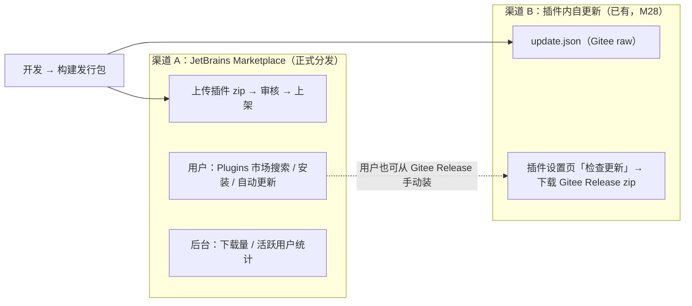
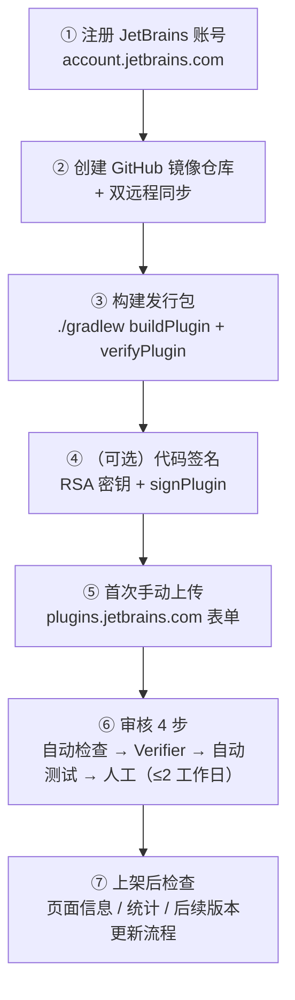
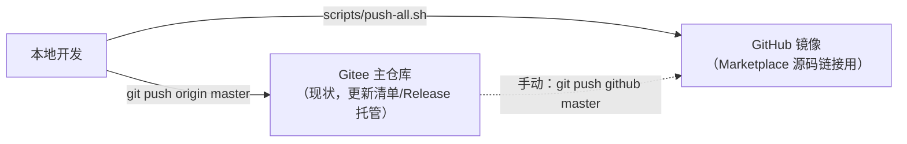
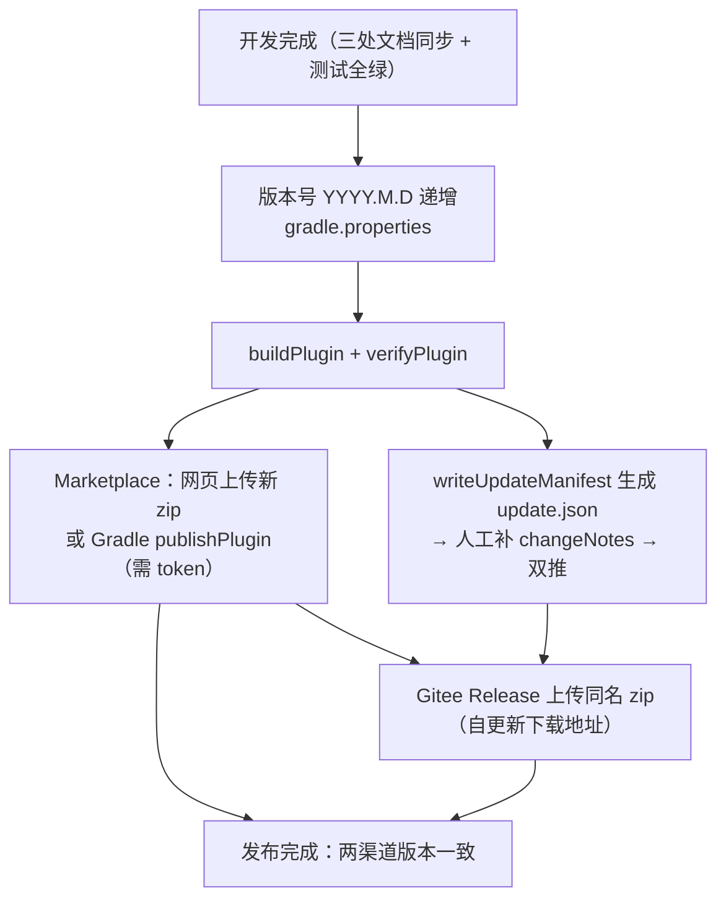
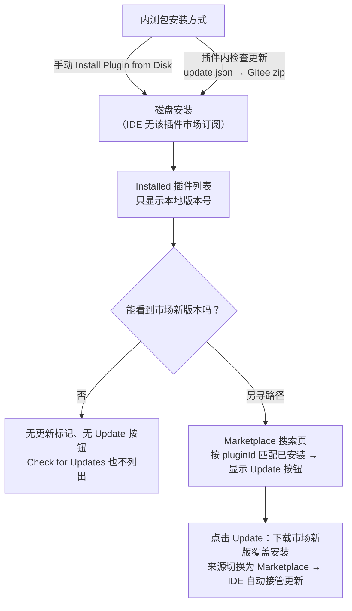

# Marketplace 发布流程-说明文档

> 面向「首次在 JetBrains Marketplace 发布插件」的全流程指南，已按本插件（mybatis-plus-sql-visualizer）实际情况逐项对照。
> 信息源：JetBrains 官方文档（查证时间 2026-08-16，链接见附录 §7）。官方文档如有更新，以官网为准，本文标记「官方原文」处保留原意。

---

## 1. 概览与核心结论

### 1.1 发布渠道全景

本插件有**两条发布/更新渠道**，互不冲突、互为补充：



- **Marketplace 是正式发行渠道**：用户搜索/发现、评分、自动更新都在这；本次要发布的就是它。
- **自更新渠道继续保留**：`update.json` 指向 Gitee Releases（已有 `writeUpdateManifest` 任务），两者版本号保持一致（详见 §5.7）。

### 1.2 核心结论（先读）

| 问题 | 结论 |
|---|---|
| Gitee 仓库能否直接作为 Marketplace 源码链接？ | 官方要求源码链接「公网可达、公开可访问」，文档举例 GitHub/GitLab，**未明确列出 Gitee**。稳妥做法：**双仓库**——Gitee 为主仓库（现状不变），GitHub 建镜像，Marketplace 源码字段填 GitHub |
| 开源许可证与源码链接 | 本项目 LICENSE = **Apache-2.0**（开源）→ 上传表单选择开源许可证时 **源码链接必填**（官方原文 "If you select an open-source license, you need to provide a link to the source code"），缺失是常见被拒原因 |
| 首次发布怎么传 | **首次必须通过网页手动上传**（官方：The first publication must always be uploaded manually）；后续版本可用 Gradle `publishPlugin` 自动发布 |
| 代码签名 | 官方建议发布前签名（`signPlugin` 自动执行）；当前公钥上传功能官方仍标记未开放，未签名也可上传但 IDE 安装时可能弹警告。首次发布**建议先不配置签名**，跑通流程后再补（见 §5.4） |
| 发布频率/版本号 | 版本号沿用 `YYYY.M.D`；**Marketplace 不接受同一版本号重复上传**，每次更新必须升版本 |
| 内测包用户能否直接更新到市场版 | **不能自动**。磁盘安装（含插件内自更新安装的包）在 IDE 里无市场订阅，不会收到市场更新；需**一次性迁移**到市场渠道（详见 §10.3） |

---

## 2. 发布前置准备（对照本插件核验）

### 2.1 plugin.xml 要素（已就绪）

| 要素 | 本插件现状 | 要求 | 状态 |
|---|---|---|---|
| `<id>` | `cn.song.mybatisplus.visualizer.mybatis-plus-sql-visualizer` | 唯一 FQN，发布后不可改 | ✅ |
| `<name>` | SQL Visualizer | 建议 ≤20 字符、不含 "Plugin"/"Support" 等后缀词、无版本号 | ✅（14 字符，符合 ≤20 建议；2026-08-28 起由旧名更名，插件 ID 不变） |
| `<description>` | 英文开头 ≥40 字符 + 中文段落 | Marketplace 预览卡取描述**前 40 字符（须英文摘要）** | ✅（英文在前） |
| `<vendor url>` | https://gitee.com/SongRenShuo | 公网可达 | ✅ |
| `<idea-version since-build>` | 243 | 兼容列表由此推导 | ✅ |
| 图标 | `META-INF/pluginIcon.svg` | 图标须在插件包内；不要用默认模板/占位 logo | ⚠️ 见 2.2 待办 |

### 2.2 发布前待办清单（本插件缺口）

| 待办 | 说明 | 优先级 |
|---|---|---|
| 补充 `pluginIcon_dark.svg` | 目前只有亮色图标（`META-INF/pluginIcon.svg`）；dark 候选图在 `src/main/resources/icons/candidates/pluginIcon_dark.svg`，启用它或换正式图 | P1 |
| 检查插件包内是否混入无关文件 | 官方：不要把库重打包进主 jar（Plugin Verifier 会误报）；本插件运行时零第三方依赖，风险低 | P2 |
| 确认 jar 内 changeNotes | `patchPluginXml.changeNotes` 已显式配置（build.gradle.kts），Marketplace 页面的 What's new 取自上传 zip | ✅ |
| README 补 Marketplace 安装说明 | 可选；README 已有功能/触发方式说明 | P3 |
| 决定 Marketplace 页面截图 | 推荐 1200×760，展示预览弹窗/日志面板实际效果 | P1（上传表单需要） |

---

## 3. 全流程总览



---

## 4. Step ①：账号与 Vendor 验证

1. 注册 JetBrains 账号：<https://account.jetbrains.com>（用个人邮箱即可）。
2. 登录 Marketplace 作者后台：<https://plugins.jetbrains.com/author/me>。
3. 首次操作须接受 **《JetBrains Marketplace Developer Agreement》**，并创建 **Vendor profile**：
   - 类型二选一：**Individual**（个人开发者）或 **Organization**（组织）；
   - 由于欧盟消费者保护法规（Directive 2005/29/EC），须声明 **trader / non-trader**（经营者/非经营者）——个人开发者选 non-trader 即可；
   - Vendor 名称会展示在插件页（如 `SongRenShuo`），发布后可在后台调整。
4. 生成 API Token（后续 Gradle 自动发布用）：作者后台 **My Tokens** 页生成 Personal Access Token，妥善保存（只显示一次）。

> 官方审核 4 步中的最后一步是人工审核（moderators），通常**最多两个工作日**，首次发布预留时间。

---

## 5. Step ②：双仓库与代码同步（Gitee 主 + GitHub 镜像）

### 5.1 为什么需要双仓库

- 开源插件**必须**提供公网可访问的源码链接（官方要求，缺失直接拒）；
- 官方文档举例 GitHub/GitLab，**未明确接受 Gitee**——填 GitHub 镜像最稳妥，审核与用户可发现性都更好；
- Gitee 保持主仓库（现状 origin），GitHub 为只读镜像，工作流零变化。

### 5.2 操作步骤

```bash
# 1. 在 GitHub 网页创建同名空仓库（不勾选 README/.gitignore，避免首推冲突）
#    路径建议：https://github.com/SongRenShuo/mybatis-plus-sql-visualizer

# 2. 添加第二个远程（本地一次性配置）
git remote add github https://github.com/SongRenShuo/mybatis-plus-sql-visualizer.git
git remote -v   # 确认：origin(Gitee) + github(GitHub)

# 3. 首次全量推送
git push -u github master
```

### 5.3 日常同步（每次发布 / 里程碑提交后）

建议在仓库根加 `scripts/push-all.sh`（并提交）：

```bash
#!/bin/bash
# 双仓库同步推送：Gitee(origin) 为主，GitHub(github) 为镜像
set -e
cd "$(dirname "$0")/.."
git push origin master
git push github master
echo "双仓库推送完成：origin + github"
```



### 5.4 双仓库协作约定

| 约定 | 说明 |
|---|---|
| 主仓库 | Gitee 唯一写源（含 Release 附件、update.json） |
| 镜像 | GitHub 只读，接受 issue；PR 合入需手动 cherry-pick（低频可忽略） |
| Marketplace 链接 | **Source code URL 填 GitHub 镜像**；Additional Information 可再加一条 Gitee 链接（自定义链接，均须公网可达） |
| 同步时机 | 每次发布前必须双推（审核方会点开源码链接） |

---

## 6. Step ③：构建发行包与本地验证

```bash
# 发版链路一命令（推荐，T-ReleasePerf-02）：buildPlugin → verifyGate 三目标兼容门禁 → testShards 全量测试
./gradlew releaseGate
# 判定：BUILD SUCCESSFUL 即三关全过（门禁 exit 0 且三份 verdict 均 Compatible，测试 0 失败）

# 分步执行（等价，供排障/单步重跑）：
./gradlew buildPlugin                # 构建发行包
./gradlew verifyGate                 # 权威兼容门禁（三目标 243+253+262，离线+豁免清单）
./gradlew testShards                 # 全量测试（3 片并行）

# 改文案/文档后重验门禁（跳过重打包，产物必须已存在）：
./gradlew verifyGate -PverifyOnly=true

# 本地冒烟（可选但推荐）
./gradlew runIde
# 在沙盒 IDE 里安装 zip（Settings → Plugins → ⚙ → Install Plugin from Disk），
# 验证：gutter 图标 / 右键转换 / 日志面板 / 设置页
```

> **发版前兼容性门禁（2026-09-09 T-Wia262 教训；2026-09-15 T-ReleasePerf 起由 verifyGate 承担）**：
> v2026.9.8 发布时 T-PreviewWiLock 引入的 `WriteIntentReadAction.compute(ThrowableComputable)` 重载
> 在 262 平台已被移除——243 编译基准 javap 核验发现不了，直到 verifier 字节码级对 262 校验才暴露
> `NoSuchMethodError` 必崩路径，市场发布受阻、自更新清单被迫回退。此后每次发版前必须跑兼容门禁。
> **`verifyGate` 直驱 verifier-cli**（`-offline` 断 marketplace 网络抖动 + `-ignored-problems` 豁免清单），
> 判定标准：**BUILD SUCCESSFUL + `build/reports/pluginVerifierGate/IU-{243,253,262}/.../verification-verdict.txt`
> 三份均标 Compatible**；deprecated/experimental 告警为 warning 级不阻断，但须与上一版计数对比，异常新增要归因。
> 换门禁的原因（字节码实证，见 build.gradle.kts failureLevel 处注释）：IPGP 2.18.1 的 `verifyPlugin`
> 任务判定不采纳 `-ignored-problems` 豁免且输出解析存在竞态（同输入一次过一次挂），已降级为报告生成器。
> 快速档：`verifySmoke`（仅 243，约 1min）/ `verifyMinimal`（243+262）；`-PverifyIdes=minimal`
> 中间轮次可省 253（约 5min），**最终发版必须三目标**（253 由 Marketplace 审核侧自行验证）。

> 检查 zip 内容：`unzip -l build/distributions/*.zip | head`——应包含 `lib/*.jar`、`META-INF/plugin.xml`、图标、messages 语言包；**不应**包含测试类或无关依赖。
> 文件大小上限 400 MB（本项目 zip 预计 <1 MB，无忧）。

---

## 7. Step ④：代码签名（首次可跳过，跑通流程后再补）

### 7.1 官方机制与现状

- 官方签名机制（2021.2 起）：**作者签名 + Marketplace 重签名**双签名；Gradle 2.x 中 `signPlugin` 会在 `publishPlugin` 前自动执行；
- **现状（2025 论坛官方答复）**：作者公钥上传功能官方仍标记 "not available"——即端到端签名验证尚未完全落地，**未签名插件当前可正常上传**；
- 但官方文档仍要求 "Before publishing a plugin, make sure it is signed"，且签名是上架质量的一部分。**建议：首次发布不配置（不阻塞），上架后补做**。

### 7.2 若要配置签名（官方方式）

```bash
# 1. 生成 RSA 4096 密钥对（openssl）
openssl genpkey -algorithm RSA -pkeyopt rsa_keygen_bits:4096 -out private_key.pem
openssl rsa -in private_key.pem -RSAPublicKey_out -out public_key.pem
# 2. 生成证书链 chain.crt（官方文档有自签 CA 流程，此处不展开）
```

```kotlin
// build.gradle.kts：intellijPlatform 块内配置
intellijPlatform {
    signing {
        certificateChain = providers.environmentVariable("CERTIFICATE_CHAIN")
        privateKey = providers.environmentVariable("PRIVATE_KEY")
        // 或用 *File 变体指向本地文件
    }
}
```

```bash
# 3. 发布时自动签名 + 校验
./gradlew signPlugin verifyPluginSignature
```

> 密钥文件**禁止提交进仓库**（环境变量注入）；私钥丢失需重新签发。

---

## 8. Step ⑤：首次手动上传（网页表单）

入口：<https://plugins.jetbrains.com/author/me> → **Add new plugin**（或用户菜单 Upload plugin）。

| 表单分区 | 填写内容（本插件对照） |
|---|---|
| Vendor profile | 选第 4 节创建的 profile（Individual / non-trader） |
| Plugin details | 名称/描述/图标等（见下方细节） |
| 文件 | `build/distributions/mybatis-plus-sql-visualizer-<版本>.zip`（≤400 MB） |
| 许可证 | 选 **Apache-2.0**（对应仓库 LICENSE）→ **必填源码链接**：GitHub 镜像 URL |
| Tags | 至少 1 个，与功能匹配：`sql`、`mybatis`、`java`、`code-analyzer`、`database` 等（后台 General Information 可改） |
| Channels | 首次正式发布用默认（stable）；Alpha/Beta 阶段可选 alpha/beta 渠道 |
| Hidden flag | 否（除非想先过审再择时公开） |

**Plugin details 细节（官方最佳实践）**：

- **名称**：自动取自 `plugin.xml <name>`（当前 `SQL Visualizer`，14 字符，符合 ≤60 硬限与官方 ≤20 建议）；
- **描述**：默认取自 `plugin.xml <description>`，预览卡取**前 40 字符英文摘要**（本插件英文段已满足）；可单独在页面编辑（与插件包分开保存）；
- **图标**：自动取自插件包内图标；页面图标可单独上传更高质量的；
- **截图**：推荐 1200×760，展示预览弹窗、动态条件面板、日志工具窗口实际效果（禁止默认主题截图、误导性图片）；
- **Additional Information**：可加 Gitee 仓库链接、官网需求池（https://sql-visualizer.jvtools.cn/about/feedback）等，**外链必须公网可达**。

---

## 9. Step ⑥：审核流程（4 步）与常见被拒原因

### 9.1 审核 4 步（官方 webinar 内容）


### 9.2 常见被拒原因（官方列出，逐项对照）

| 被拒原因 | 本插件对策 | 状态 |
|---|---|---|
| 开源插件缺源码链接 | 双仓库 + 表单填 GitHub 镜像 | 按本流程即满足 |
| 描述质量差（营销词/空话） | 描述为英文功能清单 + 中文说明，无 "lightweight/simple" 类空词 | ✅ |
| 兼容性问题（Verifier 报错） | 发布前 `verifyGate`（三目标）通过；构建基线 2024.3.7.1 | ✅ |
| 默认/占位 logo | `META-INF/pluginIcon.svg` 为自绘 MP 蓝图标，非模板默认 | ✅ |
| 插件名违规（含 Plugin/商标） | 名称无违规词 | ✅ |
| 广告/隐私问题 | 无广告、无埋点 | ✅ |

---

## 10. Step ⑦：上架后与日常版本更新

### 10.1 上架后检查

- 插件页：名称/描述/截图/链接展示是否正常；IDE 内 Plugins 市场搜索是否命中；
- 后台统计：下载量、活跃用户（后台 Dashboard）；
- 保持源码链接与插件包同步（后续每次提交后双推）。

### 10.2 日常版本更新流程（两条渠道联动）



| 步骤 | 命令/操作 | 说明 |
|---|---|---|
| 升版本 | 改 `gradle.properties`（`YYYY.M.D`） | Marketplace 不接受同版本重复上传 |
| 构建验证 | `./gradlew releaseGate`（buildPlugin → verifyGate 三目标门禁 → testShards 全量） | 发布前必做；`-PverifyOnly=true` 可跳过重打包 |
| Marketplace 上传 | 网页手动，或 `./gradlew publishPlugin -PintellijPlatformPublishingToken=…` | 后续版本可自动化 |
| 自更新清单 | `./gradlew writeUpdateManifest` → 人工补 changeNotes | 生成 `update/update.json` |
| Gitee Release | 网页创建 Release，附同名 zip | 自更新 downloadUrl 指向这里 |
| 双推 | `scripts/push-all.sh` | 源码链接保持最新 |

> ⚠️ 两渠道版本号必须一致（update.json version = Marketplace 版本），否则用户侧会出现「检查更新有新版但市场无」的困惑。

### 10.3 内测用户能否直接更新到市场新版本？（重要）

**结论：在「已安装插件列表」里看不到更新提示、也不能在那里手动更新；但在「Marketplace 搜索页」可以手动点 Update（这同时也是迁移动作）。** IDE 的插件更新机制按**安装来源**区分（官方帮助文档明确）：

- **从 Marketplace 安装** → 插件管理器记录该插件的仓库元数据（ID/版本/渠道），此后 IDE 自动检查更新、插件列表出现 **Update 按钮**、可配置自动更新；
- **从磁盘安装**（`Install Plugin from Disk` **以及本插件内置「检查更新」下载的 zip**——`PlatformPluginInstaller` 卸载旧版+解压新版，安装语义与磁盘安装相同）→ IDE **没有该插件的市场订阅**：`Settings → Plugins → Installed` 列表只显示本地版本（无"有新版本"标记、无 Update 按钮），IDE 的更新检查（含 ⚙ → Check for Updates）也不会列出它。

**但手动更新有一扇门**：`Settings → Plugins → Marketplace` 搜索页按 **pluginId** 匹配已安装插件——市场版本高于本地版本时，该插件显示 **Update 按钮**（而非 Install）。点击 Update = 从市场下载安装新版并覆盖磁盘版，一次操作同时完成两件事：① 手动更新到市场新版；② 安装来源切换为 Marketplace，此后自动更新由 IDE 接管。个别版本若显示 Install 而非 Update，点击效果等同（覆盖安装）。



**迁移步骤（内测用户一次性操作）**：

1. 确认市场已发布版本 **≥ 内测用户当前版本**（避免迁移时被市场旧版"降级"）；
2. 内测用户打开 `Settings → Plugins → Marketplace`，搜索插件名：
   - 市场版本更高 → 直接点 **Update**（同 pluginId 覆盖安装，按提示重启）；
   - 未显示 Update → 点 Install 覆盖安装（效果等同）；
3. 重启后安装来源变为 Marketplace：市场再发新版本时，Installed 列表出现 Update 按钮，可勾选 `Update plugins automatically` 让 IDE 自动更新；
4. 迁移后插件内「检查更新」（Gitee 渠道）仍可用，与市场渠道并存不冲突——但**两渠道版本号必须保持一致**。

**过渡期运营建议**：

| 用户群 | 安装/更新渠道 | 说明 |
|---|---|---|
| 内测群（迁移前） | 插件内自更新（Gitee） | 继续按现状工作 |
| 内测群（迁移后） | Marketplace | 覆盖安装一次即切换，之后自动更新 |
| 正式用户 | Marketplace | 主渠道 |

> 本质原因：插件内自更新是插件**自己的代码**实现（检查 update.json → 下载 zip → 安装），不经过 IDE 插件管理器的市场订阅机制；要让 IDE 接管更新，唯一的途径是插件从 Marketplace 安装一次。

---

## 11. 发布检查清单（最终 Checklist）

```markdown
□ 1. 测试全绿：./gradlew testShards
□ 2. 兼容门禁：./gradlew verifyGate（三目标，离线；日常档 verifySmoke / -PverifyIdes=minimal）
□ 3. 发行包：./gradlew buildPlugin，产物 zip 内容核对（无测试类/无关依赖）
□ 4. 版本号已递增（YYYY.M.D），patchPluginXml.changeNotes 已更新
□ 5. GitHub 镜像仓库存在且已同步（git push github master）
□ 6. Gitee Release 已建，zip 已附
□ 7. update.json 已生成（writeUpdateManifest）+ changeNotes 人工补充 + 双推
□ 8. Marketplace 表单：Apache-2.0 + 源码链接（GitHub）+ tags + 截图
□ 9. 沙盒 runIde 冒烟：zip 安装后功能正常
□ 10.（可选）签名配置后：signPlugin + verifyPluginSignature
□ 11. **上传新版后在 Marketplace 后台确认 listing 显示名已同步为 SQL Visualizer，页面 slug URL 不变**
```

---

## 12. 附录：官方文档与查证记录

| 主题 | 官方链接 |
|---|---|
| 发布插件（总流程） | <https://plugins.jetbrains.com/docs/intellij/publishing-plugin.html> |
| 上传新插件 | <https://plugins.jetbrains.com/docs/marketplace/uploading-a-new-plugin.html> |
| 列表最佳实践 | <https://plugins.jetbrains.com/docs/marketplace/best-practices-for-listing.html> |
| 审核准则（Approval Guidelines） | <https://plugins.jetbrains.com/docs/marketplace/jetbrains-marketplace-approval-guidelines.html> |
| 代码签名 | <https://plugins.jetbrains.com/docs/intellij/plugin-signing.html> |
| 开源软件源码义务（官方博客） | <https://blog.jetbrains.com/platform/2023/04/vendor-obligation-to-provide-source-code-for-oss-software/> |
| 插件安装与更新机制（磁盘 vs 市场，IDE 帮助） | <https://www.jetbrains.com/help/rider/2025.2/Managing_Plugins.html>（各 IDE 帮助页同名章节） |
| 作者后台 | <https://plugins.jetbrains.com/author/me> |
| 账号注册 | <https://account.jetbrains.com> |

**查证记录**：2026-08-16 检索/抓取上述官方页面。要点：① 首次发布必须手动上传；② 开源许可证 → 源码链接必填（公网可达）；③ 审核 4 步（自动检查/Verifier/自动测试/人工 ≤2 工作日）；④ 签名机制存在但公钥上传功能官方未开放（2025 论坛答复），未签名可上传、IDE 装时可能警告；⑤ 常见被拒：缺源码链接/描述差/占位 logo/兼容性。

> 本文为一次性流程说明，长期维护于 docs/；发布动作执行时如官方界面有变，以官网为准并回写本文。
