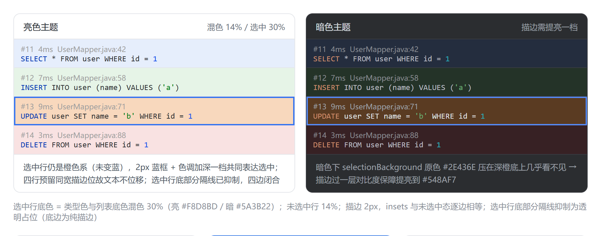
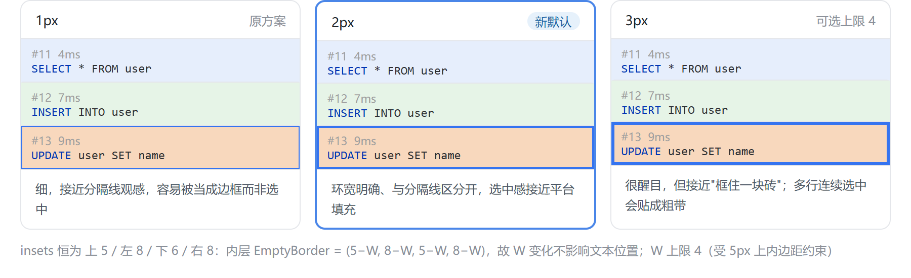

# T-CrudColor：SQL 列表 CRUD 类型颜色标记（可自定义）开发计划

> **创建日期**：2026-09-12
> **分支**：master（当前 HEAD `a5ddc2e`，工作树干净；全量基线 3322/0/0/6——T-AutoFold 交付后，实施前复核）
> **优先级**：P2（用户明确要求的新功能；纯增量渲染 + 一个设置子分组，无存量行为变更）
> **预估工时**：9.5h（配色/混色/描边纯逻辑 2h + 两个渲染器接线 2h + 设置项与面板 2h + 测试 3h + 文档 0.5h）
> **来源**：用户需求原话——「目前 sql 日志页面和 sql 历史页面的 sql 列表，现在我希望支持自定义 crud 颜色标记，你分析下需求，看看是通过背景色区分还是使用小颜色标识区分合适」
> **需求追加（2026-09-12）**：用户原话——「整行背景色的时候，选择时能不能一圈边框选中态，而不是整个选中态」。已采纳并升级为 §1.2.1 专项设计（描边选中态），该提议**消掉了否决背景色的第一理由**，见 §1.2 权重修正。
> **需求追加 2（2026-09-12）**：用户原话——「描边选中态 再粗一点」。`OUTLINE_WIDTH` 定为 **2**（逻辑像素），安全区间 `1..4`；描边加粗后「选中感不足」风险下降，`MIX_SELECTED` 维持 0.30 不上调。

---

## 一、需求分析

### 1.1 需求拆解

一句话需求里藏着三个独立决策点，必须逐一定死，否则实施期必然返工：

| 决策点 | 问题 | 本计划结论 |
|---|---|---|
| ① 标记形态 | 整行背景色 vs 小颜色标识（色条） | **左侧 3px 色条为默认**，同时提供「整行淡背景」样式，下拉三选一（见 §1.2） |
| ②「自定义」的粒度 | 自定义什么？颜色？标记方式？还是两者？ | 两者都给：**颜色可自定义**（每类型一个色值）+ **标记方式可自定义**（样式下拉） |
| ③ 覆盖范围 | 哪几个列表？ | SQL 日志页主列表 + SQL 历史页二级 SQL 列表（见 §1.4 边界） |

类型判定的口径不需要新发明：仓库已有 `LogStatementClassifier`（`log/LogStatementClassifier.kt:22`，SELECT/WITH→SELECT、INSERT、UPDATE、DELETE、其他→OTHER），且**类型过滤弹窗正在用它**。标记直接复用同一分类器，则「筛出来的 SELECT 行绝不会被标成红色」这一自洽性天然成立——这是选择复用而非另写一套正则的首要理由。

### 1.2 核心分析：背景色 还是 小颜色标识？

这是本需求唯一的实质性技术分歧，逐维度摊开对比（结论：**色条为主**）：

| 维度 | 整行背景色 | 左侧色条（小颜色标识） |
|---|---|---|
| 视觉强度 / 扫读效率 | 强，整行成块，一眼可辨 | 中，左缘 3px 竖条，需稍加留意但足够定位 |
| **选中态** | **有解**（用户 2026-09-12 提议，已采纳）：渲染器默认写法 `background = if (isSelected) list.selectionBackground else list.background`（`SqlLogPanel.kt:1417`、`HistorySqlLogPanel.kt:482`）会让类型色**在键盘上下浏览时被整块覆盖消失**；改为「保留类型色调 + 2px 选中描边」（不铺平台选中填充）即可化解——详见 §1.2.1 | **无冲突**：色条是独立子组件（`BorderLayout.WEST`），选中只覆盖单元格背景，色条原样保留 |
| **SQL 语法高亮** | **冲突**：SQL 行颜色取自编辑器配色方案（`SqlListFragmentRenderer` 经 `EditorColorsScheme` 取色，`SqlListFragmentRenderer.kt:31-39`），该调色板按「编辑器背景」调过对比度；铺底后关键字对比度下降，暗色主题（Darcula `#1E1F22`）尤甚——铺淡了看不出来、铺浓了压字 | 无冲突（色条不占 SQL 文本区域） |
| **耗时着色** | **冲突**：耗时文本已用红 `0xD32F2F` / 橙 `0xE67E22` / 绿 `0x4CAF50` 表达快慢（`SqlLogPanel.kt:1344-1355`），行底再铺同族色 = 两个颜色通道同时喊话；历史页此前就明确「uniform 灰——不按耗时变色避免与 SQL 高亮冲突」（`HistorySqlLogPanel.kt:502`） | 轻微：色条在左缘、耗时色在元信息行文本，位置分离不打架 |
| 列表密度 / 噪音 | 200 行满屏色块 + 1px 行分隔线，视觉噪音大 | 低噪音，仅左缘一条细线 |
| 渲染成本（热路径） | O(1)（设 background） | O(1)（设 `colorBar.background`，子组件复用**零分配**） |
| 亮/暗主题适配 | 每种主题各需一次混色计算，否则暗色下发闷 | 直接使用配置色，两主题均可见 |
| IDE 原生一致性 | 平台列表行背景由 LaF 统一管理，插件覆写属「越权观感」 | 与平台既有模式一致（测试运行窗口结果左色条、新 UI 标签页左色条） |

**结论：以「左侧色条」为主标记。** 四条否决背景色的理由按权重排序是：① 选中态覆盖（功能性问题）② 压 SQL 高亮与耗时着色的对比度（可读性问题）③ 视觉噪音 ④ 偏离平台观感。

> **2026-09-12 用户提议后的权重修正**：用户提出「背景色样式下，选中态用一圈边框而不是整块选中填充」——这条建议把**理由 ① 直接消掉**（选中态不再是硬冲突，而是可解的实现选择）。剩余理由 ②③④ 属**可读性与审美层**，不是功能性缺陷。故：**默认仍为色条**（暗色主题下背景色的对比度代价确实更明显），但背景色样式从「有硬伤的备选」升级为「**与色条等价可选的正经样式**」，实施时两条路径都必须做到完整可用、可回归。

**但背景色并非不做**——用户需求里的「自定义」明确要的是选择权，且两种形态各有审美偏好，靠计划书替用户拍板有返工风险。因此落地方案是**一个下拉框三选一**：

- `色条`（默认）：仅左侧 3px 色条；选中态走平台原生填充（与现状一致）；
- `整行淡背景`：仅整行底色，用**与列表当前背景按 14% 混色**的方式生成（`blend(base, tint, 0.14)`），天然适配亮/暗主题；**选中态 = 保留类型色调（30% 混色）+ 2px 选中描边**（不铺平台选中填充，见 §1.2.1）；
- `关闭`：与现状逐字节一致（零行为变更，可回退）。

混色与描边均为纯逻辑（可独立单测），两种形态共用同一份「类型 → 颜色」映射，只是消费点不同（色条设 `colorBar.background` / 整行设单元格 `background`），增量成本约 15 行 + 描边边界约 20 行。

#### 1.2.1 背景色样式的选中态设计：描边而非填充（用户提议，已采纳）

**问题**：`background` 样式下若沿用平台选中填充（`selectionBackground` 整块铺满），类型色调在选中行被完全覆盖——用户用上下键逐行浏览时，颜色恰在需要辨别的时刻消失；若改为「与 `selectionBackground` 混色」保留色相，则选中蓝 + 类型色混出的第三色既不像选中也不像类型，语义两头不靠（暗色主题 `#2E436E` 上尤其浑浊）。

**方案**：`background` 样式下，选中行**不铺平台选中填充**，改为两条通道同时表达选中：

1. **类型色调保留**，并在选中时提高混色比例（`0.14` → `0.30`）——选中行「同色相、更深一档」，与相邻未选中行形成层次；
2. **`OUTLINE_WIDTH = 2` 的选中描边**环绕整行（颜色取 `list.selectionBackground` 焦点态 / 失焦态两档，`cellHasFocus` 参数区分——渲染器当前忽略该参数，本次用起来）。
   - **2026-09-12 用户追加**：「描边再粗一点」——`1px → 2px` 定为默认。逻辑像素 2px 在 HiDPI 上是 4 设备像素，环宽足够醒目但不至于像"框住一块砖"；仍嫌细可调常量到 3（**上限 4**，受 5px 上内边距约束，见下）。

**效果对照（设计稿，非实现截图）**：

亮色 / 暗色两主题下的描边选中态——重点看两点：① 暗色列的描边提亮差异 ② 选中行**四边闭合**（底边为纯描边，无灰线穿插）：



描边宽度三档对照（1px 原方案 / 2px 新默认 / 3px 可选上限 4）——每列内边距按各自描边宽度补偿，故列内文本位置不随选中位移：



> 两图为**设计稿**（按下方色值表手工渲染的静态示意，用于确认观感与选型），**不是实现后的真机截图**；实施后真机观感以 §4.3 走查为准。图源 HTML 未入库（临时文件），如需重出图可按下方色值表复现。
>
> **素材位置**：设计稿放 `docs/images/design/`（与 `docs/images/` 根目录下的**对外素材**分离——后者是 README / 插件介绍页 / Marketplace 引用的二维码与功能截图，受众与生命周期不同）；命名 `{任务号}-{说明}.png`，本图归属 T-CrudColor。规范见《文档命名规范-说明文档.md》§图片/设计稿。

**设计稿色值表**（复现两图所需，非实现色值来源——实现色值来自用户配置与默认色）：

| 项 | 亮色主题 | 暗色主题 |
|---|---|---|
| 列表底色 | `#FFFFFF` | `#1E1F22` |
| 面板底色 / 边框 | `#FFFFFF` / `#E4E6EA` | `#2B2D30` / `#393B40` |
| 行分隔线 | `#E4E6EA` | `#393B40` |
| 选中行底部分隔线 | **抑制**（透明占位，底边为纯描边） | **抑制**（同左） |
| 选中描边 | `#3574F0` | `#548AF7`（提亮档，非 `#2E436E` 原色） |
| 未选中行底色（14%） | SELECT `#E6EEFC` / INSERT `#E6F4E7` / DELETE `#F9E2E2` | SELECT `#242D3E` / INSERT `#243328` / DELETE `#372124` |
| 选中行底色（30%） | UPDATE `#F8D8BD` | UPDATE `#5A3B22` |
| 元信息灰 | `#9E9E9E` | `#8A8D93` / 选中行 `#9DA0A8` |
| SQL 关键字 / 字符串 / 数字 / 正文 | `#0033B3` / `#067D17` / `#1750EB` / `#2B2D30` | `#CF8E6D` / `#6AAB73` / `#2AACB8` / `#BCBEC4` |

> 上表亮/暗两组底色即 `blend(列表底色, 类型色, 0.14 / 0.30)` 的实测结果——可作为 §4.2 混色单测的期望值参照（暗色两列同时印证「14% 在 `#1E1F22` 上偏含蓄」，是 `MIX_NORMAL` 可能需要上调到 0.20 的量化依据）。

**实现要点（防三个坑）**：

- **防文本位移**：描边会带来 `W` px 四边 insets，若只在选中态加描边，选中瞬间整行文本会右移/下移 `W` px，键盘连续浏览时表现为抖动。故**两种状态的 insets 必须严格相等**——未选中 `CompoundBorder(MatteBorder(0,0,1,0, separator), EmptyBorder(5,8,5,8))`（insets 上 5 / 左 8 / 下 6 / 右 8），选中 `CompoundBorder(描边 W, CompoundBorder(MatteBorder(0,0,1,0, TRANSPARENT), EmptyBorder(5-W, 8-W, 5-W, 8-W)))`。
  - **选中行抑制内层底部分隔线**（2026-09-12 用户指出底边观感问题后定稿）：内层 `MatteBorder` 的颜色由 `separator` 换成**同尺寸透明色**（insets 仍为 1px，尺寸不变、不破 insets 相等）。理由：若保留分隔线，它会画在内层区域的底部，即**蓝色描边环内部**——出现「蓝框底边之上浮一条 1px 灰线」，把完整的选框割断；抑制后底边为纯 2px 描边，选框四边完整闭合。
  - 备选（**不采纳**）：保留分隔线。代价=框内底部多一条灰线，且相邻两行都选中时中间会出现「蓝 2px + 灰 1px + 蓝 2px」的夹线粗带；本方案下相邻选中行为「蓝 2px + 蓝 2px」= **4px 连续蓝带**，语义更干净。
  - `W=2`（默认）→ 内层 `EmptyBorder(3,6,3,6)`：上 2+3=5 / 左 2+6=8 / 下 2+1+3=6 / 右 2+6=8，**逐边相等**。
  - **上限推导**：内层 inset 必须 ≥ 0 → `5-W ≥ 0` 且 `8-W ≥ 0` → **`W ≤ 4`**（W=4 时 `EmptyBorder(1,4,1,4)`，上内边距恰好用尽）。`W ≥ 5` 会算出负 inset 导致 `EmptyBorder` 抛 `IllegalArgumentException`——常量加 KDoc 注明安全区间 `1..4` 并做 `coerceIn` 兜底。
  - 单测**按 W 参数化**断言两侧 insets 相等（不是写死某一档），这样以后调宽不会漏改。
- **防热路径分配**：两个 Border 实例在 `init` 预建、渲染时**引用切换**（`border = if (selected) selectedBorder else normalBorder`），零分配。描边色随主题/失焦变化 → 用自建 `AbstractBorder` 子类持**可变 color 字段**（渲染时只改字段，不重建 Border），避免「主题切换后描边色冻结在构造时」的缺陷。
- **防描边在暗色主题下不可见**：`selectionBackground` 在暗色主题是 `#2E436E`（深蓝），而选中行底色已被类型色调加深（如 UPDATE 橙混色后约 `#5A3B22`）——深蓝描边压在深橙底上对比度不足，等于没有描边。故描边色不能直接用 `selectionBackground` 原色，需过一层对比度保障：自研纯函数 `ensureOutlineContrast(color, isDark): Color`（按亮度差阈值提亮，暗色下走亮一档）。
  - 平台 `com.intellij.ui.ColorUtil.brighter(Color, int tones)` / `mix(...)` 已核实存在于编译目标（2024.3.7.1），但 `tones` 的换算语义不直观、断言需依赖平台实现细节 → **用自研纯函数**（可独立单测、行为可断言），不引入平台行为耦合。
- **防前景色错配**：片段辅助函数按 `isSelected` 决定前景（`formatDurationFragment` 选中返回白 `0xFFFFFF`、`formatSourceFragment` 选中返回组件前景，`SqlLogPanel.kt:1344-1368`）。`background` 样式下底色是**淡色调**而非饱和选中填充，白字在亮色主题的淡底上会不可见 → 渲染器需分派 `useSelectionFill = isSelected && style != STYLE_BACKGROUND`，仅在色条样式（走平台填充）时传 `true`。
  - **附带收益**：耗时着色在背景色样式下**不再被选中态抹成白色**，快/慢信号在浏览全程保持——这是描边方案相对平台填充的一个额外好处。

**代价（如实记录）**：描边选中态偏离 IntelliJ 列表「选中 = 填充」的通用观感（Project/Run 视图均为填充），用户首次接触可能觉得选中「不够实」。缓解=描边加粗到 2px（2026-09-12 用户追加）+ 描边色用饱和的 `selectionBackground` 提亮档而非弱化灰线 + 选中行色调加深一档。
> 描边加粗到 2px 后，「选中感不足」的风险显著下降——**故 `MIX_SELECTED` 维持 0.30 不再上调**（0.45 会让底色过浓、反过来压 SQL 高亮，与选型初衷相悖）。若真机仍反馈选中感弱，优先继续加粗描边（`W` 3→4），而不是加深底色。

**不扩散**：描边选中态**仅**用于 `background` 样式；`色条` 样式保留平台原生填充（这是它「零偏离」优势的一部分）。

> 明确**不做**的第三种形态：把语句首关键字（SELECT/INSERT/…）本身染成类型色。该通道已被 SQL 高亮占用（关键字加粗 + 编辑器配色），叠加会形成双色关键字，语义与观感双输。

### 1.3 已定决策

1. **标记形态**：左侧 3px 色条为默认；「整行淡背景」为可选样式；单个下拉框（`JComboBox`）三选一，**不拆成两个独立开关**——避免「样式=关闭 但开关=开」这类自相矛盾态，也避免配置面膨胀（T-PortLossBatch1 假开关教训）。
   - **1a（用户 2026-09-12 提议）**：`background` 样式的选中态 = **保留类型色调（混色比例 0.14→0.30）+ `OUTLINE_WIDTH = 2` 的选中描边**，**不铺**平台选中填充；`色条` 样式维持平台原生填充不变。详见 §1.2.1。
   - **1b**：两状态 Border insets 必须逐边相等（防选中瞬间文本位移 `OUTLINE_WIDTH` px 抖动），单测**按 W 参数化**锁定；`W` 安全区间 `1..4`（受 5px 上内边距约束，超界 `coerceIn` 兜底）。
   - **1c**：前景色分派改走 `useSelectionFill = isSelected && style != STYLE_BACKGROUND`，避免淡底上的白字不可见；附带收益=耗时着色在 `background` 样式下不再被选中态抹白。
2. **颜色集合**：SELECT / INSERT / UPDATE / DELETE 四类各一色；**OTHER（MERGE/TRUNCATE/CREATE/DROP 等）不标记**——避免满屏色条稀释信号，也不提供配置项（保持配置面最小；真机若要求再补，一处分支）。
3. **默认配色**：SELECT `#4A86E8`（蓝）/ INSERT `#4CAF50`（绿）/ UPDATE `#E67E22`（橙）/ DELETE `#D32F2F`（红）。
   - 已知重叠：INSERT/UPDATE/DELETE 与耗时着色（绿/橙/红）同族。缓解=色条在左缘、耗时色在元信息行文本，位置分离；且四色均可改。若真机反馈混淆，仅需改默认值一处（决策可逆）。
4. **分类口径**：统一走 `LogStatementClassifier`（与类型过滤弹窗同源）。多语句 / 批处理 SQL 按**首关键字**归类——与过滤行为一致（不引入第二套口径）。
5. **色条位置**：占据现有 8px 左内边距中的 3px（左内边距 8 → 5，色条 3，合计仍为 8），**文本左缘像素位置不变**——避免全列表文本右移引起的整屏视觉跳动，也避免惊动既有布局/文本断言。
6. **行高零影响**：色条为独立子组件，不改两行结构、不新增任何文本片段，`measureFixedCellHeight`（`SqlLogPanel.kt:857`）实测结果不变，T-LogListFreeze 的固定行高 O(1) 快路径不受影响。
7. **生效时机**：渲染器直读设置（片段通道既有范式——`formatTimestampFragment`/`formatDurationFragment` 均直读 `PluginSettings`）。设置变更经既有 `SETTINGS_CHANGE_TOPIC` 订阅（`SqlLogPanel.kt:415-423`）触发 `refreshList()` 重绘即生效；历史页补一次列表 repaint（其本身在 tab 切换时 `refresh()`）。
8. **配置入口**：设置 → SQL 日志 → MyBatis Core 分组末尾新增子分组「CRUD 颜色标记」：样式下拉 + 四个 `com.intellij.ui.ColorPanel`（色板控件，平台原生，已核实编译目标 2024.3.7.1 存在）+「恢复默认颜色」按钮。
   - **不新增复选框**：`PluginSettingsPersistenceTest.kt:153` 有「复选框总数应为 25」的硬台账，用下拉框 + 色板可保持台账不动（减少无谓的连带修改面）。
9. **不纳入 `SettingsIO` 导出/导入**：与同族显示项一致（`logTimestampEnabled` / `showDurationInLogList` 均未纳入 `exportToJson`，`SettingsIO.kt:27-52`）——避免导出侧出现「半套日志显示项」的语义歧义。若用户要求，导出/导入各一行即可。
10. **持久化格式**：色值为 `String` 十六进制 `#RRGGBB`（与 `logTimestampFormat` / `reverseWrapperFormat` 的字符串设置范式一致）；解析失败 / 空串一律回退默认色，**不抛异常、不写坏配置**。
11. **不做「按类型改字体/加图标」**：标记只走颜色，保持单一通道。

### 1.4 范围边界

| 面板 | 类 | 本期 |
|---|---|---|
| SQL 日志页（SQL Logs tab）主列表 | `SqlLogPanel.LogEntryListCellRenderer`（`SqlLogPanel.kt:1379`） | ✅ 做 |
| SQL 历史页（SQL History tab）二级 SQL 列表 | `HistorySqlLogPanel.HistoryCellRenderer`（`HistorySqlLogPanel.kt:454`） | ✅ 做 |
| SQL 历史页一级**文件**列表 | `HistoryFileCellRenderer`（`HistorySqlLogPanel.kt:401`） | ❌ 不做（文件无 CRUD 类型语义） |
| 独立工具窗口「SQL History」（预览历史，F-7） | `history/SqlHistoryPanel.kt:205-227` | ❌ 本期不做：该列表走 **JLabel + HTML span** 通道（非片段通道），着色机制与上述两个列表不同构，且属另一功能面（收藏/标签）。若用户要求，另立任务按同款方案改造（色条可经 `BorderFactory` 左侧 MatteBorder 实现）。 |
| Log→SQL / SQL→Java 面板 | — | ❌ 不做（非 SQL 日志列表） |

> **待用户确认项**：用户原话「sql 日志页面和 sql 历史页面」按工具窗口内两个 tab 理解（SQL Logs / SQL History）。若实际指的是独立工具窗口「SQL History」（预览历史），实施前请一句话确认，改造点按上表最后一行另计。

---

## 二、现状与接线点

### 2.1 渲染链路（两个渲染器，结构同构）

```
SqlLogPanel.refreshList（SqlLogPanel.kt:878）
  → filterByType（:114，调用 LogStatementClassifier）→ filterBySearch → applySort
  → JBList 快照渲染 → LogEntryListCellRenderer.getListCellRendererComponent（:1410）
       ├─ background = isSelected ? selectionBackground : list.background（:1417）
       ├─ metaLine 片段：行号 → 时间戳 → 耗时 → 来源 → ⨉N 徽章（:1427-1437）
       └─ sqlLine 片段：SqlListFragmentRenderer.renderFragments（:1439）

HistorySqlLogPanel.showFileContent → HistoryCellRenderer（HistorySqlLogPanel.kt:475）
       ├─ background = isSelected ? selectionBackground : list.background（:482）
       ├─ metaLine 片段：[耗时] [时间戳] [来源]（:503-505）
       └─ sqlLine 片段：SqlListFragmentRenderer.renderFragments（:506）
```

两个渲染器均为 `JPanel(BorderLayout)` + 内部 `JPanel(GridLayout(2,1))`（CENTER），边框为 `MatteBorder(0,0,1,0, JBColor.border())` + `EmptyBorder(5,8,5,8)`（`SqlLogPanel.kt:1397-1400`、`HistorySqlLogPanel.kt:469-472`）。**色条挂 `BorderLayout.WEST` 是零结构冲突的位置**——CENTER 已被 GridLayout 双行面板占用，WEST 空闲。

### 2.2 分类器现状与一处热路径隐患

`LogStatementClassifier.classify(sql)`（`LogStatementClassifier.kt:30-42`）实现为：

```kotlin
val firstToken = trimmed.split(Regex("\\s+"))[0].uppercase()
```

`Regex("\\s+")` **每次调用都重新编译 Pattern**。当前它只在刷新路径被调用（`filterByType`），但**渲染路径按 cell 调用**会把该开销放大到每次重绘 × 可见行数（滚动、悬停、选中、resize 均触发重绘）。

处置：给 `LogSqlEntry` 加**条目级 lazy 缓存**（与既有 `dedupeKey by lazy`（`LogSqlModels.kt:76`）同款范式，body 内属性不参与 data class 的 `equals/copy`）：

```kotlin
val statementType: StatementType by lazy { LogStatementClassifier.classify(restoredSql) }
```

并把 `filterByType` 也切到该属性——刷新路径的重复分类归零，**净收益抵消新增渲染分支的成本**。代价=每条目多一个 `Lazy` 小对象（缓冲上限 200 条，可忽略）。

### 2.3 设置链路

```
PluginSettings.State（PluginSettings.kt:33，@State + XmlSerializer，数据类默认值兜旧 xml）
  → PluginSettingsPanel.buildSections（:296）→ sectionGroup("settings.log.tab.mybatis")（:453）
  → 三处接线：isModifiedSqlLog（:971 分支调用）/ apply（:1080 分支）/ reset（:1182 分支）
  → 设置变更 → messageBus.syncPublisher(SETTINGS_CHANGE_TOPIC)（PluginSettingsPanel.kt:1130）
  → SqlLogPanel 订阅（:415-423）→ refreshList() 重绘
```

新增设置项**必须**同时接三处（`isModified` / `apply` / `reset`）——历史上 `reverseWrapperFormat` 漏挂 `isModified` 导致「改完 Apply 灰掉、改动被平台静默丢弃」的假开关事故（`PluginSettingsPanelBindingTest.kt:20-26` 有专项回归）。

### 2.4 分类器语义核对（复用无坑）

- `StatementType` 为 5 值枚举（`LogStatementClassifier.kt:14-20`），与 `FILTERABLE_TYPES`（`SqlLogPanel.kt:103-112`）一致：过滤弹窗只列 4 类，OTHER 在全选时透传。
- 分类基于 `restoredSql`（参数已还原）——参数值形如 `'select'` 的字符串不会影响首 token 判定（首 token 恒为语句关键字）。
- 分页计数 SQL（`SourceMarkers.isMpPaginationCount`）本质是 `SELECT COUNT`，归 SELECT 蓝色，语义正确。

---

## 三、改动清单

### 3.1 新增文件

**`src/main/kotlin/cn/song/mybatisplus/visualizer/log/SqlListTypeColor.kt`**（纯逻辑，可独立单测）

```kotlin
object SqlListTypeColor {
    const val STYLE_BAR = "bar"              // 左侧色条（默认）
    const val STYLE_BACKGROUND = "background" // 整行淡背景
    const val STYLE_OFF = "off"              // 关闭（现状行为）

    const val DEFAULT_SELECT = "#4A86E8"
    const val DEFAULT_INSERT = "#4CAF50"
    const val DEFAULT_UPDATE = "#E67E22"
    const val DEFAULT_DELETE = "#D32F2F"

    /** 未选中行的混色比例（淡色调）。 */
    const val MIX_NORMAL = 0.14
    /** 选中行的混色比例（同色相加深一档，与描边共同表达选中）。 */
    const val MIX_SELECTED = 0.30

    /** 类型 → 标记色；关闭 / OTHER → null（不标记）。读设置，非法值回退默认色。 */
    fun colorOf(type: StatementType): Color?
    /** 解析 "#RRGGBB"；非法 / 空 → fallback。不抛异常。 */
    fun parseHex(hex: String, fallback: Color): Color
    /** 按比例混色（base 为主）：用于整行淡背景，适配亮/暗主题与选中态。ratio ∈ [0,1]。 */
    fun blend(base: Color, tint: Color, ratio: Double): Color
    /** 当前样式（读设置；未知值按 STYLE_BAR 兜底）。 */
    fun styleOf(): String
    /** 当前样式是否走平台选中填充（仅 STYLE_BAR 为 true；STYLE_BACKGROUND 走描边）。 */
    fun usesSelectionFill(style: String): Boolean
    /** 描边色对比度保障：与行底色亮度差不足时提亮（暗色主题必需，否则深蓝描边压深色底不可见）。 */
    fun ensureOutlineContrast(color: Color, isDark: Boolean): Color
}
```

**`src/main/kotlin/cn/song/mybatisplus/visualizer/log/SqlListSelectionOutline.kt`**（§1.2.1 描边选中态，两渲染器共用）

```kotlin
/**
 * 选中描边 Border（AbstractBorder 子类）：W 像素四边描边 + 内层 Border 委托。
 *
 * - width：描边厚度（逻辑像素），安全区间 1..4——上限由渲染器 5px 上内边距约束（内层 inset 不得为负），
 *   超界 coerceIn 兜底，避免 EmptyBorder 抛 IllegalArgumentException。
 * - color：可变字段——渲染时只改色不重建（主题切换/焦点变化下零分配、不冻结构造时色值）。
 */
internal class SqlListSelectionOutline(
    width: Int,
    private var color: Color,
    private val inner: Border,
) : AbstractBorder() {
    private val width = width.coerceIn(MIN_WIDTH, MAX_WIDTH)

    fun setColor(c: Color) { color = c }

    override fun getBorderInsets(c: Component) =
        inner.getBorderInsets(c).also { it.top += width; it.left += width; it.bottom += width; it.right += width }

    override fun paintBorder(c: Component, g: Graphics, x: Int, y: Int, w: Int, h: Int) {
        super.paintBorder(c, g, x, y, w, h)
        g.color = color
        // 四条边带（而非嵌套 drawRect）：W>1 时角部不会重叠、不依赖描边精度
        g.fillRect(x, y, w, width)                        // 上
        g.fillRect(x, y + h - width, w, width)            // 下
        g.fillRect(x, y + width, width, h - 2 * width)    // 左
        g.fillRect(x + w - width, y + width, width, h - 2 * width) // 右
    }

    companion object {
        const val MIN_WIDTH = 1
        /** 上限=5（渲染器上内边距）−1：留 1px 余量，避免内层 inset 恰好为 0 时的退化观感。 */
        const val MAX_WIDTH = 4
    }
}
```

> 关键两点：① `getBorderInsets` 在**内层 insets 上四边各 +W**，因此「内层 `EmptyBorder` 四边各 -W」即可让两种状态的 insets 逐边相等（§1.2.1 防文本位移）。② 描边用 `fillRect` 四条边带而非 `drawRect` 嵌套——`drawRect` 只能画 1px，W>1 时需嵌套多次，角部会重叠且线宽受绘制精度影响。

### 3.2 模型层

1. **`LogSqlModels.kt`**：`LogSqlEntry` body 内新增 `val statementType: StatementType by lazy { … }`（KDoc 写明：渲染热路径缓存，避免 `Regex` 每次编译；不参与 equals/copy）。
2. **`SqlLogPanel.kt:114`**：`filterByType` 内 `LogStatementClassifier.classify(it)` → `it.statementType`（行为等价，消除刷新路径重复分类）。

### 3.3 渲染层（两个渲染器，同构改动）

3. **`SqlLogPanel.kt:1379 LogEntryListCellRenderer`**：
   - 新增字段 `private val colorBar = JPanel().apply { preferredSize = Dimension(3, 1); isOpaque = false }`；
   - `init` 内 `add(colorBar, BorderLayout.WEST)`，并把 `EmptyBorder(5, 8, 5, 8)` 的左内边距改为 **5**（5 + 3 = 8，文本左缘不变）；
   - `init` 内预建两套 Border（§1.2.1）：`normalBorder = CompoundBorder(MatteBorder(0,0,1,0, separator), EmptyBorder(5,8,5,8))`；`selectedBorder = SqlListSelectionOutline(OUTLINE_WIDTH, color, CompoundBorder(MatteBorder(0,0,1,0, TRANSPARENT), EmptyBorder(5-OUTLINE_WIDTH, 8-OUTLINE_WIDTH, 5-OUTLINE_WIDTH, 8-OUTLINE_WIDTH)))`——`OUTLINE_WIDTH = 2` 时内层 `EmptyBorder(3,6,3,6)`，insets 逐边相等（上 5 / 左 8 / 下 6 / 右 8）；选中行内层分隔线为**透明占位**（仅占 1px inset，不绘制），底边为纯描边；
   - `getListCellRendererComponent` 内（取到 entry 之后）：按 `SqlListTypeColor.styleOf()` 分派——
     - `bar`：`colorBar.background = tint` + `colorBar.isOpaque = true`；`border = normalBorder`；单元格背景/前景走原逻辑（`selectionBackground` 填充 + `selectionForeground`）；
     - `background`：`colorBar.isOpaque = false`；`border = if (isSelected) selectedBorder else normalBorder`（并 `selectedBorder.setColor(cellHasFocus ? 焦点态选中色 : 失焦态选中色)`，取 `list.selectionBackground` / `UIManager.getColor("List.selectionInactiveBackground")`）；单元格背景 = `blend(list.background, tint, isSelected ? MIX_SELECTED : MIX_NORMAL)`；**前景不走 `selectionForeground`**；
     - `off` / `tint == null`：`colorBar.isOpaque = false` + `border = normalBorder` + 背景走原逻辑（**与现状逐字节一致**）；
   - **前景分派收口**：局部变量 `val useSelectionFill = isSelected && SqlListTypeColor.usesSelectionFill(style)`，`fg` 取 `useSelectionFill` 而非裸 `isSelected`；`formatDurationFragment(entry.executionTimeMs, useSelectionFill)`、`formatSourceFragment(entry, useSelectionFill)` 同步改传（避免 `background` 样式下淡底白字不可见，且耗时着色不再被抹白）。
4. **`HistorySqlLogPanel.kt:454 HistoryCellRenderer`**：同款改动（色条字段 + WEST 挂载 + 左内边距 8→5 + 两套 Border 预建 + `useSelectionFill` 前景分派；背景分派同上——注意该渲染器元信息行恒用 `HISTORY_META_GRAY`、不按耗时变色，故 `useSelectionFill` 只影响单元格前景）。
5. **`HistorySqlLogPanel.kt`**：新增 `internal fun repaintSqlList()`（仅 `sqlList.repaint()`），供设置变更时即时生效（不重扫文件、不重载列表）。

### 3.4 设置层

6. **`PluginSettings.kt:33 State`** 新增 5 个字段（数据类默认值兜旧 xml，无需版本迁移）：
   ```kotlin
   var crudColorStyle: String = "bar"           // bar / background / off
   var crudColorSelect: String = "#4A86E8"
   var crudColorInsert: String = "#4CAF50"
   var crudColorUpdate: String = "#E67E22"
   var crudColorDelete: String = "#D32F2F"
   ```
   （默认值常量放 `SqlListTypeColor`，State 侧引用，避免双份字面量。）
7. **`PluginSettingsPanel.kt`**：
   - 字段区（`:250` 附近）：`crudColorStyleCombo = JComboBox<...>` + 四个 `com.intellij.ui.ColorPanel()` + `crudColorResetButton = JButton(...)`；
   - `buildSections` 的 `SECTION_SQL_LOG` 块末尾（`:494` 之后）新增 `sectionGroup("settings.log.tab.crudColor")`：样式下拉行 + 四行「SELECT/INSERT/UPDATE/DELETE 颜色」（`ColorPanel` + 行内「恢复默认」按钮）+ 分组底部一键恢复默认；
   - 三处接线：`isModifiedSqlLog`（样式/四色与 state 比对）、`apply`（写回 5 个字段，色值经 `SqlListTypeColor.parseHex` 归一化后转 `#RRGGBB` 字符串）、`reset`（控件回填 state）。
8. **`MpSqlVisualizerBundle.properties` / `MpSqlVisualizerBundle_zh.properties`**：新增键——
   `settings.log.tab.crudColor`、`settings.log.crudColor.style`、`settings.log.crudColor.style.tip`、`settings.log.crudColor.select` / `.insert` / `.update` / `.delete`、`settings.log.crudColor.reset`、`settings.log.crudColor.reset.tip`、样式三项文案（`settings.log.crudColor.style.bar` / `.background` / `.off`）。
   - 英文侧文案为**必须**：`PluginSettingsPersistenceTest.kt:138` 断言切换英文后控件文本不得残留中文（若新增复选框还需计入 25 台账——本方案不新增复选框，故仅需保证下拉项与标签走 bundle）。

### 3.5 可选增强（P1，可延后）

9. **类型过滤弹窗色块图例**（`SqlLogPanel.kt:586-599`）：每个类型复选框前加 12×12 颜色方块（自绘 `Icon`），让用户在筛选处即知配色；样式为 `off` 时不显示色块。理由=颜色若无图例，用户需去设置页才能对上号。实现需把每个 `JCheckBox` 包一层 `JPanel`（保持 `typePopupCheckBoxes` 的 `List<Pair<StatementType, JCheckBox>>` 结构不变，避免影响 `applyAllTypes`）。

---

## 四、实施步骤与测试

### 4.1 步骤

1. `SqlListTypeColor` 纯逻辑 + `SqlListSelectionOutline` 描边 Border + 单测（先测后改）。
2. `LogSqlEntry.statementType` lazy + `filterByType` 切换 + 单测（等价性断言）。
3. `LogEntryListCellRenderer` 色条/背景分派 + 两套 Border 预建 + `useSelectionFill` 前景分派 + `SqlLogPanelRendererUiTest` 增补。
4. `HistoryCellRenderer` 同款改动 + `HistoryCellRendererTest` 增补 + `repaintSqlList()` 接入 `settingsListener`。
5. `PluginSettings.State` 5 字段 + 设置面板子分组 + 三处接线 + 双 bundle。
6. 全量回归。
7. runIde 真机验证（§4.3）。
8. 文档同步（§五）。

### 4.2 单测清单

- **`SqlListTypeColorTest`（新增，纯 JUnit 零平台依赖）**：
  - `parseHex` 合法/非法（`#GGGGGG`、缺 `#`、空串、超长）→ 回退默认色且不抛；
  - `blend(base, tint, 0.0)` = base；`ratio=1.0` = tint；中间值通道独立线性（逐通道断言，含 `Color(0,0,0)` 与白底/暗底两个基线）；
  - `colorOf` 四类型取到对应设置色；`STYLE_OFF` → null；OTHER → null；
  - `styleOf` 未知字符串 → 兜底 `bar`；`usesSelectionFill`：仅 `bar` 为 true，`background` / `off` 为 false；
  - `ensureOutlineContrast`：亮色主题下已足够对比的原色**原样返回**（不改用户所见）；暗色主题下低对比色被提亮且与底色的亮度差 ≥ 阈值（对四类默认色 × 两主题共 8 组做参数化断言）。
- **`SqlListSelectionOutlineTest`（新增）**：
  - **insets 逐边相等（防文本位移，§1.2.1 核心守卫）**：对 `normalBorder` 与 `selectedBorder` 的 `getBorderInsets` 逐边断言相等（top 5 / left 8 / bottom 6 / right 8）；
  - **W 参数化**：对 `OUTLINE_WIDTH ∈ 1..4` 逐档构造 → 每档都满足 insets 逐边相等（防以后调宽漏改内层 inset）；`W = 0 / 5 / 负数` → `coerceIn` 到 `1..4`，不抛异常；
  - **边带绘制**：`W=2` 时离屏绘制后断言上下边带各 2px 高、左右各 2px 宽且四角填满（非嵌套 `drawRect` 的 1px 线）；
  - **底边闭合（防"蓝框底部夹灰线"回归）**：断言选中 Border 内层 `MatteBorder.matteColor.alpha == 0`（透明占位）；并做一次离屏整行绘制——**最底部 `W` 行像素全部等于描边色**（无 `separator` 灰混入）；
  - `setColor` 后描边色即时改变（可变字段路径生效，不依赖重建）；
  - `paintBorder` 不抛（离屏 `BufferedImage` 上以各种 w/h（含 1×1、0 宽、w < 2*W 的退化尺寸）调用）；
  - 内层 `Border` 委托：内层有 icon/text 的 `getBorderInsets` 重载不被吞。
- **`LogStatementClassifierTest` 增补**：`entry.statementType` 与 `classify(sql)` 全类型等价（含前导空白/换行/小写/空串）；`copy()` 后 lazy 重算不串值。
- **`SqlLogPanelRendererUiTest` 增补**：
  - `bar` 样式：SELECT 条目 `colorBar.isOpaque==true` 且背景 = 配置蓝；OTHER 条目 `isOpaque==false`；`off` 样式下全部条目 `isOpaque==false` 且单元格背景/边框 = 现状值；
  - 选中态（色条）：色条在 `isSelected=true` 时仍为配置色（**锁死「选中态不丢色」这一选型依据**）；单元格背景 = `selectionBackground`（平台填充保持）；
  - `background` 样式：单元格背景 = `blend(list.background, tint, MIX_NORMAL)`；选中行 = `blend(list.background, tint, MIX_SELECTED)`（**断言不等于 `selectionBackground`**——锁死「不铺平台填充」）；
  - `background` 样式选中态：`border === selectedBorder`（同一性，锁零分配引用切换）；未选中 `border === normalBorder`；两种状态 `getBorderInsets` 逐边相等（防选中瞬间文本位移 `OUTLINE_WIDTH` px）；
  - `background` 样式前景：`isSelected=true` 时耗时片段**不转白**（仍按快/慢着色）、`useSelectionFill` 分派正确；`bar` 样式 `isSelected=true` 时仍为白（现状不变）；
  - `off` 样式：`border === normalBorder`、背景/前景与现状一致（**回归基线**）；
  - 回归：元信息行/SQL 行文本片段与现状一致（不因色条改动串行）；左内边距 8 不变（文本左缘未位移）。
- **`HistoryCellRendererTest` 增补**：同款（色条色 / 选中保留 / 背景混色两档 / `selectedBorder` 同一性 / insets 相等 / 文本片段不变）。
- **`SqlLogPanelFilterTest`**：现有类型过滤用例全绿（`filterByType` 切换后行为等价）。
- **`PluginSettingsPanelBindingTest` 增补**：仅改样式下拉 → `isModified()` 为 true（**防 reverseWrapperFormat 式假开关回归**）；仅改某个颜色 → 同样为 true；`apply()` 写回 5 字段；`reset()` 控件回填。
- **`PluginSettingsPersistenceTest`**：复选框台账仍为 **25**（本方案不新增复选框，用例应原样通过——若失败说明误加了复选框，属信号而非噪音）。

### 4.3 全量回归与真机

- 全量基线 3322/0/0/6（HEAD `a5ddc2e`），新增用例净增，不回归；按并行会话铁律查登记表 + 独立沙盒 + `--no-daemon`。
- runIde 真机走查项（留人工）：
  1. 日志页跑出 SELECT/INSERT/UPDATE/DELETE 四类 SQL → 左缘四色可辨，OTHER（如有）无色条；
  2. 上下键切换选中 → **色条不消失**（选型核心依据的真机确认）；
  3. 设置切「整行淡背景」→ 列表即时变色，暗色主题下仍可读；切「关闭」→ 与改前观感一致；
  4. **`background` 样式选中态专项**：上下键连续切换选中 → ① 类型色调始终保留（不丢色）② **2px 描边**清晰可辨、相邻选中行之间不粘连（连续多行选中时描边是否会贴成一条粗线，需目视确认）③ **文本不随选中位移抖动**（insets 相等的真机确认）④ 耗时快/慢着色在选中行仍可读（不被抹白）⑤ 工具窗口失焦后描边转为失焦色、选中行仍可辨；
  5. **选中感主观验收**：`background` 样式下"选中够不够明显"（描边 vs 平台填充的观感差距）——§1.2.1 唯一的主观待确认项。反馈偏弱**优先加粗描边**（`OUTLINE_WIDTH` 2→3→4，上限 4），而非加深底色（加深会压 SQL 高亮，与选型初衷相悖）；
  6. 设置改色（如 DELETE 改紫）→ 日志页与历史页均生效；
  7. 历史页切 tab / 打开历史文件 → 二级列表色条正常；
  8. 200 条满列表滚动 → 无卡顿回潮（对比改前，EDT 无长冻结）。

---

## 五、交付时同步项

- `docs/变更记录.md` 总册顶插（2026-09-12 行）。
- `docs/MEMORY.md` 变更记录行 + 开发计划索引行。
- `CHANGELOG.md` Unreleased Added 条目（用户视角一句：SQL 日志页与历史页列表支持按 CRUD 类型着色标记，颜色与标记样式可自定义）。
- 本文件补 §实施记录（测试计数、真机复验结论、方案偏离点）。

---

## 六、风险与边界

- **描边选中态偏离平台观感（`background` 样式）**：IntelliJ 列表通用语义是「选中 = 填充」（Project/Run 视图皆然），描边属少数派。缓解=描边色取饱和的 `selectionBackground`（非弱化灰线）+ 选中行色调加深一档；若真机反馈选中感不足，提高 `MIX_SELECTED`（0.30 → 0.45）一处常量。**不接受**「描边 + 平台填充」双管齐下——那会退回「整块覆盖丢色」的原问题。
- **文本位移抖动（描边方案的唯一硬坑）**：描边自带 `W` px insets，若只在选中态加描边，键盘连续浏览时整行文本会左右/上下抖 `W` px——**描边越粗，抖得越明显**（1px 时易被当成错觉，2px 时肉眼可辨）。已用「两状态 insets 逐边相等 + 单测按 W 参数化锁定」处置（§1.2.1）；实施时**必须先写 insets 相等用例再改渲染器**，否则该缺陷在真机上极难定位。
- **描边加粗带来的两个次生观感问题**（2px 后需目视确认）：
  - **相邻选中行粘连**：多行连续选中时，上一行的下边带与下一行的上边带直接相邻（选中行已抑制底部分隔线，中间无灰线穿插）→ 贴成 **4px 连续蓝带**。属可接受（反而强化"连续选中"语义），但需真机确认不显突兀；若不可接受，可只在行内画上/左/右边带（去掉底边带）。
  - **底边闭合性（2026-09-12 用户指出后已修）**：出图阶段曾出现「选框底边缺失」——根因是选中行内层 `MatteBorder` 仍用 `separator` 色，灰线画在蓝框内部，观感上把底边割断（设计稿出图时另有 CSS `border-bottom` 简写覆盖笔误，双重叠加）。定稿=选中行内层改透明占位，四边闭合。实施时若真机看到「蓝框底部有条灰线」，即为内层 MatteBorder 色未换透明，属回退信号。
  - **上限硬约束**：`W ≤ 4`（受 5px 上内边距约束，内层 inset 不得为负）。想再粗就得同时加大 `EmptyBorder` 的上下内边距（会改变行高 → 触发 `measureFixedCellHeight` 重测 → 与 T-LogListFreeze 固定行高快路径有交互），**不建议**为追求更粗而破这条线。
- **描边色随主题/焦点失效**：若用 `LineBorder` 预建实例，颜色会冻结构造时（运行时切主题不跟随）。故用 `SqlListSelectionOutline` 的可变 color 字段，渲染时只改字段；`cellHasFocus` 区分焦点/失焦两档（渲染器当前忽略该参数，本次启用）。
- **暗色主题下的淡背景**：14% 混色在 Darcula 上偏含蓄（`#1E1F22` 上算出近黑灰）。若真机反馈「看不见」，调 `MIX_NORMAL`（0.14 → 0.20）一处常量即可；不建议为亮/暗各配一套色值（配置面翻倍）。
- **颜色与耗时着色同族**：INSERT/UPDATE/DELETE 的绿/橙/红与耗时三档同色系，可能被误读。缓解=位置分离 + 可改色；真机反馈混淆则改默认色（如 INSERT→青、UPDATE→紫）。
- **色条宽度 3px 的取舍**：更细（2px）在高 DPI 屏上易糊，更粗（4px+）会挤压文本区或需牺牲内边距。3px 为折中，真机可调。
- **历史页刷新时机**：历史页不常驻订阅设置变更（仅 tab 切换 `refresh()`）；本次补 `repaintSqlList()` 做即时生效，但若用户在设置页改色后**未切 tab 且历史页不可见**，首次可见时仍以直读设置的渲染结果为准（无陈旧态，只是不预重绘）。
- **`statementType` lazy 的内存代价**：每条目多一个 `Lazy` 对象；缓冲上限 200 条 + 自动保存淘汰，量级可忽略。不用「渲染器内 HashMap 缓存」的原因：`LogSqlEntry` 为 data class，按 equals 做键需比对完整 SQL 文本，且淘汰后易残留（泄漏面）。
- **`parseHex` 容错**：非法色值不抛异常、不阻断设置页 Apply（回退默认色）。历史教训=设置项异常必须降级而非抛（`formatTimestampFragment` 对 `logTimestampFormat` 的 `IllegalArgumentException` 兜底同款）。
- **不纳入 `SettingsIO`**：跨机迁移设置时新色值不带过去，属已定决策（§1.3-9）；若用户反馈需要，导出/导入各一行。

---

## 实施记录

> 待实施后补：交付提交、测试计数、真机复验结论、方案偏离点。
