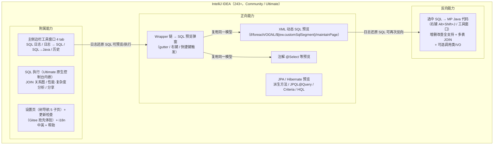
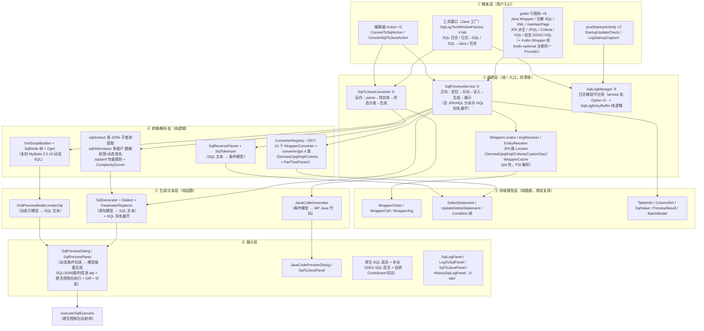
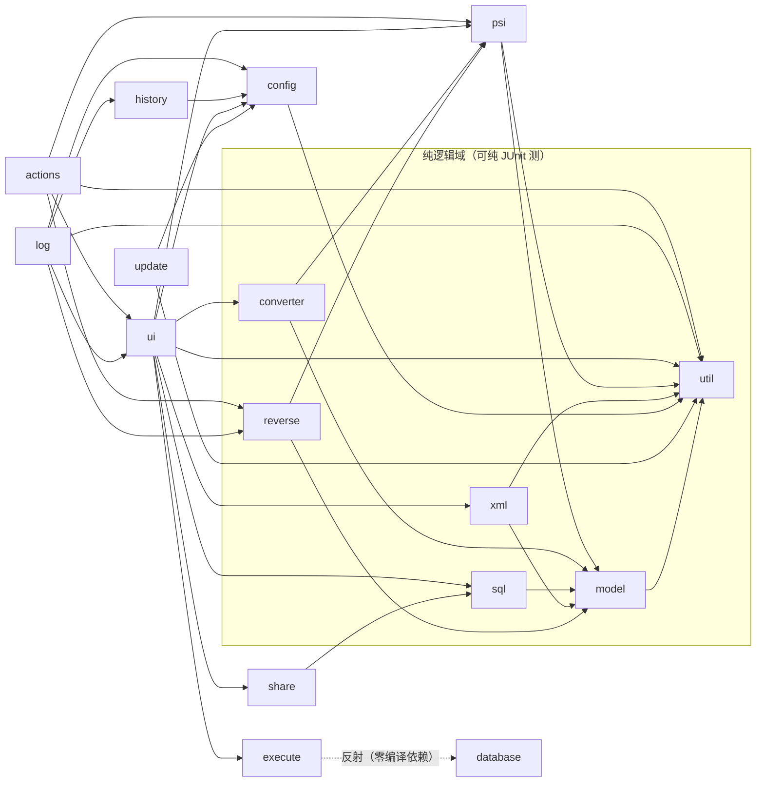
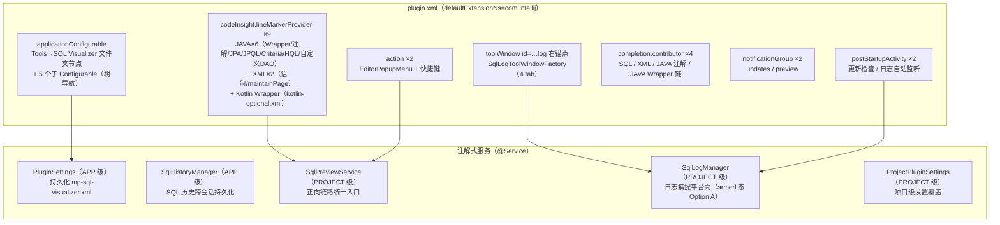
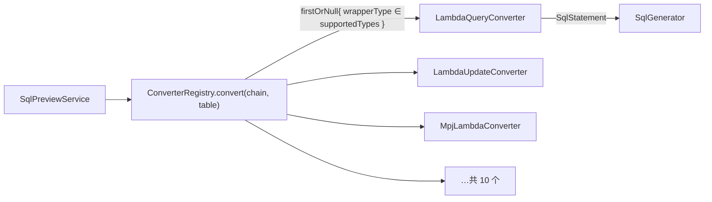

# 01 · 项目架构总览

> 系列文档（docs/架构设计/）：`01` 架构总览（本文）→ `02` 核心流程详解 → `03` 开发与测试指南。
> 本文面向首次接触本仓库的开发者，目标：读完后能回答「项目是什么、代码怎么组织、关键设计为什么这样」。
> 维护约定：随代码演进更新；架构图用 Mermaid，Gitee / Typora 可直接渲染。

---

## 1. 产品定位

**SQL Visualizer**（v2026.8.28 前名 MyBatis-Plus SQL Visualizer，插件 ID 不变）是一款 IntelliJ IDEA 插件（Kotlin 为主源码），围绕 MyBatis-Plus / MyBatis-Plus-Join（MPJ）/ Hibernate / JPA 提供双向能力：

- **正向**：把代码里的 `LambdaQueryWrapper` 等 Wrapper 调用链（含 XML / 注解动态 SQL）、Spring Data JPA 派生方法（findByXxx）、JPQL/@Query、CriteriaBuilder、HQL（含自定义 DAO）实时**转换为可读、可复制的 SQL**，支持参数回填、动态条件勾选、9 种方言、逻辑删除 / 乐观锁 / 分页注入。
- **反向**：把选中/粘贴的 **SQL 文本转换回 MP Java 代码**（QueryWrapper / LambdaQueryWrapper / Wrappers 工厂 / MPJ 等形态）。
- **附属能力**：运行日志捕获还原 + SQL 历史（主侧边栏 4 tab）、SQL 原生控制台执行（Ultimate）、JOIN 关系图、性能/复杂度分析、SQL 分享（Markdown/HTML 报告）、内置更新检查（Gitee 抢先体验通道）、设置页（树导航 5 子页）、中英双语。

### 1.1 技术栈与基线

| 项 | 值 |
|---|---|
| 语言 | Kotlin（JVM toolchain 17）主源码；`src/main/java` 仅 3 个工具窗口工厂类（规避 Kotlin + ToolWindowFactory 的 Verifier Internal API 问题） |
| 插件 ID | `cn.song.mybatisplus.visualizer.mybatis-plus-sql-visualizer`（更名后不变，升级兼容） |
| 插件名 | `SQL Visualizer`（v2026.9.2 起，原 MyBatis-Plus SQL Visualizer） |
| 版本 | 日期式 `YYYY.M.D`（gradle.properties），一日一版 |
| 平台基线 | `intellijIdeaUltimate("2024.3.7.1")`（since-build=243，不设 until-build；日常 IDE 为 2026.2.1） |
| 依赖 | `com.intellij.java`、`com.intellij.modules.xml`、可选 `com.intellij.database`（反射隔离）、可选 `org.jetbrains.kotlin`（Kotlin Wrapper 链 gutter，kotlin-optional.xml） |
| 运行时第三方依赖 | **零**（mybatis-plus-core 3.5.17 仅测试 classpath） |
| 测试 | JUnit 4 + Light/Heavy fixture，232 个测试类，2682 个用例全绿（v2026.9.2 发行基线） |

---

## 2. 分层架构

代码分六层，依赖方向自上而下（上层可依赖下层，禁止反向）：

**分层要点**：

- **③④⑤ 三层为纯函数/纯逻辑**（`model` / `converter` / `sql` / `xml` / `reverse` / `util` 及其子包），不依赖 PSI 与 IDE —— 这是大量纯 JUnit 测试类零 IDE fixture 的基础，也是核心算法可独立验证的关键。
- **③ 模型层是正反向共用的桥梁**：反向解析器（SqlReverseParser）产出的 `Condition` 与正向生成器（SqlGenerator）消费的是同一模型（round-trip 自洽），这是「SQL 能转回代码、代码能再转回 SQL」的根基。
- **② 编排层收敛所有入口**：所有 UI 触发（gutter/Action/面板）都汇入 `SqlPreviewService` 与 `SqlToJavaConverter` 两个编排点，避免 Action 与面板行为漂移（详见第 5 节设计决策）。JPA/Hibernate 六种 gutter 也统一进 `SqlPreviewService`（`previewDerivedQuery` / `previewJpql` / `previewCriteriaQuery` / `previewHql` 等方法族）。

---

## 3. 包模块依赖

源码根：`src/main/kotlin/cn/song/mybatisplus/visualizer/`（下称 `visualizer/`），17 个顶层包（另有 `src/main/java` 下 3 个 Java 工具窗口类）。依赖方向（箭头指向被依赖方）：

| 包 | 职责 | 关键类 |
|---|---|---|
| `actions` | 编辑器入口（2 个 Action） | `ConvertToSqlAction`、`ConvertSqlToJavaAction` |
| `config` | 设置持久化 + 设置页（树导航 1 父 + 5 子页）+ 项目级设置 | `PluginSettings`（@Service APP）、`PluginSettingsFolderConfigurable` + 5 个子 `SectionConfigurable`、`SettingsIO`、`ProjectPluginSettings`（PROJECT 级，`.idea/mp-sql-visualizer-project.xml`）、`UpdateSection` |
| `converter` | Wrapper→语句模型 SPI | `WrapperConverter`（接口）、`ConverterRegistry`、10 个 Converter、`MpjJoinSupport` |
| `converter/jpa` | JPA/Hibernate → SQL 转换 | `DerivedQueryConverter`（+ `PartTreeParser`）、`JpqlConverter`、`HqlConverter`、`CriteriaQueryConverter` |
| `database` | Database 控制台反射桥（仅 Ultimate） | `DatabaseConsoleLauncher` |
| `execute` | 「执行 SQL」链路（原生控制台内嵌 + core 降级） | `SqlExecutor`（prepareConsole/executePrepared/execute 三段链）、`ExecuteSqlSupport`、`DataSourceSelector`、`DataSourceSettings`、`SqlTypeClassifier` |
| `history` | SQL 历史（F-7/F-44）：收藏、搜索、两级导航 | `SqlHistoryManager`（@Service APP，跨会话持久化）、`SqlHistoryPanel`、`SqlHistorySearchBar`、`SqlHistoryEntry` |
| `log` | 主侧边栏工具窗口 4 tab + 日志捕捉 + 跳转源码 | `SqlLogManager`、`SqlLogConsoleBridge`、`MyBatisLogParser`、`HibernateLogParser`、`JdbcTemplateLogParser`、`ExecutionTimeParser`、`SlowQueryDetector`、`LogStatementClassifier`、`LogSqlRestorer`、`SqlLogEntryBuffer`、`SqlLogAutoSaver`、`SqlLogFileReader`、`SqlSourceMarker`、`CallerSourceLocator`、`SqlLogPanel`、`LogToSqlPanel`、`SqlToJavaPanel`、`HistorySqlLogPanel`、`WrapperSearchService` |
| `model` | 领域模型（纯数据类） | `WrapperChain`、`Condition`、`SelectStatement`、`UpdateDeleteStatement`、`TableInfo`、`PreviewResult`、`BatchModel`、`SqlValue`、`ColumnRef` |
| `psi` | PSI 定位与解析 | `WrapperLocator`、`WrapperAnchorDetector`、`WrapperCache`、`ArgResolver`、`ExpressionEvaluator`、`EntityResolver`、`EntityClassFinder`、`BatchOperationConverter` |
| `psi/jpa` | JPA/HQL PSI 定位与实体解析 | `DerivedMethodLocator`、`JpqlQueryLocator`、`HqlQueryLocator`、`CriteriaQueryLocator`、`CustomDaoHqlLocator`、`NamedQueryLocator`、`JpaEntityResolver`、`HbmXmlEntityResolver`（Hibernate XML 映射） |
| `reverse` | SQL→Java 反向链路（增删改查 + 多表 JOIN） | `SqlTokenizer`、`SqlReverseParser`、`JavaCodeGenerator`、`SqlToJavaConverter`、`WrapperFormat` |
| `share` | SQL 分享（F-8）：Markdown / HTML 报告 / 可执行 SQL 三格式 | `SqlShareManager`、`format/MarkdownFormatter`、`format/HtmlReportFormatter`、`format/ExecutableSqlFormatter`、`ui/ShareDialog` |
| `sql` | SQL 生成与文本工具 | `SqlGenerator`、`Dialect`、`DialectRegistry`、`ParameterReplacer`、`JoinDiagramGenerator`（JOIN 图文本）、`ComplexityScorer`、`SqlPerfAnalyzer`、`SqlCommentStripper`；子包 `extract/`（表·JOIN·子查询·SELECT* 提取）、`interceptor/`（多租户增强·数据权限·动态表名模拟）、`perf/`（PerfRule 引擎 + 规则集） |
| `ui` | 预览/弹窗/面板 + gutter + 高亮语言 | `SqlPreviewService`、`SqlPreviewDialog`、`SqlPreviewPanel`（SQL/JOIN 图/列信息 tab + 执行 + Diff + 分享）、`SqlResultPanel`、`SqlSelectionDialog`、`EntitySelectionDialog`、`XmlPreviewService`、`AnnotationSqlPreviewService`、`PagesXmlPreviewService`、子包 `gutter/`×9、`highlight/`（原生 SQL 补全/词法/格式化）、`completion/`（Wrapper 链补全）、`diagram/`（自绘 JOIN 关系图）、`diff/SqlDiffer`、`components/` |
| `update` | 自更新链路（Gitee 抢先体验通道） | `StartupUpdateCheck`、`PluginUpdateRunner`、`UpdateApi`、`PlatformPluginInstaller`、`UpdateSource`、`UpdateManifest`、`VersionComparator`、`VersionIgnore`（忽略此版本） |
| `util` | 跨层工具 | `MpSqlVisualizerBundle`（i18n）、`NamingStrategy`、`PluginBuildInfo` |
| `xml` | MyBatis 动态 SQL 复刻 | `XmlMapperParser`、`XmlScriptBuilder`、`SqlNode` 家族、`TokenParser`、`Ognl`、`DynamicContext`、`XmlEwExpander`、`XmlPreviewModel`、`XmlSqlRenderer` |

> 特殊点一：`database` 只被 `execute` 经**反射**调用（编译期零引用），使插件在 Community 版（无 Database 插件）优雅降级——`execute` 层编译期不知道 `database` 的存在。
> 特殊点二：工具窗口工厂（`SqlLogToolWindowFactory` / `SqlHistoryToolWindowFactory` / `ToolWindowVisibilityListener`）位于 `src/main/java`——Kotlin 实现触发 Verifier Internal API 误报，改用 Java 规避（历史 tab 已并入主侧边栏，History 工厂保留但未注册）。

---

## 4. 运行时组件注册

全部注册集中在一个文件：`src/main/resources/META-INF/plugin.xml`（服务用注解式注册，不在 XML 中）：

| 注册项 | 类型 | 触发/生命周期 |
|---|---|---|
| 9 个 gutter 图标 | LineMarkerProvider | Wrapper（JAVA，Kotlin 走 kotlin-optional.xml 复用同一 Provider）/ 注解（JAVA）/ XML 语句 + maintainPage（XML）/ JPA 派生、JPQL、Criteria、HQL、自定义 DAO HQL（JAVA）；点击 → `SqlPreviewService` |
| 2 个 Action | EditorPopupMenu | `Alt+Shift+Q`（正向）/ `Alt+Shift+J`（反向） |
| 工具窗口 | ToolWindow（right，Java 工厂类） | 4 tab：SQL 日志 / 日志 → SQL / SQL→Java / 历史（F-44 历史并入，独立 toolWindow 注册已注释）；工具栏含「?」帮助（JCEF 内嵌浏览器打开本地 HTML，降级系统浏览器） |
| 设置页 | Configurable（tools 组） | 文件夹节点 + 5 子页（界面与操作 / SQL 预览 / 表名映射 / SQL 日志 / 关于），`SectionConfigurable` 统一基类 |
| 启动活动 ×2 | PostStartupActivity | 更新静默检查（Gitee 抢先体验通道，默认关）；日志自动监听 |
| 补全 ×4 | CompletionContributor | 语言=SQL（预览编辑器原生 SQL）/ XML（mapper + 注解源码补全）/ JAVA（注解 + Wrapper 链上下文补全） |
| 服务 ×5 | 注解 @Service | APP 级 2 个（PluginSettings / SqlHistoryManager）+ PROJECT 级 3 个（SqlPreviewService / SqlLogManager / ProjectPluginSettings） |

---

## 5. 关键设计决策

### 5.1 ConverterRegistry SPI —— 新增 Wrapper 类型零 UI 改动

`WrapperConverter` 接口 = `supportedTypes` + `convert(chain, table)`。新增一种 Wrapper 只需实现接口并追加进 `ConverterRegistry.converters` 列表，UI 层（SqlPreviewService）零改动（F-20 可扩展性要求）。当前注册 10 个：LambdaQuery / LambdaUpdate / LambdaDelete / MpjLambda / MpjQuery / MpjLambdaQuery / QueryWrapper / UpdateWrapper / UpdateJoin / DeleteJoin。

JPA/Hibernate 侧是平行的一族（`converter/jpa`，不进 WrapperConverter SPI）：`DerivedQueryConverter`（findByXxx 派生方法经 `PartTreeParser` 解析条件树）、`JpqlConverter`（JPQL/@Query，含 IN 子句参数识别）、`HqlConverter`（HQL/JPQL 文本 → 原生 SQL，SELECT 裸别名展开为实体列清单）、`CriteriaQueryConverter`（CriteriaBuilder 调用链）。实体解析由 `psi/jpa/JpaEntityResolver`（@Entity/@Table/@Column/@ManyToOne 注解）与 `HbmXmlEntityResolver`（Hibernate XML 映射）承担，与 MP 侧 `EntityResolver` 独立。

### 5.2 共享编排防漂移

项目反复踩过「Action 与面板各写一套逻辑导致行为不一致」的坑，因此：

- **正向**：`SqlPreviewService`（project 服务）是唯一编排点；`showResult` 统一弹窗（Action、gutter、日志面板共用），`previewAsync` 统一后台 ReadAction + EDT 回调（2025.3+ 慢操作守卫）。
- **反向**：`SqlToJavaConverter`（object）被 `ConvertSqlToJavaAction` 与 `SqlToJavaPanel` 双入口复用——parse/generateCode 纯函数、findCandidates 须后台 ReadAction。
- **展示**：`SqlPreviewPanel.renderSql` 统一处理三种渲染源（正向模型 / 批量模型 / XML 模型），面板勾选后按模型级重生成。

### 5.3 WrapperCache 双维度失效

解析结果按 `(PsiFile, 锚点偏移, replaceParams 开关, 表配置签名)` 缓存：

- 文件内容变更（modificationStamp）失效；
- **表配置签名**（推断策略/忽略字段/前缀后缀等 6 项设置）变更失效——修复「改设置后预览不生效」；
- 命中缓存时还校验**实体文件**戳（@TableName/@TableField 注解来源），实体变更重算。

gutter 锚点判定走 `WrapperAnchorDetector.anchorElement` 的 O(1) 纯语法快速路径（不 resolve），满足编辑器行图标性能红线。

### 5.4 反射隔离：Community / Ultimate 双模式

| 场景 | 方案 |
|---|---|
| 执行 SQL（Ultimate Database 插件） | `execute/SqlExecutor` 三段链：`prepareConsole`（面板打开即准备控制台，原生 Database 控制台内嵌到预览面板结果区，不执行）→ `executePrepared`（在已准备控制台上执行）→ `execute`（准备+执行合一）；底层反射 `DatabaseConsoleLauncher`（编译期零引用 database 类；Community 下提示降级）。数据源选择用原生 `DataSourceSelector` 弹窗 |
| 日志控制台挂载（execution API） | `SqlLogConsoleBridge` 反射桥（IPGP 发行版裁剪 `com.intellij.execution`，编译期不可用），`LogFilterProxyHandler` 代理分发 `ConsoleView.Filter` |

### 5.5 其他决策

- **i18n 自管理**：`util/MpSqlVisualizerBundle` 自管 zh/en bundle（默认中文），语言设置独立于 IDE 界面语言（zh/en/AUTO）；平台组件文案（如 cancelAction）须 bundle 显式覆盖。
- **XML 引擎复刻**：`xml/` 包按 mybatis-3.5.19 源码复刻动态 SQL 算法（if/trim/foreach/choose、TokenParser、OGNL 受限求值器、include 内联、`${ew.customSqlSegment}` 占位），与真实 MyBatis 行为对齐（测试逐项对照）。
- **零运行时依赖**：插件 jar 不依赖任何第三方库（MP 注解仅测试期存在），规避依赖冲突与体积问题。
- **版本兼容下限 243**：构建平台 = 最低支持版本 2024.3.7.1，公共 API 向后兼容保证 2025.x/2026.x 可运行；2025.3+ 的慢操作守卫、UiCompatibleDataProvider 等平台差异已按版本适配。
- **预览编辑器原生 SQL 高亮（M34）**：自研 `MP_SQL_Preview` 语言 + parserDefinition/fileType 注册已移除——跨 IDE 语言调度不可靠（全语言注册的 Contributor 不被 `forLanguage` 返回）。现预览编辑器直接用 IDEA 原生 SQL 语言（DatabaseTools `com.intellij.sql.SqlLanguage`）获得高亮，自研补全显式注册 `language="SQL"`；词法/格式化/着色（`ui/highlight/SqlLexer`、`SqlFormatter`、`SqlHighlightColors`）保留用于日志列表 HTML 渲染与非项目文件场景。
- **更新双通道**：稳定版走 JetBrains Marketplace 推送；`autoCheckUpdate` 默认关闭，勾选后进入 **Gitee 抢先体验通道**（只检查 `update/update.json`，`preview.update.json` 为推送前草稿）；通知支持「忽略此版本」（`VersionIgnore` 纯函数，仅抑制自动检查通知，手动检查不受影响）。
- **帮助零网络依赖（M36.5.80）**：工具栏「?」主路径用 JCEF 内嵌浏览器加载插件内置本地 HTML（`docs/发行说明/marketplace-custom-page.html`，纯内联样式）；JCEF 不可用或资源缺失时降级系统浏览器打开在线文档，不再做网络探测。

---

## 6. 速查：从入口到代码

| 我想找 | 去哪看 |
|---|---|
| 正向转换全流程怎么走 | `ui/SqlPreviewService.preview()` → 详见 `02-核心流程详解.md` §2 |
| 如何把 Wrapper 变成 SQL 文本 | `converter/`（模型构建）→ `sql/SqlGenerator.generateWithParams`（文本渲染） |
| JPA/HQL 预览在哪 | `psi/jpa/`（Locator 族）→ `converter/jpa/`（转换器）→ `SqlPreviewService.previewDerivedQuery/previewJpql/previewHql/…`，详见 02 篇 §4 |
| 反向 SQL→Java 在哪实现 | `reverse/`（Tokenizer → Parser → Generator），编排在 `SqlToJavaConverter` |
| 执行 SQL / 原生控制台内嵌 | `execute/SqlExecutor`（三段链）+ `database/DatabaseConsoleLauncher`（反射桥），详见 02 篇 §2.5 |
| 新增一个设置项要改哪 | `config/PluginSettings.State` + 对应子页 `SectionConfigurable` + 消费点（详见 `03` §4.3） |
| 日志捕捉怎么工作 | `log/SqlLogConsoleBridge` → `MyBatisLogParser` → `LogSqlRestorer` → `SqlLogEntryBuffer` → `SqlLogPanel`；批量还原走 `LogToSqlPanel`；跳转源码链路见 02 篇 §6.4 |
| SQL 历史 | 捕捉条目经 `log/SqlLogAutoSaver` 自动落盘 `.idea/sql-visualizer/sql-history/` → `history/HistorySqlLogPanel` 两级导航（文件列表 → 条目列表） |
| 测试怎么组织、怎么跑 | `03-开发与测试指南.md` §2 / §3 |
| 项目历史变更 | `docs/变更记录.md`（任务粒度，唯一权威）+ `CHANGELOG.md`（版本粒度） |
