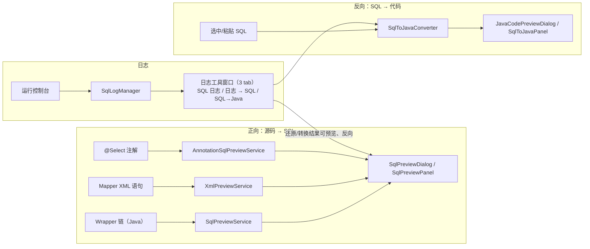
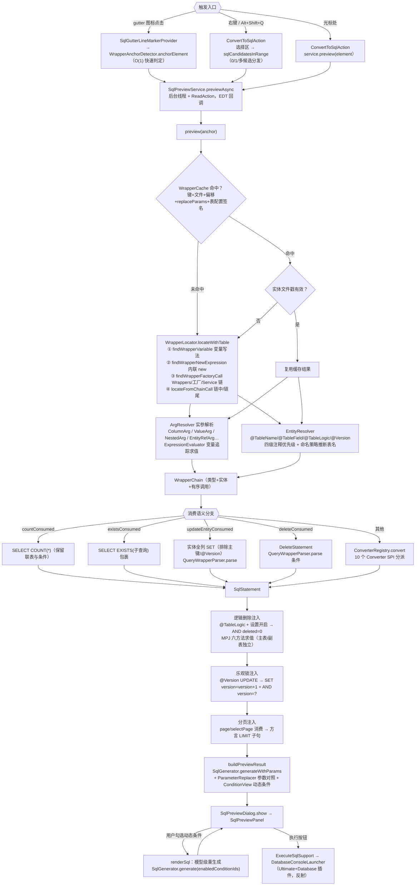
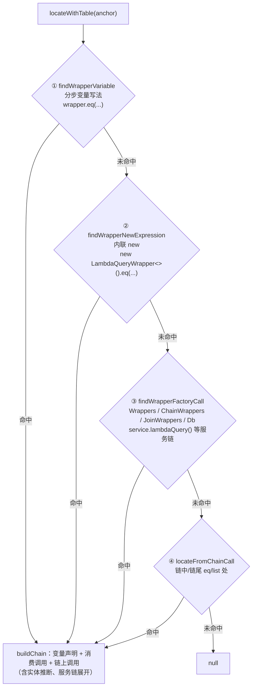
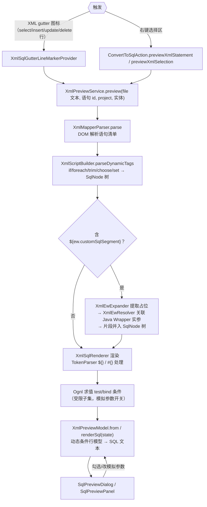
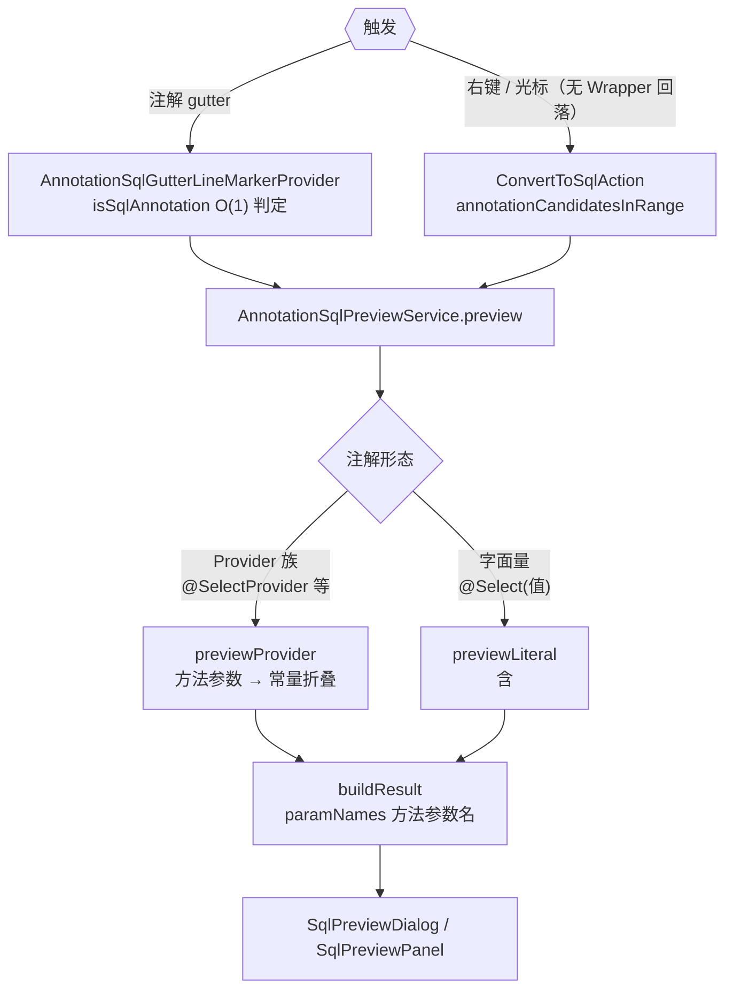
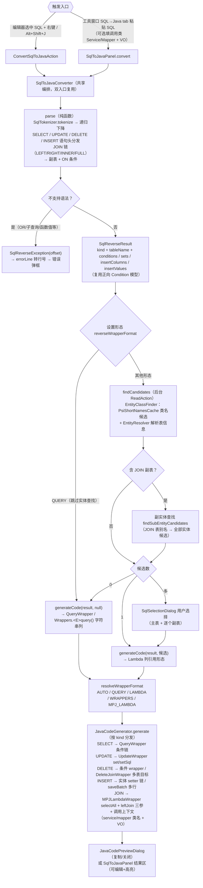
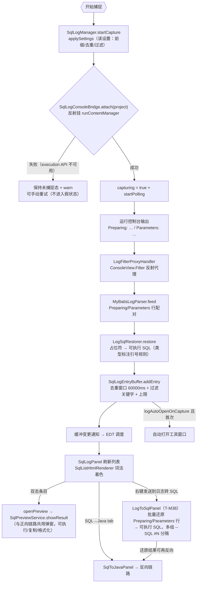
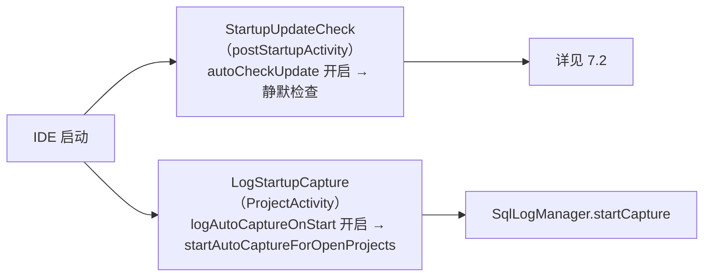
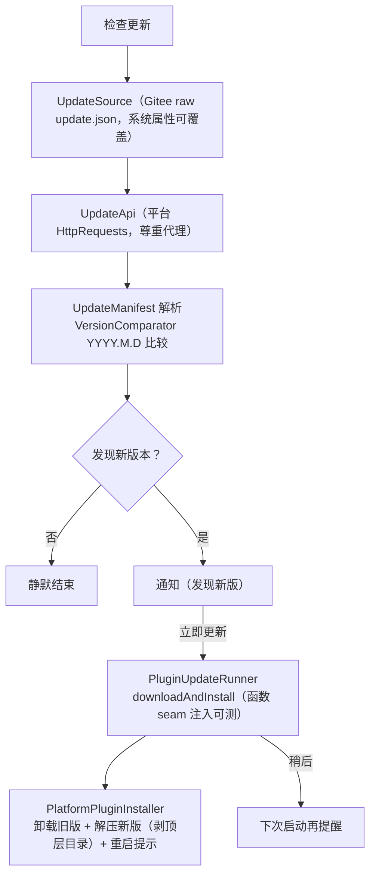

# 02 · 核心流程详解

> 系列文档（docs/架构设计/）：`01` 架构总览 → `02` 核心流程详解（本文）→ `03` 开发与测试指南。
> 本文拆解 6 条核心链路，每条含 Mermaid 流程图 + 关键类方法表 + 数据流说明。源码根：`src/main/kotlin/cn/song/mybatisplus/visualizer/`（下称 `visualizer/`）。

---

## 1. 链路总览

---

## 2. 正向链路：Wrapper 链 → SQL 预览（核心主线）

### 2.1 流程图

### 2.2 关键类与方法

| 环节 | 类.方法 | 说明 |
|---|---|---|
| 触发 | `ui/gutter/SqlGutterLineMarkerProvider.getLineMarkerInfo` | gutter 只做 O(1) 锚点判定，不 resolve |
| 触发 | `actions/ConvertToSqlAction.actionPerformed` | 选择区多 SQL → `SqlSelectionDialog`；XML 走 `previewXmlStatement/previewXmlSelection` |
| 异步 | `ui/SqlPreviewService.previewAsync` | 后台 ReadAction + EDT 回调（2025.3+ 慢操作守卫） |
| 缓存 | `psi/WrapperCache.getOrCompute` | 文件戳 + 表配置签名双维度失效 |
| 定位 | `psi/WrapperLocator.locateWithTable` | 四种定位策略按序尝试（见 2.3） |
| 实参 | `psi/ArgResolver.toWrapperCall` / `resolve` | 方法引用→列、字面量/变量→值、嵌套 lambda→WrapperChain |
| 实体 | `psi/EntityResolver.resolve` / `inferDecoratedTableName` | 注解 + 注释四级优先级 + 命名策略 |
| 分派 | `converter/ConverterRegistry.convert` | `firstOrNull { wrapperType ∈ supportedTypes }` |
| 注入 | `SqlPreviewService.evaluateLogicDeleteState` / `injectOptimisticLockCondition` / `applyPageLimit` | 按源码顺序扫描链调用维护逻辑删除三态 |
| 生成 | `sql/SqlGenerator.generateWithParams` | 纯函数：语句模型 → SQL 文本 + 未解析参数 + 回填提示 |
| 展示 | `ui/SqlPreviewPanel.showResult` / `renderSql` | 三渲染源统一：正向模型/批量模型/XML 模型 |

### 2.3 WrapperLocator 四种定位策略

### 2.4 数据流要点

- **模型贯通**：`WrapperChain`（调用链）→ `SqlStatement`（Select/Update/Delete）→ `GeneratedSql`（文本+参数+提示）→ `PreviewResult`（展示载荷）→ `SqlPreviewModel`（面板动态条件载体）。
- **动态条件**：`Condition.toggle`（ConditionToggle 元数据）→ 面板左栏复选框 → 勾选集合回传 `SqlGenerator.generate(enabledConditionIds)` 模型级重生成（不是文本替换，保证语义一致）。
- **无 WHERE 警示**：UPDATE/DELETE 无条件时 `buildWarning` 红色提示全表操作。
- **批量操作第二路径**：`BatchOperationConverter.convert` 识别 `service.updateBatchById(list)` 等 → `BatchModel.renderSql(activeColumns)` 模板渲染（与 Wrapper 路径平行，共用参数回填与执行按钮）。

---

## 3. XML 子链路：Mapper XML 动态 SQL 预览

### 3.1 流程图

### 3.2 关键类

| 类 | 职责 |
|---|---|
| `xml/XmlMapperParser` | mapper 文件解析：语句清单 + 错误收集 |
| `xml/XmlScriptBuilder` | 复刻 MyBatis 3.5.19 `parseDynamicTags`：DOM → SqlNode 树 |
| `xml/SqlNode` 家族（If/Trim/Foreach/Text） | 节点渲染，foreach 行/次数面板交互 |
| `xml/TokenParser` | `#{}` / `${}` 通用 token 处理（GenericTokenParser 复刻） |
| `xml/Ognl` | 受限 OGNL 子集求值（test/bind/`${}` 判真，对齐 ExpressionEvaluator 两套语义） |
| `xml/XmlIncludeExpander` | `<include refid>` 内联展开 |
| `ui/XmlEwResolver` | `${ew.customSqlSegment}` → Java Wrapper 实参 → SQL 片段 |
| `ui/XmlParamTypeResolver` | mapper 方法签名 → 参数类型 → 回填引号映射 |
| `ui/XmlSqlCompletionContextResolver` | namespace → Mapper 接口 → 主实体/联表候选（补全共用） |
| `xml/XmlPreviewModel` | 动态条件行模型（复选框开关）→ renderSql |

---

## 4. 注解子链路：@Select 等注解预览

---

## 5. 反向链路：SQL → MP Java 代码

### 5.1 流程图

### 5.2 关键类

| 类 | 职责 |
|---|---|
| `reverse/SqlTokenizer` | SQL 词法：WORD/STRING/NUMBER/SYMBOL 四类 token |
| `reverse/SqlReverseParser` | 递归下降解析：语句头分发 SELECT/UPDATE/DELETE/INSERT（T-M36.7）；JOIN 链 → 副表 + ON 条件（T-M37）；不支持语法抛 `SqlReverseException` 带偏移量 |
| `reverse/JavaCodeGenerator` | 按语句 kind 分发生成：SELECT 条件链 / UPDATE set/setSql / DELETE 条件或 DeleteJoinWrapper / INSERT 实体 setter 或 saveBatch 多行；`opMethod` 算子映射、列→字段名映射（EntityTarget）、调用上下文（InvocationTarget：service/mapper + VO）、JOIN 多表 MPJ 渲染 |
| `reverse/WrapperFormat` | 形态枚举 + `resolveWrapperFormat(format, hasEntity)` 纯函数分发 |
| `psi/EntityClassFinder` | 表名 → 实体类候选（类名启发式：snake→Camel 等）；`findSubEntityCandidates` 副实体候选（JOIN 表） |

**多表 JOIN 支持（T-M37）**：解析层把 JOIN 链转为结构化条件（ON 等值列对 → `ColumnComparison`，多条件/非等值收集原文透传；WHERE 条件列保留表别名归属）；生成层按主实体可用性分发——主实体可用 → `MPJLambdaWrapper` + `selectAll()` + 三参 `leftJoin(副.class, 副::getX, 主::getY)`（ON 多条件回落字符串 join 形态）；主实体缺失 → `MPJQueryWrapper<>(类.class)`；副实体缺失回落带前缀字符串列名。副表多候选时面板按 JOIN 顺序逐个弹选择框。

### 5.3 形态分发矩阵（`resolveWrapperFormat`）

| 设置形态 | 有实体 | 无实体 |
|---|---|---|
| AUTO（默认） | LambdaQueryWrapper | QueryWrapper |
| QUERY | QueryWrapper（**跳过实体查找**） | QueryWrapper |
| LAMBDA | LambdaQueryWrapper | QueryWrapper |
| WRAPPERS | `Wrappers.<E>lambdaQuery()` + lambda 列 | `Wrappers.<E>query()` + 字符串列 |
| MPJ_LAMBDA | MPJLambdaWrapper | QueryWrapper |

### 5.4 双入口一致性

`SqlToJavaConverter` 是唯一编排点：`parse` / `errorLine` / `findCandidates` / `generateCode` 四个职责被 Action 与工具窗口面板完全复用；面板额外做输入区补全/格式化、形态下拉（下拉写穿持久化 + tab 重选刷新，suppress 防误触发重生成）、调用类/VO 类选择器（`ClassPickerField`：Goto Class 选择器选项目 Java 类，选中/清除后自动重生成，T-M39）。

---

## 6. 日志捕获链路：运行控制台 → 还原 SQL

### 6.1 流程图

### 6.2 关键类与设置消费

| 类 | 职责 | 关联设置 |
|---|---|---|
| `log/SqlLogManager`（PROJECT 服务） | 平台壳：capturing 状态机、缓冲订阅调度、自动打开窗口 | `logAutoOpenOnCapture`、`logDedupeWindowMs`、`logFilterKeywords` |
| `log/SqlLogConsoleBridge` | 反射桥（execution API 不在编译 classpath）；attach/detach/polling | — |
| `log/LogFilterProxyHandler` | ConsoleView.Filter 反射代理分发 | — |
| `log/MyBatisLogParser` | 行配对解析（前缀可配置；`logMixedPrefix` 兼容 `==>` 格式） | `logSqlPrefix`、`logParamPrefix`、`logMixedPrefix`、`logMaxParseLength` |
| `log/LogSqlRestorer` | `?` → 实际值还原（String 加引号、数字原样、时间格式） | — |
| `log/SqlLogEntryBuffer` | 纯逻辑缓冲（去重/暂停/上限/监听器，纯 JUnit 可测） | 见上 |
| `log/SqlListHtmlRenderer` | 列表条目 SQL 着色（SqlLexer 分词 + 主题色） | — |
| `log/LogToSqlPanel` | 「日志 → SQL」tab（T-M38）：批量还原日志行（复用 parser + restorer；`LogSqlEntry.toLogText` 与右键发送 round-trip），多组 `-- SQL #N` 分隔、参数不足红字警告、单行/多行切换 | `logSqlPrefix` 等（同源读设置） |
| `log/HelpDialog` | 工具栏「?」帮助弹窗（T-M39）：四节内容（核心功能/使用方法/快捷键/反馈）i18n 双语，主题化 HTML 渲染 | — |
| `log/LogStartupCapture` | postStartupActivity：设置开启时对已打开项目自动监听 | `logAutoCaptureOnStart` |
| `log/SqlLogToolWindowFactory` | 工具窗口工厂（三 tab：SQL 日志 / 日志 → SQL / SQL→Java + 工具栏帮助） | — |

---

## 7. 启动与自更新链路

### 7.1 启动链路

### 7.2 自更新链路（M28）

---

## 8. 常见问题速查（链路定位）

| 现象/需求 | 定位方向 |
|---|---|
| 某 Wrapper 方法转换不对 | `converter/QueryWrapperParser` 方法级映射（`eqOrIsNull`/`like`/`inList`/`parseGroup`…）或对应类型 Converter |
| SQL 渲染格式不对 | `sql/SqlGenerator`（多行/单行、缩进、关键字引用） |
| 方言差异 | `sql/Dialect` + `DialectRegistry`（renderLimit/引号） |
| 表名/列名推断不对 | `psi/EntityResolver.inferDecoratedTableName` + `config` 表映射设置 |
| 反向解析报错 | `reverse/SqlReverseParser` 的明确不支持清单（OR/子查询/函数值/`?` 占位符等；JOIN 与增删改查已支持） |
| 日志条目不出现 | `log/SqlLogConsoleBridge.attach` 失败路径 + `MyBatisLogParser` 前缀配置 |
| 动态条件面板不对 | `model/Condition.toggle` 元数据 + `SqlPreviewPanel.renderSql` 重生成 |
