# 02 · 核心流程详解

> 系列文档（docs/架构设计/）：`01` 架构总览 → `02` 核心流程详解（本文）→ `03` 开发与测试指南。
> 本文拆解 6 条核心链路，每条含 Mermaid 流程图 + 关键类方法表 + 数据流说明。源码根：`src/main/kotlin/cn/song/mybatisplus/visualizer/`（下称 `visualizer/`）。

---

## 1. 链路总览

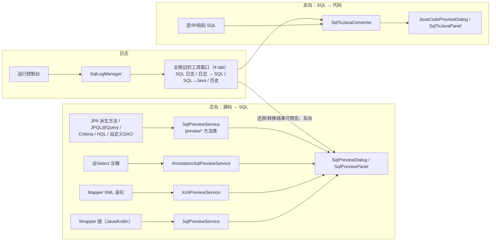

---

## 2. 正向链路：Wrapper 链 → SQL 预览（核心主线）

### 2.1 流程图

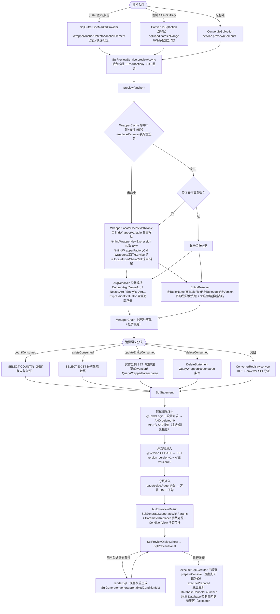

### 2.2 关键类与方法

| 环节 | 类.方法 | 说明 |
|---|---|---|
| 触发 | `ui/gutter/SqlGutterLineMarkerProvider.getLineMarkerInfo` | gutter 只做 O(1) 锚点判定，不 resolve（Kotlin 语言复用同一 Provider，经 kotlin-optional.xml 注册） |
| 触发 | `actions/ConvertToSqlAction.actionPerformed` | 选择区多 SQL → `SqlSelectionDialog`；XML 走 `previewXmlStatement/previewXmlSelection` |
| 异步 | `ui/SqlPreviewService.previewAsync` | 后台 ReadAction + EDT 回调（2025.3+ 慢操作守卫） |
| 缓存 | `psi/WrapperCache.getOrCompute` | 文件戳 + 表配置签名双维度失效 |
| 定位 | `psi/WrapperLocator.locateWithTable` | 四种定位策略按序尝试（见 2.3） |
| 实参 | `psi/ArgResolver.toWrapperCall` / `resolve` | 方法引用→列、字面量/变量→值、嵌套 lambda→WrapperChain |
| 实体 | `psi/EntityResolver.resolve` / `inferDecoratedTableName` | 注解 + 注释四级优先级 + 命名策略 |
| 分派 | `converter/ConverterRegistry.convert` | `firstOrNull { wrapperType ∈ supportedTypes }` |
| 注入 | `SqlPreviewService.evaluateLogicDeleteState` / `injectOptimisticLockCondition` / `applyPageLimit` | 按源码顺序扫描链调用维护逻辑删除三态 |
| 生成 | `sql/SqlGenerator.generateWithParams` | 纯函数：语句模型 → SQL 文本 + 未解析参数 + 回填提示 |
| 展示 | `ui/SqlPreviewPanel.showResult` / `renderSql` | 三渲染源统一：正向模型/批量模型/XML 模型 |

### 2.3 WrapperLocator 四种定位策略

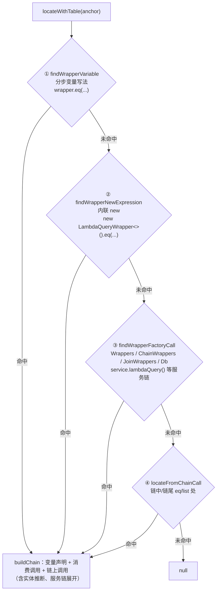

### 2.4 数据流要点

- **模型贯通**：`WrapperChain`（调用链）→ `SqlStatement`（Select/Update/Delete）→ `GeneratedSql`（文本+参数+提示）→ `PreviewResult`（展示载荷）→ `SqlPreviewModel`（面板动态条件载体）。
- **动态条件**：`Condition.toggle`（ConditionToggle 元数据）→ 面板左栏复选框 → 勾选集合回传 `SqlGenerator.generate(enabledConditionIds)` 模型级重生成（不是文本替换，保证语义一致）。
- **无 WHERE 警示**：UPDATE/DELETE 无条件时 `buildWarning` 红色提示全表操作。
- **批量操作第二路径**：`BatchOperationConverter.convert` 识别 `service.updateBatchById(list)` 等 → `BatchModel.renderSql(activeColumns)` 模板渲染（与 Wrapper 路径平行，共用参数回填与执行按钮）。

### 2.5 执行链路（M36：原生 Database 控制台内嵌）

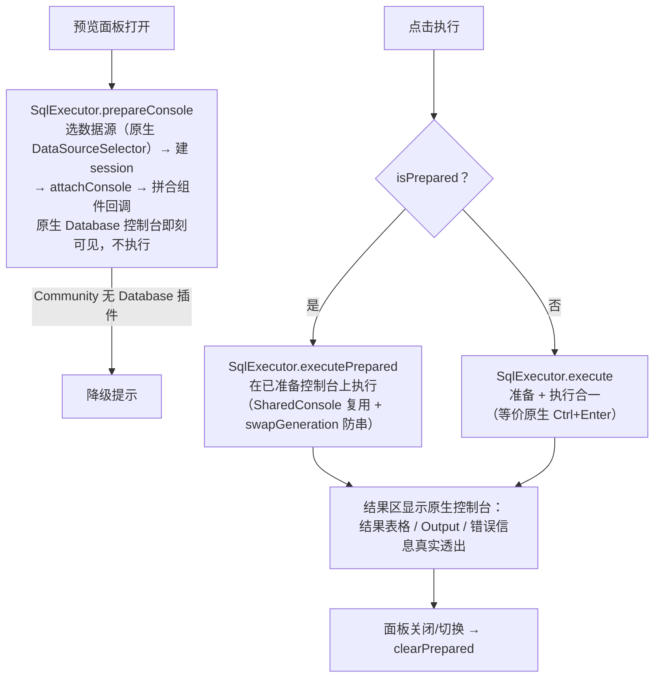

要点：

- **原生组件而非自研结果面板**：执行走 IDEA Database 插件完整控制台（方言预映射、事务保护、错误展示全套平台能力），预览面板以持久 SplitPane 换底方式内嵌；跨预览共享控制台治连接挂死，`swapGeneration` + `REUSE_ACCEPT_TICKS` 治「滞后一轮」与布局闪烁（详见 `docs/MEMORY.md` 与 M36.5 系列开发计划）。
- **Community 兼容**：`SqlExecutor` 编译期零引用 database 类，运行时经反射桥 `database/DatabaseConsoleLauncher` 解析；无 Database 插件时执行按钮降级提示。
- **执行临时文件**：SQL 写 `.idea/sql-visualizer/exec/`（目录常量 `SqlLogAutoSaver.DATA_DIR_NAME`，随插件更名迁移，不考虑向前兼容），document 驱动三方同步防 File Cache Conflict。

---

## 3. XML 子链路：Mapper XML 动态 SQL 预览

### 3.1 流程图

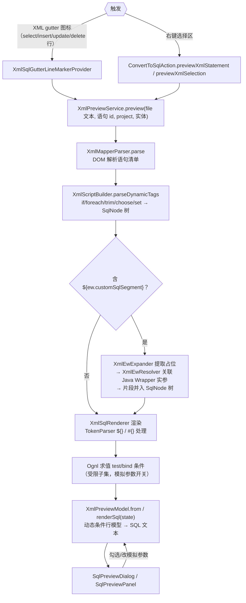

### 3.2 关键类

| 类 | 职责 |
|---|---|
| `xml/XmlMapperParser` | mapper 文件解析：语句清单 + 错误收集 |
| `xml/XmlScriptBuilder` | 复刻 MyBatis 3.5.19 `parseDynamicTags`：DOM → SqlNode 树 |
| `xml/SqlNode` 家族（If/Trim/Foreach/Text） | 节点渲染，foreach 行/次数面板交互 |
| `xml/TokenParser` | `#{}` / `${}` 通用 token 处理（GenericTokenParser 复刻） |
| `xml/Ognl` | 受限 OGNL 子集求值（test/bind/`${}` 判真，对齐 ExpressionEvaluator 两套语义） |
| `xml/XmlIncludeExpander` | `<include refid>` 内联展开 |
| `ui/XmlEwResolver` | `${ew.customSqlSegment}` → Java Wrapper 实参 → SQL 片段 |
| `ui/XmlParamTypeResolver` | mapper 方法签名 → 参数类型 → 回填引号映射 |
| `ui/XmlSqlCompletionContextResolver` | namespace → Mapper 接口 → 主实体/联表候选（补全共用） |
| `xml/XmlPreviewModel` | 动态条件行模型（复选框开关）→ renderSql |

---

## 4. 注解与 JPA/Hibernate 子链路

### 4.1 MyBatis 注解（@Select 等）

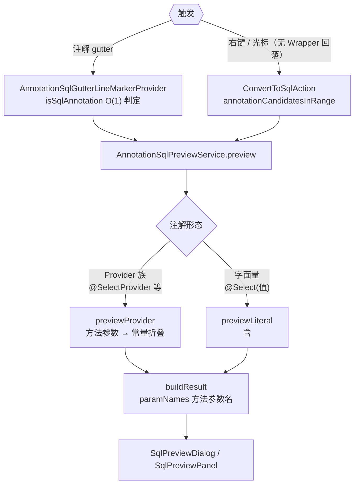

### 4.2 JPA / Hibernate（F-14/F-45 系列）

六种 gutter（均注册进 `SqlPreviewService` 方法族，实体解析由 `psi/jpa/JpaEntityResolver`（注解）与 `HbmXmlEntityResolver`（Hibernate XML 映射 .hbm.xml）承担）：

| 入口（gutter / 右键） | Locator（psi/jpa） | 转换器（converter/jpa） | 说明 |
|---|---|---|---|
| Repository 派生方法 `findByXxx` | `DerivedMethodLocator` | `DerivedQueryConverter` + `PartTreeParser` | 方法名 → 条件树（PartTree 语法），SQL 含 `?` 占位符 |
| `@Query` 注解（JPQL 或原生 SQL） | `JpqlQueryLocator` | `JpqlConverter`（IN 子句参数识别） | JPQL 转原生 SQL；named 参数 `:name` 回填 |
| CriteriaQuery 调用链（cq.from/cb.equal…） | `CriteriaQueryLocator` | `CriteriaQueryConverter` | 解析 CriteriaBuilder 链式调用 |
| HQL（session.createQuery） | `HqlQueryLocator` | `HqlConverter` | 多行/字符串拼接（PsiPolyadicExpression）均识别；**M36.7：SELECT 裸别名展开为实体列清单**（`SELECT u` → 全列，无 SELECT 自动补列清单；JOIN 副表/元数据缺失降级 `alias.*`）——修复 MySQL `Unknown column 'u'` |
| 自定义 DAO（commonDao.findByQuery 等） | `CustomDaoHqlLocator` | `HqlConverter` | 自定义 DAO 方法内的 HQL 识别 |
| 命名查询 | `NamedQueryLocator` | `HqlConverter` | @NamedQuery / XML 命名查询 |

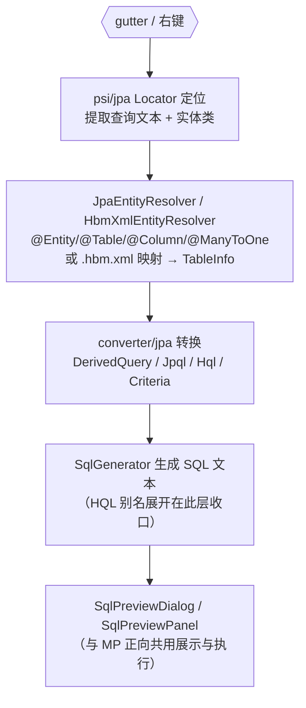

展示层完全复用 MP 正向链路的 `SqlPreviewDialog` / `SqlPreviewPanel`（动态条件勾选、参数回填、执行、Diff），差异只在「定位 + 转换」两段。

---

## 5. 反向链路：SQL → MP Java 代码

### 5.1 流程图

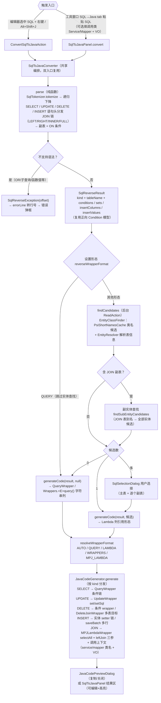

### 5.2 关键类

| 类 | 职责 |
|---|---|
| `reverse/SqlTokenizer` | SQL 词法：WORD/STRING/NUMBER/SYMBOL 四类 token |
| `reverse/SqlReverseParser` | 递归下降解析：语句头分发 SELECT/UPDATE/DELETE/INSERT（T-M36.7）；JOIN 链 → 副表 + ON 条件（T-M37）；`?` 参数占位符 → `SqlValue.Placeholder`（WHERE/SET/INSERT/LIMIT 全支持，生成 `"?"` 占位由用户替换）；不支持语法抛 `SqlReverseException` 带偏移量 |
| `reverse/JavaCodeGenerator` | 按语句 kind 分发生成：SELECT 条件链 / UPDATE set/setSql / DELETE 条件或 DeleteJoinWrapper / INSERT 实体 setter 或 saveBatch 多行；`opMethod` 算子映射、列→字段名映射（EntityTarget）、调用上下文（InvocationTarget：service/mapper + VO）、JOIN 多表 MPJ 渲染；SELECT 调用形态（方法名经 MP/MPJ jar 实证）：分页（LIMIT）→ `page/selectPage`、VO（≠ 实体名）→ `selectJoinList(Vo.class, wrapper)`（强制 MPJ wrapper——参数类型 MPJBaseJoin）、分页+VO → `selectJoinListPage/selectJoinPage(page, Vo.class, wrapper)`；调用类 → 驼峰首字母小写实例变量（`bannerService.page(...)`）；多表形态：join 可三参 lambda 化 → MPJLambdaWrapper，否则回落 MPJQueryWrapper（字符串 join 仅 StringJoin 合法）；多表删除 → `new DeleteJoinWrapper<>(主.class)` + `.delete("t", "t1")`，无法映射时报错 |
| `reverse/WrapperFormat` | 形态枚举 + `resolveWrapperFormat(format, hasEntity)` 纯函数分发 |
| `psi/EntityClassFinder` | 表名 → 实体类候选，两级查找：类名启发式（snake→Camel + `Entity` 后缀变体）快路径 → 未命中时全量扫描 `@TableName` 注解值/推断表名反查（实体命名与表名驼峰不一致时兜底，如 `AccountRoleRelEntity` ↔ `sys_account_role_rel`）；`findSubEntityCandidates` 副实体候选（JOIN 表） |
| `ui/EntitySelectionDialog` | 手动选择实体弹窗（可选开关 `reverseManualEntitySelection` 控制）：按 SQL 涉及的表逐行分组（主表 + JOIN 副表），自动候选预选第一个、行内 Goto Class 手动挑选、✕ 清除；多表 JOIN 一次多选（替代逐表弹窗）；主表 0 候选时单行弹窗兜底，取消回落字符串列名；开关关闭 → 纯自动推断（0 候选回落、多候选取第一个，不弹任何选择框） |

**多表 JOIN 支持（T-M37）**：解析层把 JOIN 链转为结构化条件（ON 等值列对 → `ColumnComparison`，多条件/非等值收集原文透传；WHERE 条件列保留表别名归属）；生成层按主实体可用性分发——主实体可用 → `MPJLambdaWrapper` + `selectAll()` + 三参 `leftJoin(副.class, 副::getX, 主::getY)`（ON 多条件回落字符串 join 形态）；主实体缺失 → `MPJQueryWrapper<>(类.class)`；副实体缺失回落带前缀字符串列名。副表多候选时面板按 JOIN 顺序逐个弹选择框。

### 5.3 形态分发矩阵（`resolveWrapperFormat`）

| 设置形态 | 有实体 | 无实体 |
|---|---|---|
| AUTO（默认） | LambdaQueryWrapper | QueryWrapper |
| QUERY | QueryWrapper（**跳过实体查找**） | QueryWrapper |
| LAMBDA | LambdaQueryWrapper | QueryWrapper |
| WRAPPERS | `Wrappers.<E>lambdaQuery()` + lambda 列 | `Wrappers.<E>query()` + 字符串列 |
| MPJ_LAMBDA | MPJLambdaWrapper | QueryWrapper |

### 5.4 双入口一致性

`SqlToJavaConverter` 是唯一编排点：`parse` / `errorLine` / `findCandidates` / `generateCode` 四个职责被 Action 与工具窗口面板完全复用；`invocationHasMpj` 按调用类名检索并遍历继承链（接口 + 父类递归）实证 MPJ 能力（`MPJBaseService`/`JoinService`/`MPJBaseMapper`/`JoinMapper`，1.5.6 实证接口），结果经 `InvocationTarget.mpj` 驱动生成器——无 MPJ 能力时 VO 回落实体查询（注释提示）、多表 JOIN/删除明确报错；面板额外做输入区补全/格式化、形态下拉（下拉写穿持久化 + tab 重选刷新，suppress 防误触发重生成）、调用类/VO 类选择器（`ClassPickerField`：Goto Class 选择器选项目 Java 类，选中/清除后自动重生成，T-M39）。

---

## 6. 日志捕获链路：运行控制台 → 还原 SQL

### 6.1 流程图

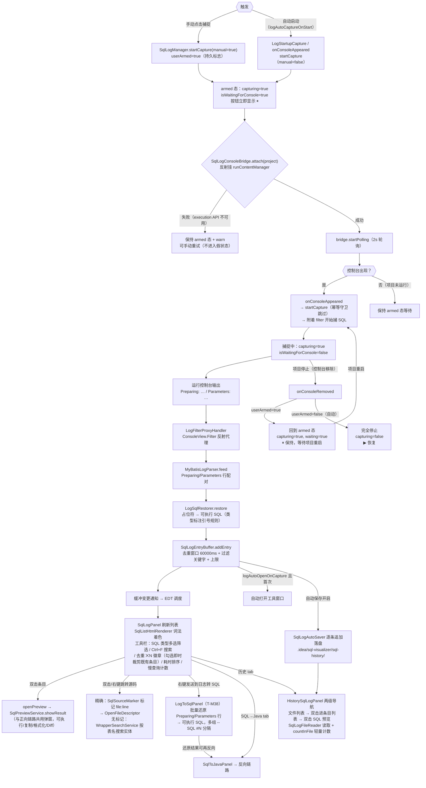

### 6.2 关键类与设置消费

| 类 | 职责 | 关联设置 |
|---|---|---|
| `log/SqlLogManager`（PROJECT 服务） | 平台壳：capturing 状态机、缓冲订阅调度、自动打开窗口 | `logAutoOpenOnCapture`、`logDedupeWindowMs`、`logFilterKeywords` |
| `log/SqlLogConsoleBridge` | 反射桥（execution API 不在编译 classpath，`Class.forName` 显式用**平台 classloader**——插件 classloader 子类看不到父类）；attach/detach/polling；`hasMainConsole()` 检查主控制台进程存活（`ProcessHandler.isProcessTerminated()`——`getAllDescriptors()` 进程死后仍返回旧 tab，须额外检查进程状态） | — |
| `log/LogFilterProxyHandler` | ConsoleView.Filter 反射代理分发 | — |
| `log/MyBatisLogParser` | 行配对解析（前缀可配置；`logMixedPrefix` 兼容 `==>` 格式）；Parameters 行喂入后**立即闭合**生成条目（原等下一句 Preparing 才闭合，致第一条 SQL 延迟显示 + 同 SQL 去重时序错乱） | `logSqlPrefix`、`logParamPrefix`、`logMixedPrefix`、`logMaxParseLength` |
| `log/HibernateLogParser` / `log/JdbcTemplateLogParser` | Hibernate 与 JdbcTemplate 日志格式识别（与 MyBatis parser 并行的另外两族来源） | 对应前缀设置 |
| `log/ExecutionTimeParser` | p6spy / MP TimeCount / 自定义前缀耗时解析 → `LogSqlEntry.executionTimeMs`（bridge 每次喂行前调用；此前从未接线，耗时恒 null——F-44-2 root fix） | `logTimePrefix` |
| `log/SlowQueryDetector` / `LogStatementClassifier` | 慢查询计数（阈值色 <100ms 灰 / ≥100ms 橙 / ≥阈值 红）与 SQL 类型分类（SELECT/UPDATE/…，驱动类型筛选弹窗） | `slowQueryThresholdMs` |
| `log/LogSqlRestorer` | `?` → 实际值还原（String 加引号、数字原样、时间格式） | — |
| `log/SqlLogEntryBuffer` | 纯逻辑缓冲（去重/暂停/上限/监听器，纯 JUnit 可测；`dedupeExisting` 勾选去重时立即裁剪既有条目，去重丢弃分支也通知——⨉N 徽章一帧同步） | 见上 |
| `log/SqlLogAutoSaver` / `SqlLogFileReader` | 自动保存（逐条追加 `.idea/sql-visualizer/sql-history/`，`-- source: … --` 标准注释头）与读取（兼容 2/3 横线新旧格式、`countInFile` 轻量条数统计）；`DATA_DIR_NAME` 统一目录常量 | 自动保存设置 |
| `log/SqlSourceMarker` / `CallerSourceLocator` | F-44-6 精确跳转：解析应用侧 `SQLVIS-SOURCE|path|line` 标记行（见 §6.4）；`CallerSourceLocator` 为调用栈→用户代码帧纯函数（自 v2026.9.2 起仅 Instrumentation 方案使用） | — |
| `log/SqlListHtmlRenderer` | 列表条目 SQL 着色（SqlLexer 分词 + 主题色；M46 一度移除 HTML 通道致高亮丢失，F-44-2 回滚恢复） | — |
| `log/WrapperSearchService` | 无源码标记时的回退跳转：按 SQL 表名后台搜索项目实体/Wrapper（近似，可能落空） | — |
| `log/LogToSqlPanel` | 「日志 → SQL」tab（T-M38）：批量还原日志行（复用 parser + restorer；`LogSqlEntry.toLogText` 与右键发送 round-trip），多组 `-- SQL #N` 分隔、参数不足红字警告、单行/多行切换 | `logSqlPrefix` 等（同源读设置） |
| `log/SqlLogPanel.HelpAction` | 工具栏「?」：JCEF 内嵌浏览器加载**本地** HTML（classpath 资源 `src/main/resources/html/marketplace-custom-page.html`，纯内联样式；v2026.9.11 起单源，docs/发行说明 旧副本已删除）；JCEF 不可用/资源缺失 → 系统浏览器降级（M36.5.80 定稿，HelpDialog 弹窗已移除） | — |
| `log/LogStartupCapture` | postStartupActivity：设置开启时项目打开即进入 armed 态；`suppressed=true` 时调 `startListeningOnly()`（不进入 armed） | `logAutoCaptureOnStart`、`logAutoCaptureSuppressed` |
| `log/ProjectListenerRegistrar` | `object`（非 `@Service(APP)`——262 平台 @Service(APP) 默认懒加载，无代码访问则不实例化，listener 永不注册），由 `LogStartupCapture.execute()` 调用 `registerIfNeeded()` 注册 messageBus listener | `logAutoCaptureOnStart` |
| `log/SqlLogToolWindowFactory`（Java，`src/main/java`） | 工具窗口工厂（四 tab：SQL 日志 / 日志转 SQL / SQL→Java / 历史 + 工具栏帮助；Kotlin 实现触发 Verifier 误报故用 Java） | — |

### 6.3 监听生命周期设计（Project 级，非模块级）

`SqlLogManager` 是 `@Service(Service.Level.PROJECT)`，整个 Project **只有一个 capturing 状态位**，不区分模块：

#### 状态机（4 个核心标志）

| 标志 | 含义 | 持久化 | 按钮 |
|---|---|---|---|
| `capturing` | 是否开启监听（armed 或捕捉中） | 内存 | true=⏸ / false=▶ |
| `isWaitingForConsole` | 是否等待控制台出现 | 内存 | tooltip 提示 |
| `userArmed` | 手动开启（跨项目生命周期持久） | 内存 | 决定项目停止后行为 |
| `logAutoCaptureSuppressed` | 用户显式停止自动启动（跨重启持久） | **XML** | 阻止项目打开时 armed 态 |

#### 状态转换

```
[空闲] --点击捕捉(manual=true)--> [armed: capturing=true, waiting=true, userArmed=true, suppressed=false]
[armed] --项目启动(console出现)--> [捕捉中: capturing=true, waiting=false]
[捕捉中] --项目停止(console移除)--> [armed: waiting=true]（userArmed=true && !autoStart 持久）
                                     [完全停止: capturing=false]（其他情况）
[armed] --项目启动--> [捕捉中]
[任意] --点击停止--> [空闲]（autoStart 开启时置 suppressed=true）
```

#### 手动 vs 自动（`userArmed` + `logAutoCaptureSuppressed`）

- **手动开启**（点击「捕捉」按钮）：`startCapture(manual=true)` → `userArmed=true` + 清 `suppressed`。项目停止后回到 armed 态（⏸ 保持），项目重启自动恢复捕捉。
- **自动开启**（`logAutoCaptureOnStart=true`）：`startCapture(manual=false)` → `userArmed=false`。项目停止后完全停止（▶ 恢复），项目重启再次自动捕捉。
- **手动+自动同时开启**：自动启动优先——项目停止后完全停止。守卫：`userArmed=true && !autoStart` → armed 态；否则完全停止。
- **用户显式停止 + autoStart 开启**：`suppressed=true`（持久化到 XML）。

#### `suppressed` 标志规则（设置优先）

| 操作 | suppressed |
|------|------------|
| 用户点"停止" + autoStart 开启 | → `true` |
| 项目启动（onConsoleAppeared）+ autoStart | → `false`（设置优先） |
| 用户手动点捕捉 | → `false` |
| 设置里关→开 autoStart | → `false` |

#### `startListeningOnly()`（suppressed 模式）

当 `suppressed=true` 时 `LogStartupCapture` 不进入 armed 态，但仍需检测项目启动（项目启动时 `onConsoleAppeared` 自动捕捉）。故 `startListeningOnly()` 挂载桥 + 启动轮询，但不设 `capturing=true`（不显示 armed）。轮询检测控制台出现 → `onConsoleAppeared` → `autoStart=true` 时清 `suppressed` + 自动捕捉。

#### 项目级语义

- **按钮状态 = `manager.capturing`**：`CaptureAction.update()` 仅读这一标志位决定图标/文案。
- **监听对象 = 本 Project 的 RunContentManager**：`bridge.attach(project)` 反射挂载到本项目的运行控制台，2s 轮询扫描 `getAllDescriptors()` 所有 console。
- **多模块场景**：单 Project 多模块运行时，bridge 自动扫描全部 console 输出；某个模块停止 → console 消失，但 `capturing` 不变 → 按钮保持 ⏸，剩余模块继续被监听，新启动模块 2s 内自动挂载。
- **多项目场景**：每个 Project 独立一个 `SqlLogManager` + 一个 bridge，各项目监听生命周期互不干扰；`logAutoCaptureOnStart` 是 APP 级设置，值共享但触发独立。
- **设置页行为**：勾选「项目启动时自动开始监听」后由 `LogStartupCapture`（postStartupActivity）触发进入 armed 态，项目启动运行后自动开始捕捉。`SectionConfigurable.apply()`（设置子页基类，SQL 日志等子页共用）检测"关→开"变更时立即进入 armed 态（`suppressed=false` 时）——项目已打开后才开启设置由此入口生效（20260907-1617 自未注册的 PluginSettingsConfigurable 迁入）。
- **项目停止检测**：`scanAll()` 每 2s 检测主控制台（`ConsoleViewImpl`）进程是否存活——`getAllDescriptors()` 在进程死后仍返回旧 tab（tab 保留），故须额外检查 `ProcessHandler.isProcessTerminated()` + `isProcessTerminating()`；进程死 → `hasMainConsole()` 返回 false → `onConsoleRemoved()`。
- **回调作用域陷阱**：bridge 构造时 `.apply { onConsoleRemoved = { this@SqlLogManager.onConsoleRemoved() } }` 必须用 `this@SqlLogManager` 显式指定 receiver——`.apply` 的 receiver 是 bridge，省略则 `onConsoleRemoved()` 解析为 bridge 自己的字段（默认空实现），导致项目停止时回调永不触发。
- **图标刷新方案**：不用 `ActionToolbar.updateActionsAsync()`（沙盒中 `MyUpdateRunnable.run()` 检查 `!isShowing` 跳过更新），改用 `UIUtil.uiTraverser()` 遍历组件树 + 反射 `getAction()` 匹配 `CaptureAction` 直接 `setIcon()` + `repaint()`（详见 `pitfall-actiontoolbar-refresh-api`）。

### 6.4 跳转源码链路（F-44-6，v2026.9.2）

控制台 SQL 日志本身不含调用位置，旧方案「按表名猜实体」常跳不准，且旧 `extractSourceLocation` 在 **IDE 控制台线程**取调用栈（只有 JDK/IntelliJ/插件帧），`sourceFile/sourceLine` 恒空。现行双轨：

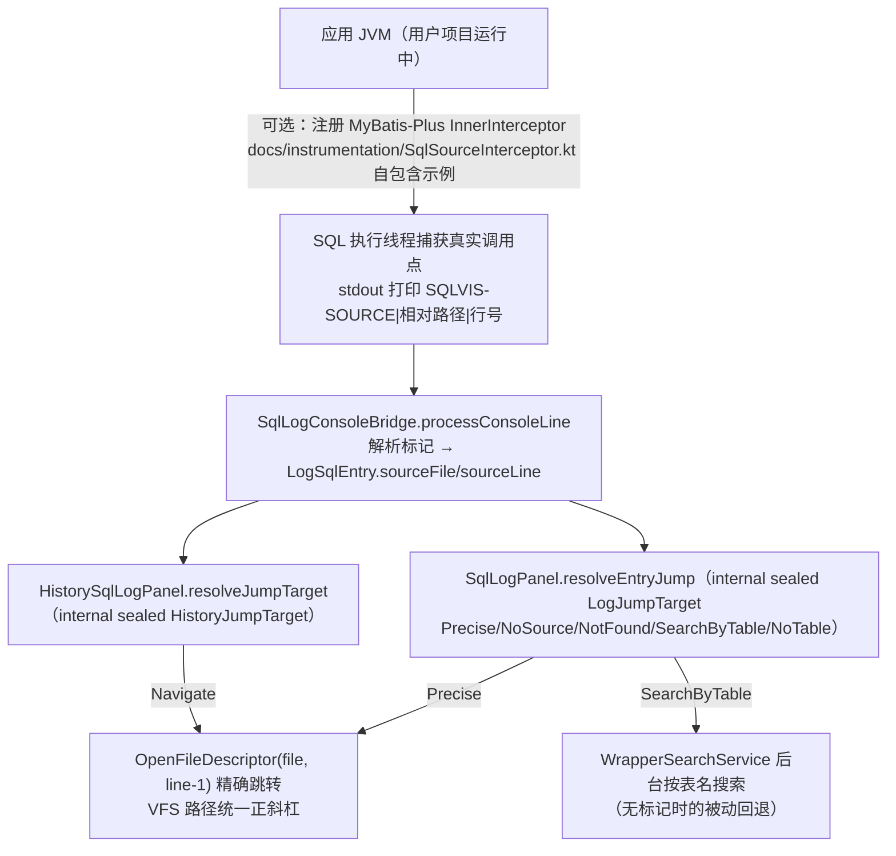

- **无标记零影响**：应用未注册拦截器时无标记行，实时/历史日志被动回退表名搜索，行为与旧版一致。
- **历史条目同享**：`sourceFile/sourceLine` 随 `SqlLogAutoSaver` 落盘、`SqlLogFileReader` 读回，历史面板跳转与实时面板同一套精确逻辑。

---

## 7. 启动与自更新链路

### 7.1 启动链路

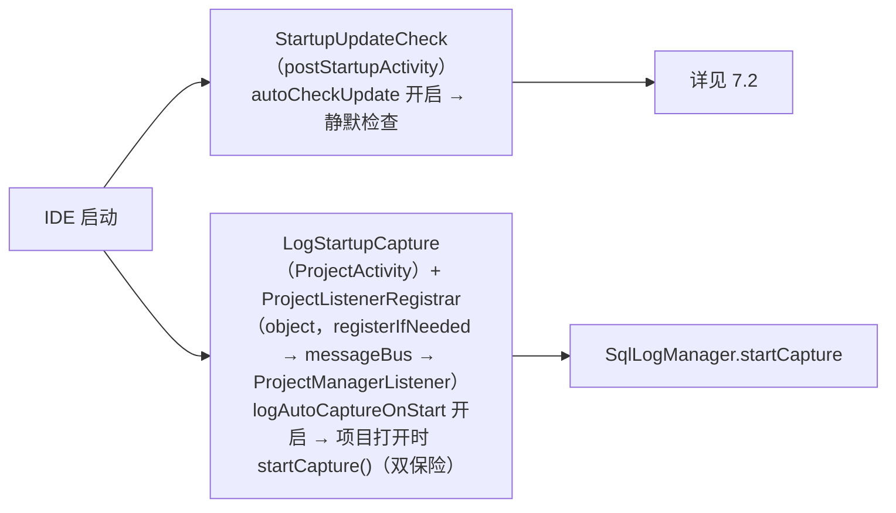

### 7.2 自更新链路（M28 → Gitee 抢先体验通道改造）

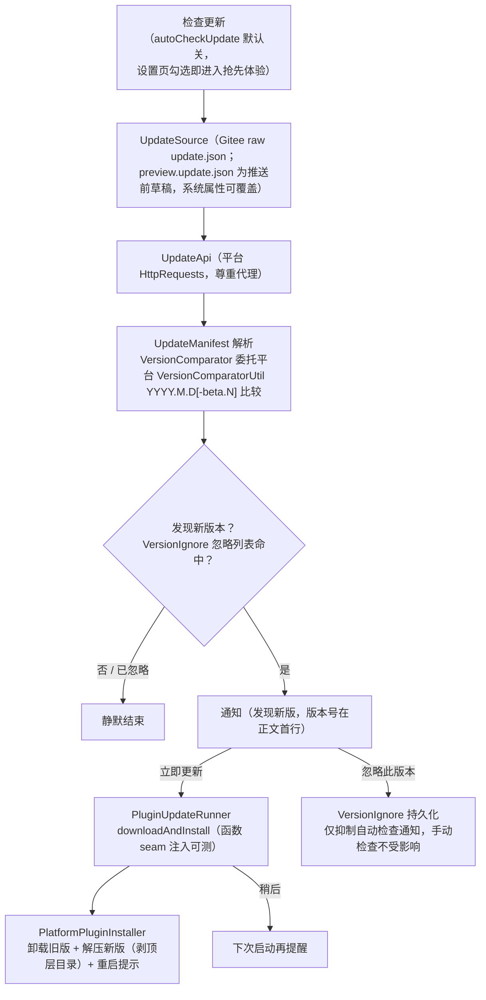

- **双通道分工**：稳定版由 JetBrains Marketplace 推送；Gitee 通道（`update/update.json`）是**内测抢先体验**，`autoCheckUpdate` 默认 false，用户主动勾选才开启。
- **本地清单测试**：`Run IDE (Local Manifest)` 沙盒运行配置，可在推送 Gitee 前全链验证（含 T-DynUpdate 免重启热替换）——本地服务与 `update.json` 由 `dev-support/hotswap-local-server.py` 随任务自动生成起停，流程见《测试沙盒验证清单》更新节。

---

## 8. 常见问题速查（链路定位）

| 现象/需求 | 定位方向 |
|---|---|
| 某 Wrapper 方法转换不对 | `converter/QueryWrapperParser` 方法级映射（`eqOrIsNull`/`like`/`inList`/`parseGroup`…）或对应类型 Converter |
| JPA/JPQL/HQL 预览不对 | `psi/jpa/` Locator（定位/提取）+ `converter/jpa/`（PartTree/JPQL/HQL/Criteria）；HQL 列展开在 `HqlConverter`（M36.7） |
| 执行按钮无反应/控制台空白 | `execute/SqlExecutor` 三段链（prepareConsole → executePrepared）；反射桥 `database/DatabaseConsoleLauncher`；布局塌缩史见 M36.5 系列开发计划 |
| SQL 渲染格式不对 | `sql/SqlGenerator`（多行/单行、缩进、关键字引用） |
| 方言差异 | `sql/Dialect` + `DialectRegistry`（renderLimit/引号/upsert） |
| 表名/列名推断不对 | `psi/EntityResolver.inferDecoratedTableName` + `config` 表映射设置；JPA 实体走 `psi/jpa/JpaEntityResolver` / `HbmXmlEntityResolver` |
| 反向解析报错 | `reverse/SqlReverseParser` 的明确不支持清单（OR/子查询/函数值等；`?` 占位符与 JOIN、增删改查已支持） |
| 日志条目不出现 | `log/SqlLogConsoleBridge.attach` 失败路径 + `MyBatisLogParser` 前缀配置（Hibernate/JdbcTemplate 走各自 parser） |
| 耗时显示 `—` | `log/ExecutionTimeParser` 前缀配置 + `SqlLogConsoleBridge` 喂行接线（F-44-2） |
| 跳转源码不准 | 先查应用是否注册 `SqlSourceInterceptor`（标记行）；无标记走 `WrapperSearchService` 表名回退（近似） |
| 历史 SQL 不显示 | `.idea/sql-visualizer/sql-history/` 目录（更名后旧目录不读）+ `SqlLogFileReader` 格式兼容（2/3 横线） |
| 动态条件面板不对 | `model/Condition.toggle` 元数据 + `SqlPreviewPanel.renderSql` 重生成 |
